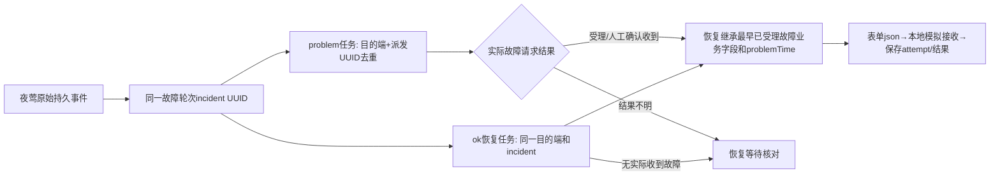

# 1.0接收样例、页面属性与夜莺字段映射

更新：已按业务提供的转换规则新增center独立文件签名，默认路径可覆盖；仍仅本地模拟，Java编码需对照向量。见[密钥部署与签名约定](external-push-signing.md)。此前“sign未知”的记录为当时状态，未自动改写旧任务。

2026-10-28。本轮基于新的一对真实故障/恢复展示文本及1.0详情截图，保留既有专用渠道、任务、尝试、人工审计和center发送架构。仅本地模拟，不访问生产接口，不新增人员匹配、短信电话、接听回调或下游查询。原附件和截图不提交仓库；以下只记录结构事实，客户名、设备地址、标签和原sign不写入样例或默认配置。

本轮开始前冻结的是上一轮完整工作区，HEAD仍为`ed46238250ca41c9ff881a3ffe454d17ac8f07ef`，不是仅比较最近提交；本轮新增改动与前轮未提交实现分开核对。冻结副本位于仓库外`/tmp/external-fields-baseline-*`，定位文件`/tmp/external-fields-baseline-path`；manifest SHA256=`05bac497b666fce9c08a8d70dc22dccca06ee292a88c3609f335e39ea7a44687`。

## 附件和页面可以证明什么

- 两个展示对象分别为ok/problem；除alarmType与recoveryTime以外，其他八个字段相同。故障的recoveryTime为空，恢复补齐；problemTime保持不变，时间差为722秒，截图持续时间为12分2秒，与之相符。
- companyId是名称/归属文本，截图客户显示名称与报文原文不同。这证明1.0存在自己的展示/归属解析，不能证明具体查表键、匹配规则或总部/分部字段，也不能将本地业务组数字ID直接代入。
- deviceName含前缀、下划线和IP，截图保留这些字符。设备名是完整文本，不是只能包含IP的字段；新增本地测试还覆盖端口、括号和接口斜杠（补充边界并非冒充附件字符）。
- deviceTags原文为未加引号的方括号展示列表，截图为带单引号项的列表文本，共9项。显示可以由数组、字符串或接收端格式化产生，仍不能确定原始线上类型。本阶段继续使用明确标注的JSON字符串假设，保留用户指定字符串，不自动造标签语法。
- sign为同对相同的32位十六进制外观值。外观不能证明MD5或任何算法，配对相同也不能证明它是唯一键；前一附件还存在不同告警共享sign。保留字段和待补充签名扩展点，绝不复制原值为配置或默认。
- 报文中恢复对象列在故障对象前面，只是文件排列，不证明实际接收顺序。截图和业务方确认两条已关联，但具体使用哪些字段关联仍需1.0解析逻辑证据。

## 十个字段的属性与配置位置

当前模拟Payload的十个字段均是Go string → JSON string。时间缺失、映射缺失/矛盾和原始标签取值不唯一时不发送；不从截图推断额外的最大长度、枚举或生产默认值。

| 字段 | 属性/1.0显示 | 夜莺事实来源及配置 | 故障/恢复规则 |
| --- | --- | --- | --- |
| alarmType | 已确认的事件类型，影响自动故障状态 | 自动：AlertCurEvent.IsRecovered（历史is_recovered） | false→problem，true→ok；不能手动互换 |
| companyId | 接收端归属输入，不一定是页面最终客户名 | 规则params.company_id固定文本，或company_id_label指定原始事件标签 | 不从group_id/group_name/本地客户主键推断；恢复保留已受理故障值 |
| deviceType | 设备类型文本，截图显示为主机 | 规则device_type，或device_type_label指定原始事件标签 | 不从datasource类别默认映射；恢复保留原故障值 |
| deviceName | 完整设备名称文本 | 规则device_name_label指定原始tags键；历史alert_his_event.tags，按`,,`分隔键值并以第一个`=`拆键和值 | 保留前缀/IP/端口/括号/下划线/斜杠；缺值、空白或多个不同值阻止发送；恢复保留原故障值 |
| problemTime | 原始故障时间，非接收时间 | 自动FirstTriggerTime/历史first_trigger_time，Unix秒按渠道time_zone输出YYYY-MM-DD HH:mm:ss | 恢复沿用已受理故障的字符串，不用恢复时刻替换 |
| recoveryTime | 自动恢复时间 | 自动RecoverTime/历史recover_time；ToHis以恢复时LastEvalTime形成历史恢复时刻 | 故障为空字符串；恢复必须有效且不早于原故障时间 |
| triggerName | 报警内容文本 | 自动RuleName/历史rule_name | 当前没有另加模板映射；恢复保留原故障内容 |
| level | 接收端等级文本，如样本的“严重” | 规则level_map为JSON对象字符串，显式将Severity/历史severity的数字文本键映射为目标文本 | 不默认把1/2/3改成某种1.0词典；恢复保留原故障值 |
| deviceTags | 接收端标签展示输入，真实线上类型待确认 | 规则device_tags固定字符串，或device_tags_label指定原始事件标签的完整字符串 | 当前不自动取全部夜莺标签或改成数组；恢复保留原故障值 |
| sign | 生成规则未知 | 保留sign；本阶段只允许渠道内显式测试值TestSign，生产模式仍被拒绝 | 不作轮次/派发唯一键，不猜算法；任务查询一律[REDACTED] |

同一独立部署、相同渠道/目的端/接收地址，可用不同规则的固定取值，也可由同一规则指定标签键读取不同事件的取值。不新增branchId、客户主数据或负责人匹配。这里的“标签映射”只决定从夜莺哪个原字段取文本，不代表已确认1.0认可该文本为某医院/分部。

对于company_id/device_type/device_tags，只能选一种来源：原固定字段或对应的`*_label`。两者都有非空值时阻止发送，缺少/歧义也阻止。旧固定参数继续工作；未设置可选标签键时不改变已有快照的路由表示和指纹。切换来源时界面明确清除未选中的映射，加载矛盾旧配置时显示错误，不能任意取第一项。

## 页面入口及“JSON配置”的含义

1. **告警通知→通知媒介→外部告警推送（模拟）**：配置接收地址、稳定目的端、时区/超时和显式测试签名；新增十字段来源表、JSON来源表达式示意及前往通知规则的链接。渠道仍默认关闭，没有真实客户标识或生产地址默认。
2. **告警通知→通知规则→新增/编辑→选择上述媒介**：配置JSON业务字段来源。companyId、deviceType、deviceTags有“固定文本/原始告警标签”选择；deviceName填写标签键；level填写映射JSON；重复提醒仍须显式选择。十字段表说明自动项，不需要手工输入故障时间或恢复时间。
3. **通知媒介→外部推送任务（管理员）→详情**：新增实际保存JSON只读视图，sign统一隐藏；不是从最新规则临时拼出的样例。等待恢复的快照在worker领取时才引用已受理故障字段，零次尝试不能当成实际已发送；校验失败时可能是空字段或无法解析，原因另外显示。读取/刷新不发送、也不修改任务。

JSON来源表达式不是任意可编辑模板，也不是网络发送入口。专用后端结构体统一序列化，worker用url.Values.Encode()提交一个表单json字段，不允许UI自行填写事件数组、生命周期UUID或签名算法来绕过校验。

## 当前怎样关联故障与恢复

本地incident UUID跨当前/历史事件保存，每次派发有独立dispatch UUID和源序号。不是event.Id、hash、problemTime或sign拼出来的轮次；恢复继承同一incident。恢复不需要用户手工把两条JSON配对。重复提醒有独立派发，不因sign相同合并；静默/过滤/恢复开关照旧，不补造缺失故障。此为夜莺发送端关联；不能据此声称1.0采用相同机制，UUID也没有新增到外部十字段协议。

实际领取恢复任务时，从同一目的端/incident里最早实际受理或人工确认收到的故障载荷继承companyId、deviceType、deviceName、problemTime、triggerName、level和deviceTags，只更新类型与恢复时间；sign由当时显式模拟配置提供，不推测其生命周期含义。已发送结果不明仍阻塞恢复，未发送提醒不要求先成功。没有可用故障时保留原因，不自动补一条。

## 截图中其余属性的职责

报警/恢复接收时间由1.0接收侧产生，不是problemTime/recoveryTime；它们与源时间相差数秒不能用作字段替换。持续时间可以由两源时间计算。自动故障状态“已恢复”与线下处理“未恢复”同时存在，说明自动恢复与人工工作流不是同一属性。

处理工程师、故障原因、线下处理时间/说明属于1.0后续业务；本端不新增字段或实现这些流程。接口受理仍不等于人员、短信或电话成功。

## 验证、增量与后续

新增测试沿用已经授权的持久登记/HTTP和UI入口：先复现缺少标签映射、缺少JSON视图，再修复；不模拟内部发送模块。

- `pkg/externalpush/mapping_test.go`：保存原始事件及规则，同一接口下总部/分部合成取值、不同设备类型、带下划线/IP/端口/接口字符的名称；恢复时标签改变仍保持原故障字段；与原样例相同的722秒时间差。固定/标签同时设置、缺失、空白/重复不同值阻止发送。输入全部为TEST及文档地址段。
- `center/router/router_external_push_test.go`：管理员可查看实际JSON，sign及snapshot秘密不返回，普通用户拒绝；GET不改变状态/版本，原人工操作回归。
- 前端行为：十字段可见、切换来源清除旧映射、保存标签来源重新打开、只读JSON和关联说明；查询不触发POST。
- [本地请求响应证据](external-push-field-evidence.json)：解码后的四个合成表单JSON、回环地址、HTTP200/业务数字200；只证明本地适配，不是1.0真实落库或下游通知。

本轮相对冻结完整工作区的[关键diff](external-push-fields-key.diff)只展示字段取值与可见配置/查询增量；新测试、国际化及配套资源另在上述文件中核对。

关键改动：`pkg/externalpush/protocol.go`字段取值、`routes.go`可选映射快照、`store.go`脱敏只读预览；前端`ExternalPushFields.tsx`、规则`ChannelParams/ExternalPush.tsx`和`ExternalTasks.tsx`。无表结构或SQL迁移，不调整其他Provider、worker重试/租约或默认开关。新增标签来源需要center和edge/alert同版本理解可选参数，混合版本未验证；旧固定参数保留兼容。

最小待确认：1.0归属解析/有效客户文本与总部分部表达、设备/等级词典、真实JSON原文及deviceTags类型/语法、sign算法/覆盖字段/凭据/可验证向量、1.0实际配对和重复提醒政策、源时间时区/精度、异常落库核对及接口保存与人员通知分项验收。首次登记前崩溃窗口、真实edge双进程及生产模式仍未解决/验证，不宣称恰好一次。

## 本轮检查记录

聚焦Go测试（pkg/externalpush、alert/dispatch、center/router、models）通过；字段映射/歧义及既有脱敏三对样例专项race通过。新增页面专项3套9项通过。红/绿日志分别保存在本地`/tmp/external-fields-mapping-{red,green}.log`、`external-fields-detail-{red,green}.log`、`external-fields-ui-{red,green}.log`。

### Standards

独立只读复核未发现硬规范问题或值得扩大重构的新增异味。未改schema/导出入口/CenterApi路径；可选标签缺省保持旧快照形状；实际JSON从已保存载荷读取且先隐藏sign，snapshot不返回。

### Spec

独立只读复核未发现确认的需求偏差或越界。字段来源显式、标签和固定取值明确互斥，设备名保持完整，原UUID/未知保护保留；没有推断1.0配对算法、客户主键、标签线上类型或sign算法，也没有新增下游功能。

两个轴新增阻塞项均为0。人工验收和生产联调均未执行。

## 完整检查及更新实例

- `make verify`退出0：Go2758项通过、0失败、48跳过（含子测试）；前端214套、1854项通过。48项跳过包括未配置的外部服务/数据库专项与真实通知，不算通过；具体原因在本机`/tmp/external-fields-verify.log`。本轮未执行make verify-all，未新增vet或全量其他部署模式结论。
- `sh fe.sh`与同仓前端生产构建成功，Node24.22.0/pnpm10.32.1；源码摘要`d168e2a8d79ff26b8a65c147318e6f36a59936edb1c0ddfa4cd0748d14e0f364`。`N9E_TEST_FRONTEND_DIR="$PWD/frontend/pub" go test ./front/statik -count=1`通过。构建体积、PlusPlaceholder及React/Antd既有警告仍在，未导致失败。
- 功能构建`20261028T071424Z-b6e588c7`使用自有隔离PostgreSQL/miniredis、basic预览。Playwright实际创建默认关闭的模拟媒介，显示十字段及配置链接；仅临时启用自有回环fixture。通过现有通知规则页面把company/type/tags切换为标签来源，保存、重新打开，确认旧固定字段已清除。
- 合成告警规则读取共享只读测试Prometheus的vector表达式，经真实引擎→既有规则→持久任务→center worker→回环接收端，problem/ok共2次请求、各一次attempt及accepted（测试任务27/28，规则11）。两次同incident、相同problemTime；完整设备名称保留。保存JSON与实际HTTP表单解码后的对象逐字段相等，查询仅将sign隐藏。刷新/重载零次任务写请求，无页面异常，已受理任务不提供重发按钮。私有证据`/tmp/external-fields-browser-evidence.json`，截图`external-fields-rules.png`及`external-fields-task-json.png`在同一/tmp下。
- 初次页面测试没有通过：自建fixture未填原本必填的授权团队，表单未提交导致等待超时。补齐现有团队作为本地管理权限后复验通过，未修改旧必填规则；该授权团队不作为推送接收人，专用派发依旧不展开人员。测试自建媒介/通知规则最终关闭、告警disabled，回环服务器停止；数据/审计保留供核对。
- 本轮21个文件（20文本、1配套ZIP）及ZIP内656个文本资源，与新旧附件原客户、设备名、触发项、标签列表、sign和IP共28个敏感原值/URL解码变体对照，零命中。扫描不等于对所有语义敏感信息的自动证明。原附件和图片未提交。
- `git diff --check`通过；无新提交、推送或生产发布。仅字段取值测试使用隔离SQLite，运行实例增加了实际PostgreSQL行为证据；未新增MySQL/完整SQL初始化重放/真实edge或多center部署验证。

最终交付前仅补记文档后刷新构建，按同一源码/前端身份核对管理员只读JSON、映射说明和默认关闭；最后build ID在交付消息列出。LAN `http://192.168.0.152:30305`可达；公网dev5 TLS探测仍失败，不能写成公网验收通过。

人可依次查看：`/notification-channels/add?ident=external_push`的十字段来源表 → `/notification-rules/edit/11`的关闭模拟规则映射 → `/notification-channels/external-tasks`任务28详情的恢复JSON。不要把这里的TEST归属/标签/等级或示例地址用于真实客户配置，也不要启用生产渠道。

