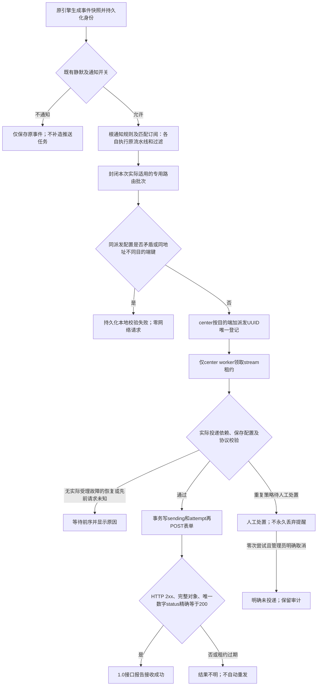

# 外部推送缺陷修复与验证记录

协议后续更新：业务已确认故障problem、恢复ok；旧TEST类型不再发送。当前协议状态见 [脱敏样例适配验证](external-push-samples.md)，下面保留前轮修复证据。

本轮基于未提交的第一阶段完整工作区修复，Git HEAD 仍为 ed46238250ca41c9ff881a3ffe454d17ac8f07ef。此前审查报告保留为历史证据，不覆盖其中旧实现的结论。

## 实施设计与测试边界

按本轮明确要求，测试边界为：既有事件/通知规则到任务登记、任务公开接口到本地HTTP接收端、迁移公开入口到启动错误、页面到管理员API。使用真实隔离数据库和回环模拟服务，不模拟内部类、不调用生产接口。逐项先保留失败证据再修复。

排查预测依次为：全部快照序列被误作连续投递序列导致空洞阻塞；全库配置共识把未适用规则当成冲突；迁移新增返回错误未传播及浮点比较造成启动/响应误判。分别用对应公开边界的失败断言验证。

1. 源 incident_sequence 只表示全部快照相对顺序，允许空洞。投递依赖只查询实际登记及已尝试的任务，不推断不存在的前序，也不补造故障。
2. 恢复需要至少一条实际已尝试并确认接收的故障；已尝试且结果不明的故障继续阻塞。尚未发送的重复不强制先发送。恢复先到或没有实际发送故障时保留等待及原因。恢复尝试后禁止自动发送同轮次的迟到故障，保留人工处置。
3. 重复策略显式保留。review_repeats 按已有实际故障尝试判断，不能因静默快照序号大于1就把第一次外推当成重复。允许管理员取消从未尝试的任务，记为明确未投递并审计，绝不记成对方已收到；已尝试未知任务不能取消绕过恢复保护。
4. 完整派发在现有通知规则/订阅及流水线命中后收集专用路由，登记前封闭该批次；同一派发同一目的端的实际配置冲突在任何请求前阻止。其他事件可向同一地址携带不同参数。worker只校验本任务引用的保存配置，不扫描全库强制同映射。现有其他渠道仍走原路径。
5. 新增可返回错误的启动迁移入口，保留原导出入口兼容；同步身份迁移失败也继续尝试其他迁移并汇总错误。center在完成必要schema检查之前不启动告警和HTTP，失败明确退出，不以关闭外推worker冒充正常启动。渠道关闭也不能跳过原告警所需身份列。
6. 响应采用精确数值比较；拒绝重复status键、非对象、非JSON、空体、截断和尾随内容，仍保守unknown且不自动重发。成功显示只表述“1.0接口报告接收成功”。

## 协议与可靠性边界

各客户为本地独立部署，数据隔离。同一部署可有总部、分部及不同设备，共用同一接收接口。通过原协议哪些字段区分归属仍待确认，不增加branchId，也不假定companyId就是分部字段。测试字段值均显式标为模拟假设。人员匹配、账号、短信、电话仍由1.0负责；本轮不新增回调/查单，不修改1.0，不支持生产地址/生产签名。

首次持久任务登记前仍有原内存队列/异步通知派发窗口，没有事务outbox，不能保证绝不丢失。封闭路由批次覆盖当前仓库原生派发；不同重入批次若配置已改变，已开始的请求无法撤回。暂停旧进程迟到恢复也不能由本地租约远端隔离。实际edge双进程及生产协议验证单独报告。

## 复现与验证结果

实施中逐项补充实际命令、失败/通过结果、构建与页面证据；未执行项不记为通过。

## 当前流程与业务语义

这里的任务始终是“向1.0接收接口推送一个告警事件”。没有新增本地人员匹配、短信/电话发送、接听回调或1.0下游查单。原普通渠道仍走原 Sender/Provider，不套用专用成功判定或重试规则。本轮仅为专用派发收集增加同步事件副本，避免它与旧接收人字段填充并发读写。

| 情形 | 当前处理 |
| --- | --- |
| 静默、过滤、渠道关闭时的源快照 | 可有源序号但没有专用任务；后续不等待不存在的任务 |
| 已登记但从未发送的提醒 | 与已尝试请求区分；恢复不强制它先成功 |
| 明确不投递 | 管理员以理由和版本取消，记 not_delivered，零次尝试；不伪造受理 |
| 已发请求结果不明 | 保留 unknown 和原 attempt；后续故障/恢复等待核对，不能用取消绕过 |
| 接口受理或人工确认已收到 | 允许解除实际前序依赖；人工确认保持独立状态及审计 |
| 从未向该目的端送过故障却收到恢复 | 保留 waiting_predecessor，原因明确；不自动补造故障 |
| 恢复已经尝试后又授权发送旧提醒 | worker拒绝自动重新打开同一轮故障，转人工处置；未尝试任务可明确取消 |
| 新一轮故障 | 使用新的持久incident UUID，不按hash/时间推断合并 |

`all_dispatches` 仍为显式逐次提醒；`review_repeats` 仍保留正常提醒任务等待人工决定。第一次实际外推不因源序号大于1被误判为提醒。恢复若被原规则/静默/恢复开关过滤，1.0仍可能保留未恢复故障；没有新增强制绕开开关的规则。

## 修改位置

下表是本轮修复，第一阶段保留的 schema/Provider 等文件未整体回退。HEAD仍未新增提交，完整实现与修复均在工作区，不能把HEAD单独当作构建版本。

| 文件与入口 | 本轮变化 |
| --- | --- |
| alert/dispatch/dispatch.go：HandleEventNotify、HandleEventWithNotifyRule、handleEventWithNotifyRule | 真实根规则/订阅经过原过滤后收集完整专用路由；旧渠道发送分支保留；并发前同步复制通知事件 |
| alert/dispatch/external_push_batch.go | 封闭并等待当前实际路由集合后一次登记；不通过等待固定毫秒来猜路由是否齐全 |
| pkg/externalpush/store.go：RegisterDispatch、Register、Act | 完整批次入参；同次派发矛盾配置及地址别名阻止；保留单路公开入口；取消零次尝试任务并审计 |
| pkg/externalpush/routes.go：routeConsensus | 只核对该批次保存引用，不扫描其他事件/规则要求全库参数一致 |
| pkg/externalpush/worker.go：claim、send、Expire | 按实际任务及attempt依赖，允许源序列空洞；恢复锚点和未知保护；重复策略按实际投递判断 |
| pkg/externalpush/response.go | 独立严格响应解析及有界精确十进制比较，无float64舍入 |
| pkg/externalpush/protocol.go、schema.go | 保存封闭路由引用和not_delivered状态；schema注释与fail-fast一致 |
| center/router/router_external_push.go | CenterApi接收routes完整批次，返回任务ID数组；查询/人工操作鉴权保留 |
| models/migrate/migrate.go、center/center.go | 必要迁移错误记录、继续其他同步迁移、汇总并启动前返回；保留原void导出兼容；无关ES迁移仍best-effort |
| frontend/.../ExternalTasks.tsx、notificationChannels/locale/{zh_CN,en_US}.ts、pkg/i18nx/var.go | 取消操作及明确未投递状态；界面/原因文案同步，不把接口受理写成人员成功 |
| alert/dispatch/external_push_test.go、pkg/externalpush/{regressions_test,external_push_test}.go | 序列空洞、真实路由/订阅流水线、取消、精确状态及别名回归 |
| models/migrate/external_push_failure_test.go、center/external_push_startup_test.go | DDL故障注入、渠道关闭下旧告警写入、真实启动拒绝及修复后恢复 |
| frontend/.../ExternalTasks.test.tsx | 明确取消需理由和版本、刷新只读、终态无错误操作 |
| scripts/external-push-preview-smoke.py | 新增真实引擎--regressions，创建自己的静默/过滤/渠道开关配置并清理 |
| front/statik/assets.zip、doc/api/external-push.md、本记录 | 同仓前端配套产物、现行配置说明及修复证据 |

本轮未增加SQL列或表；新状态在原varchar(32)中保存。第一阶段的GORM与三种数据库SQL保持配套。本轮验证覆盖其必要迁移，但没有把SQLite结果当作其他方言证明。

## 故障复现与自动化证据

测试均使用临时SQLite、自己创建的PostgreSQL/MySQL数据库及127.0.0.1模拟HTTP；真实引擎使用本worktree私有预览PG、miniredis和只读测试Prometheus。没有对生产接收端发请求。

| 问题/场景 | 修复前证据 | 修复后可观察断言 |
| --- | --- | --- |
| 静默首条、中间过滤、中途启用造成源序列空洞 | /tmp/external-fix-gaps-red.log | TestSourceSnapshotGapsDoNotBlockActualDeliveries：2/3/4、1/4/5、5/7/9均只发3条正确事件；不补缺号 |
| 未发送提醒阻塞恢复 | /tmp/external-fix-recovery-red.log | TestRecoveryDoesNotRequireNeverSentReminder：首故障受理、提醒manual且零次尝试、恢复受理；不把提醒记成已收到 |
| 全库规则参数一致限制 | /tmp/external-fix-routing-red.log | TestSameEndpointAllowsIndependentApplicableRules：同地址同目的端、不同事件的TEST总部/分部标记和设备类型均发送；测试值不证明1.0归属协议 |
| 同次派发参数冲突 | 旧实现问题已在审查记录 | TestActualApplicableRulesConflictBeforeAnyWorkerRequest、TestApplicableDispatchConflictBlocksBeforeAnyRequest：封闭批次冲突零次出网；重复登记只有一任务 |
| 根规则及订阅异步收集 | 新增真实入口回归 | TestRootAndSubscriptionShareOneApplicableDispatchPlan：根与订阅冲突拒绝；订阅经真实event_drop丢弃则根规则仅发一次 |
| 同地址改destination绕过去重 | /tmp/external-fix-alias-red.log | TestSameDispatchCannotAliasOneEndpointWithDifferentDestinations：两个别名任务均校验失败、attempt=0、接收端0次 |
| 身份列DDL失败被吞并跳过其他模块 | /tmp/external-fix-migration-red.log | TestIdentityMigrationFailureDoesNotSkipOtherModules：错误传播但NotifyRule等同步迁移继续；禁用渠道也不能忽略缺列 |
| 缺列仍启动/旧告警入库 | 故障注入验证 | TestDisabledChannelIdentityFailureBlocksSchemaAndOldPersistence、center启动测试：缺列校验及启动失败，旧事件写入也报错；修复DDL再迁移后原事件及身份成功保存 |
| 既有ES迁移失败意外变fatal | /tmp/external-fix-es-red.log | TestUnrelatedESMigrationKeepsBestEffortCompatibility：ES错误记录，必要schema有效且不扩大到旧无关模块启动失败 |
| 浮点舍入/重复status误受理 | /tmp/external-fix-status-red.log | TestStrictBusinessStatusCannotRoundOrChooseDuplicate拒绝近似200及重复键；原响应表新增精确指数/分数指数和超大指数用例 |
| 取消伪造收到/绕过unknown风险 | /tmp/external-fix-cancel-red.log | TestCancelUnsentDoesNotPretendReceiptOrBypassUnknown：取消独立终态及actor审计，无法取消已尝试未知请求，恢复不凭取消发送 |
| 事件副本与旧接收人填充竞态 | /tmp/external-fix-race-red.log | 同步DeepCopy后根/订阅与并发worker专项race通过；未借此重构其他Provider |
| 页面取消动作 | /tmp/external-fix-ui-red.log | Jest验证明确POST含reason/version、刷新不写、取消后终态；实际页面验收另记 |

已有回归继续覆盖：先保存后超时只发一次并unknown、未知前序阻塞恢复、sending重启/租约到期不自动重投、故障/恢复/再次故障独立身份、表单中文及特殊字符round-trip、deviceTags字符串、HTTP失败/非JSON/空体/截断/尾随内容/重定向不误受理、管理员权限/CAS及普通渠道行为。未调用真实短信/电话验证它们的外部交付。

响应成功条件是完整读取、HTTP 2xx、完整且没有尾随内容的JSON对象、顶层status键唯一且为精确数字200；200.0和2e2等数学上相等的值可以受理，字符串"200"、近似数、重复键（同值也拒绝）均不能受理。异常保守unknown，绝不由异常反推“对方未落库”，不继承通用HTTP重试、不跟随重定向。

## 迁移和兼容处理步骤

1. center以MigrateChecked启动，身份列失败会明确记录列/表/DDL错误；继续尝试其余同步模块，汇总错误返回。已知必要迁移失败时不启动旧异步事件迁移；后续必要账本失败也由返回错误阻止服务启动。
2. HTTP、告警引擎及worker均在必需迁移和CheckSchema之后启动；关闭渠道不是缺列兼容办法。原告警INSERT也会携带新增身份列，因此缺列继续运行会破坏原告警持久化，启动必须失败。
3. 运维修复数据库DDL权限、空间或具体方言错误，保留数据库及原始错误证据，再以相同版本重启完成同步迁移；检查schema通过和原事件入库后才恢复服务。不能只关闭专用渠道掩盖错误。
4. 原导出void Migrate兼容已有调用者并记录错误，但外部n9e-plus自行调用旧入口时不能强制它传播错误；它需要采用MigrateChecked或等效启动检查，当前仓库不能替外部二进制承诺fail-fast。
5. 未升级批次快照的旧待发送任务缺Routes时会保守校验失败，需人工核对；已受理记录及attempt保留。不自动按新配置改写旧任务或补投历史事件。

## 剩余边界、未验证模式与协议清单

- 首次登记前：原内存队列、事件历史写入和异步规则处理不在同一事务。没有持久路由outbox，进程在事件入库后、批次登记前崩溃仍可能漏登记；本轮没有根据历史记录自动补投。更早、身份尚未持久化时的崩溃也无法保证继承同一轮次。
- 顺序：已登记任务由stream租约串行检查；不凭缺失源序号推断丢失，也无法预知尚未登记的更早事件。发现更晚故障或恢复已有attempt时，迟到故障保留人工处置，不再自动发送。原事件cur/his写入事务和上游重复接入身份仍有原边界；缺身份/同序号矛盾均拒绝猜测合并。
- 去重：完整原生派发批次内，同目的端/同派发唯一约束及地址别名检查有效。不同重入批次更改配置或逻辑键、不同URL实际落到同一业务系统、非原生单路调用没有全知防重保证；不能以随意改destination修复冲突。保持逻辑目的端稳定，配置变更前关闭渠道、核对在途任务。旧HTTP请求无法由本地租约撤回。
- 未知结果：对方无接收去重/可靠查单，不自动重投。租约到期不代表旧进程不可能恢复；人工重发前要确认原worker已退出、请求结束，并与接收端核对迟到记录。管理员操作不能证明下游人员通知成功。
- center/edge：代码及CenterApi模拟测试证明edge登记、center发送的职责，实际两个二进制/网络分区/版本滚动升级未验。登记API从第一阶段单路入参变为routes完整批次；旧格式明确失败，不静默退回先到先发。未来混合版本部署须协调升级，不能声称旧edge无需升级即可可靠兼容。现有CenterApi最多三轮重试只用于登记，不用于外推重发。
- 数据库：SQLite迁移故障注入和center拒绝启动已验；真实临时PostgreSQL/MySQL8的专用GORM/升级SQL/唯一约束/worker专项已验。MySQL/PostgreSQL整套Docker初始化脚本从空库重放、这两种方言的真实权限故障启动、跨主机多center及真实edge部署未验。普通make verify里未配DSN的专项skip不算通过，另行显式配置结果单独报告。
- 原渠道：全仓回归验证本地行为，按要求没有真实发送短信、电话或验证它们的运营商链路；未把外推状态写成原人员渠道成功。
- 生产协议：总部/分部由哪些原字段表达、客户标识映射（本地客户ID不自动等于1.0标识）、设备类型/名称与等级映射、原始传输格式及deviceTags类型/字符串格式、sign算法/凭据、配对和重复提醒政策、故障送出后恢复是否必须同步、异常实际落库语义均待对方确认。当前仅simulation，必要值缺失/歧义阻止发送，不用本地hash/MD5/HMAC冒充sign，不新增branchId或本地负责人匹配。

两个只读审查分别核对规范和本轮需求，基线均为ed462382完整工作区。发现的地址别名绕过、ES迁移失败边界扩大、主文档旧语义及根/订阅测试缺口已处理并复审；两个轴均未发现新增阻塞项。并发检查另外发现事件副本读取与旧字段填充的竞态，已在本轮派发入口局部修复。原NotifyConfigCache.GetNotifyScript零值默认的既有并发写问题未扩展修改；测试在并发旧路径前初始化默认值，不能把该专项race通过外推为全仓无竞态。

## 后续联调操作与验收

1. 先取得1.0原协议、总部/分部归属样例及可验证签名向量，明确客户数据边界、重复提醒和恢复同步决策；不要以本轮模拟标记反推正式字段。
2. 单独设计生产签名/凭据和地址许可，消除或接受首次登记前窗口，验证真实center/edge及计划数据库部署；当前版本继续拒绝生产地址和生产模式。
3. 取得明确测试联调授权后，使用测试客户/设备/人员，先核对接收端原始保存条数和JSON原文，再分别核对业务消息、人员匹配、账号通知、短信/电话证据。成功响应本身只证明接口报告受理。
4. 核对所有unknown/sending、旧worker和在途请求后再做人工重发或切换；保留操作理由、操作者和版本。不要自动重放存量活跃告警，不要批量盲重试未知结果。
5. 本轮提供的预览只用于人工复核本地模拟与账本，默认不启用生产渠道。人工体验验收和生产发布仍由用户分别确认，本轮没有代填任何人工验收结论。

关键源码定位（当前工作区）：alert/dispatch/dispatch.go:170、:719；alert/dispatch/external_push_batch.go:12；pkg/externalpush/store.go:44、:254；routes.go:24；worker.go:123、:178；response.go:11、:54；schema.go:11；models/migrate/migrate.go:71、:266；center/center.go:79；frontend/src/pages/notificationChannels/pages/ExternalTasks.tsx:128；对应真实根/订阅用例 alert/dispatch/external_push_test.go:150。

渠道中途启用只影响后续由原引擎正常生成并命中规则的派发，不立即回放历史事件；若原规则不重复提醒且故障从未实际投递，随后恢复仍保留“没有实际投递故障”的等待原因。此处不能用自动补造故障解决，也没有改变既有重复提醒开关。

## 本轮最终验证结果

- `make verify`（本机 /tmp/external-fix-verify-acceptance.log）退出0：59项预览脚本测试；Go 2749项（含子测试）通过、0失败、48跳过；前端213套件、1850项通过。跳过包括未配外部服务/真实通知/数据库DSN等，逐项原因在日志中；没有把这些外部集成算作通过。输出中的既有React/Antd测试警告未造成测试失败。
- `go test ./models/migrate ./center ./alert/dispatch ./pkg/externalpush ./center/router -count=1` 通过；根/订阅并发副本修复后另由最终make verify和专项race再次覆盖。
- `go test -race ./alert/dispatch ./pkg/externalpush -run 'TestRootAndSubscription|TestActualApplicable|TestSameDispatchCannotAlias|TestConcurrentDuplicate' -count=1` 通过，证据 /tmp/external-fix-race-green.log；不是全仓race结论。
- 独立显式配置临时DSN执行 `TestExternalPushDatabaseDialects` 退出0：PostgreSQL、MySQL8各有GORM/upgrade_sql子测试通过，含worker/唯一约束；证据 /tmp/external-fix-dialects-final.log。测试创建的数据库、自己启动的两个容器及匿名卷均已删除，未删除共享预览PG或Prometheus。
- `sh fe.sh`、前端生产构建/同仓statik打包通过；`N9E_TEST_FRONTEND_DIR="$PWD/frontend/pub" go test ./front/statik -count=1` 通过。Node 24.22.0、pnpm 10.32.1；前端源码摘要6df1df81656e961247d2da10eaf80c3445de592d988fa07900cf5c2e31341267。
- `git diff --check` 通过。没有提交、推送或发布生产实例。

### 真实引擎到本地模拟端

执行 `python3 -B scripts/external-push-preview-smoke.py --regressions --local-only --output /tmp/external-fix-engine-evidence.json` 退出0。功能构建 **20261027T120026Z-0a8c54b0**：经普通登录的既有API创建专用渠道、通知规则、告警规则及notify-only静默；真实引擎读取共享只读测试Prometheus的vector表达式，经过事件持久化、通知规则、center登记和worker POST表单，接收端共13次请求、13条accepted，各1次attempt。

| 实际场景 | 接收结果 |
| --- | --- |
| 基本故障→恢复→再次故障，并将第二轮恢复 | 4条受理；故障/恢复同incident，新故障不同incident |
| 首故障notify-only静默后解除，随后正常提醒与恢复 | 仅投递源序号2/3/4；静默序号1已存在历史但没有任务 |
| 中间正常提醒被既有severity过滤，随后提醒与恢复 | 仅投递1/3/4；序号2已存在历史但没有任务 |
| 渠道关闭时首故障，故障中途启用，随后提醒与恢复 | 仅投递2/3/4；关闭期间序号1不补造任务 |

每组三条任务同一incident、不同dispatch；恢复不抢先且引用已实际收到故障。脚本断言被过滤/关闭的dispatch未登记，接收端检查Content-Type、表单唯一字段json及deviceTags字符串。配置关闭/规则disabled及静默删除在finally执行；证据保留于本worktree预览私库，回环模拟服务器已经停止。证据是本地模拟接收，不是1.0真实保存或下游通知。

后续仅补交付文档对应的源码身份并刷新构建，功能/前端没有变化时保留上述运行证据；界面验收及最终可访问入口另按最新构建核对。

### 页面复验发现并修正的局部问题

在构建20261027T121322Z-b5afec3c实际完成配置保存、查询及取消后，浏览器错误收集仍失败，未将该轮写成页面通过：

- 专用渠道被已知类型的通用条件送入远端flashcat文档iframe；远端404页面脚本抛出includes异常，证据 /tmp/external-fix-ui-diagnose.log。现仅external_push使用既有本地Document分支，新增中英文模拟说明，不修改其他Provider或通用Document实现，也不再为该渠道加载远端文档脚本。
- 人工操作modal空理由的validateFields拒绝未处理，浏览器报Object异常。新增ExternalTasks公共组件用例先失败（/tmp/external-fix-ui-validation-red.log），修复后4项通过（...-green.log）：仅显示本地字段错误、modal保留、没有POST及自动操作。

这两项不改变后端任务、协议或重试。真实引擎13请求及数据库专项证据可以保留；前端产物和页面验收需在重新构建后复验，结果以下述最终记录为准。

### 更新构建页面验收通过

构建 **20261027T122345Z-3361f635**，源码指纹 d6a4b17cd49283479064ae7e0c29aa082b358232ffee4171bac98f44b6dca256，前端源码摘要6df1df81656e961247d2da10eaf80c3445de592d988fa07900cf5c2e31341267。通过局域网真实生产构建页面执行（非Vite开发服务器）：匿名任务查询拒绝、正常登录、新渠道默认关闭且地址/签名空值、必填校验、完整模拟配置保存和重新打开、本地说明渲染、真实引擎矛盾路由任务查询、刷新只读、空操作理由阻止提交、填写理由后明确取消、审计及刷新恢复。页面异常0、专用远端文档iframe请求0、该矛盾配置的模拟接收请求0。

保留任务22：零次attempt，状态not_delivered；管理员root以明确测试理由执行cancel_unsent，有版本条件和审计记录，未把取消写成已收到。此前页面脚本试跑留下的20/21号零次尝试记录也保留用于排查，20为校验失败、21为已取消。全部测试自建渠道、通知规则和告警规则均在finally关闭；没有启用生产渠道。实际截图已由Agent查看：本地配置说明与默认关闭显示正常，任务取消、零次尝试及审计均可见。

证据：/tmp/external-fix-ui-evidence.json、/tmp/external-fix-ui.log、/tmp/external-fix-config.png、/tmp/external-fix-task-audit.png。截图和日志不包含登录密码；私有凭据文件仍由preview status给出，不能提交或公开。

页面修复后的最后一次make verify（/tmp/external-fix-verify-acceptance.log）退出0：Go2749通过、48跳过；前端213套件/1850项通过。更新后的statik逐文件比对也通过（/tmp/external-fix-statik-final.log）。构建存在既有PlusPlaceholder导出提示及测试React/Antd警告，未导致检查失败；未借本轮修改其他媒介或通用文档组件。规范和需求两轴对最后UI增量均已只读复审通过。

本段证据补写后仅刷新文档对应的构建身份，后端/前端不再修改；最终交付build ID以回复及preview status为准，并执行最后只读页面核对。入口为同局域网 **http://192.168.0.152:30305/__preview/ready**，登录后进入“通知媒介 → 外部推送任务（管理员）”；本机回环也可用。公网开发域名TLS探测仍失败（直连及本机代理均EOF），未绕过或标绿公网门禁，不能宣称公网交付验收通过。

人工可查看任务11–19验证三组源序列空洞后的正确顺序，查看22号取消审计，再新建渠道核对默认关闭/空生产参数及本地说明。不要启用已经结束测试的回环配置，其接收服务器已停止。此处是Agent自动化及浏览器检查，不是人工验收签字或生产发布，更不代表1.0原始告警入库或后续人员通知已验收。

迁移失败边界补充：当前center还会传播MigrateTables原本返回的CMDB迁移错误，未更改其SQL；其他原本仅日志的模块及ES仍按既有日志策略处理。本轮没有注入CMDB故障，不能笼统宣称所有旧模块错误都非致命。
