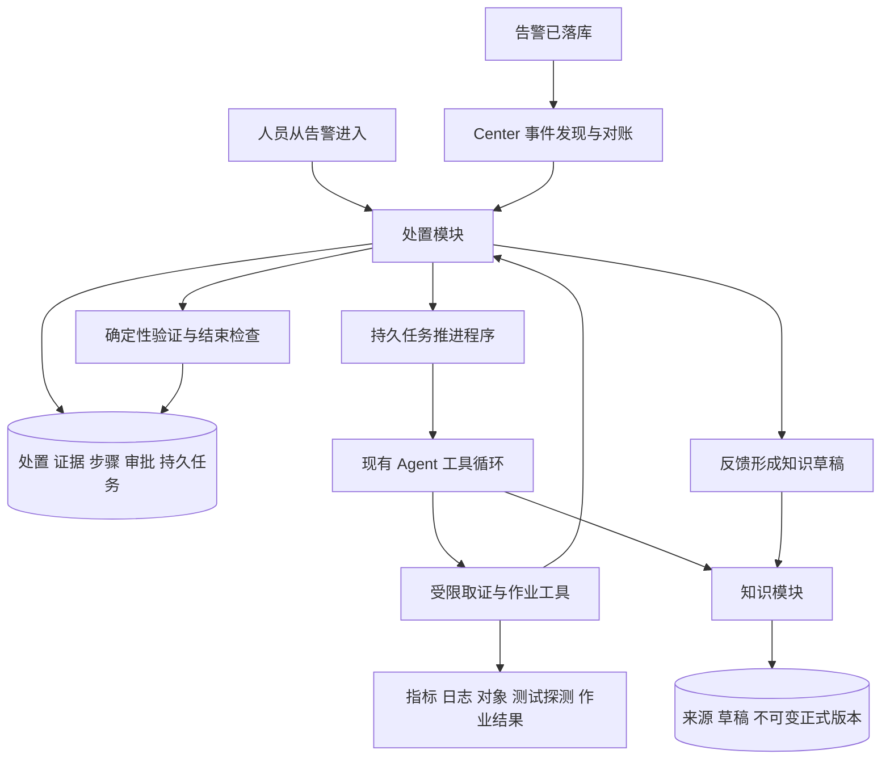

# 告警知识处置闭环开发实现方案

方案版本：v1.0。代码基线：`brawny-skunk`，`2ba46536`。状态：开发设计基准；首版实现与实际验证结果见 [实施验证记录](implementation-verification.md)。配套文件：[验证方案](validation-plan.md)。

目标是让当班人员从告警进入一次持续保存的处置作业，由 Agent 在授权范围内收集事实、检索适用知识、推进排查、准备操作并验证结果。首版采用“自动取证与辅助判断、人员确认执行、按证据结束”的运行方式。

## 1 交付范围与产品入口

第一期必须完成一条纵向链路：告警进入 → 创建处置 → 引用正式知识版本 → 记录检查与操作 → 验证恢复 → 结束并反馈。既支持人工操作，也支持 Agent 辅助；没有模型连接时仍可人工完成作业。

新增两个入口：

- **知识管理**：资料来源、结构化知识、审核发布、版本与失效处理。
- **告警处置**：我的待办、未分派、处理中、待验证、已结束；告警详情可直接进入对应处置。

首版同一业务组内可以人工把多条相关告警关联到一次处置，不以告警名称相似度自动判定共同根因。跨业务组协作、全院自动拓扑发现、大规模向量检索、生产自主修复和完整 ITSM 变更审批平台留待后续。

本次开发不调整原有阈值、静默和恢复判断来实现“消除告警”；通知发送也不作为处置创建的前置条件。

## 2 现有基础与实际缺口

以下结论来自当前仓库静态读取，不代表相应运行环境已配置或完成联调。

| 基础 | 当前实现位置 | 复用方式及缺口 |
| --- | --- | --- |
| 当前和历史告警、规则和预案链接 | `models/alert_cur_event.go`、`models/alert_his_event.go`、`models/alert_rule.go` | 引入告警快照和知识关联；新增独立处置身份。 |
| 发生轮次与派发身份 | `alert/process/process.go` 的 `pushEventToQueue` | `IncidentID` 表示一轮原生异常，`DispatchID` 表示派发快照；两者均不等于处置编号。 |
| 事件落库 | `models/alert_his_event.go` 的 `EventPersist`；`alert/dispatch/consume.go` | 首版旁路发现已落库事件；避免在指标评估和通知热路径调用模型。远端引擎最终通过 Center 持久化。 |
| Agent 工具循环 | `aiagent/agent.go`、`aiagent/types.go` | 复用模型与工具执行机制；新增持久任务推进、处置作用域及恢复逻辑。保留导出入口。 |
| 告警、对象、指标及日志工具 | `aiagent/tools/alert.go`、`target.go`、`host_health.go`、`datasource_query.go` | 可作为取证基础；逐工具核对数据源、业务组、对象和结果范围校验，不因已有名称就假设权限完整。 |
| 作业与确认 | `aiagent/tools/ibex_task.go`、`update_proposal.go`、`center/router/router_ai_interrupt.go` | 复用两阶段人员确认原则；现有确认依赖对话语义和短期存储，后台处置必须新增持久审批关联及执行对账。 |
| 文档与档案 | `archives/`、`doc/api/archives.md` | 可以引用确切文档版本；档案当前主要是登录级权限，受限知识需要自己的资料存储与授权，不能借档案链接绕过限制。 |
| CMDB | `pkg/cmdb`、`doc/api/cmdb.md` | 目前没有自动绑定 Target；需显式关联。库存 ACL 与业务组权限分别执行。 |
| 回答检查 | `aiagent/tools/verify_answer.go` | 是回答文本规则检查，不是业务恢复验证。新增结构化验证器。 |

现有前端认领请求指向 `/api/n9e-plus/alert-cur-events/...`。本功能新增原生处置认领，不依赖商业版接口。

## 3 模块职责与数据流

在 Center 内新增 `pkg/ops`，集中维护处置不变量；新增 `pkg/knowledge`，集中维护知识来源、发布与匹配。路由、页面和 Agent 工具通过同一模块 Interface 访问，避免各自实现状态和权限规则。

### 3.1 事件发现与身份

首版采用 Center 数据库旁路发现，定期扫描指定业务组/规则的当前及历史事件。建议初始轮询 5 秒，具体频率配置化；模型不可用或处置模块暂停时不阻塞原生告警。

事件 inbox 以 `DispatchID` 幂等接收；同轮重复派发通过 `IncidentID` 归入同一告警轮次。使用 `IncidentSequence` 和事件时间识别重放、乱序，并保留原始记录。恢复不得被迟到的旧触发覆盖；下一轮异常形成新轮次。

历史中可能存在同一派发的重复行；唯一性建在新 inbox，不改变原生历史插入语义。空身份的旧事件只允许人工关联或显式兼容导入，不凭 hash 猜测属于哪个发生轮次。

扫描使用稳定分页、重叠窗口、提交后更新检查点，并周期对账保留窗口内的历史与全部当前事件。不能只以 `MAX(id)` 声称不丢事件。处理事务提交失败时可重放；处置创建由唯一约束兜底。当前事件消失不构成恢复证据，删除、屏蔽和真实恢复分别处理。

首版保证对象是“已经持久化且仍在源保留期内的事件”。原生进程内队列尚未落库就丢失的事件，旁路无法补救；超出源保留期的中断需标记接入缺口，不能声称完整恢复。实施时用提交乱序、延迟入库和扫描重启用例验证保留窗内最终对账；有丢失再调整接入方式，不能仅缩短轮询周期。

### 3.2 持久任务与 Agent

处置状态、待执行步骤、工具调用意图、证据、等待原因、审批和检查点保存在关系数据库。现有 A2A Redis taskstore 有 TTL，不能承担长期处置的唯一存储；miniredis 重启也不得导致处置丢失。

任务使用数据库租约、版本号和 fencing token 防止多 worker 重复推进；每轮设置调用数、时间和重试上限。建议初始最多 12 次工具调用/轮、120 秒/轮、2 个并发运行，作为可调参数，真实表现由验证记录。等待人员、外部结果或观察窗口时释放 worker，保存 `next_run_at`，不占住模型会话睡眠。

只读调用可以受控重试。写入调用必须有幂等键与外部任务 ID；“请求超时但可能已执行”进入结果不明状态并查询对账，禁止盲目再次下发。若现有 Ibex 下发不能按客户端操作 ID 对账，先补齐可靠关联或改为人工确认结果，在此之前不承诺写操作崩溃后自动重试。

## 4 各环节的输入 输出与保存

| 环节 | 输入与获取方式 | 处理与输出 | 保存位置和下一消费者 |
| --- | --- | --- | --- |
| 接收 | Center 已落库告警或人员指定事件 | 校验范围、去重、保留触发与恢复快照 | inbox、告警关联 → 处置模块 |
| 接手 | 用户认领或明确的分派配置 | 分配负责人及权限作用域；自动只读任务使用有范围的服务身份 | 处置和审计 → worker、当班人员 |
| 补齐背景 | 对象、指标、日志查询；显式业务关联；人员补充 | 形成带来源与观测时间的事实，缺失显示未知 | 证据及上下文快照 → 知识匹配 |
| 匹配知识 | 正式版本、规则关联、环境与告警特征 | 权限过滤后匹配；返回满足、不满足、未知条件与理由 | 候选及采用版本 → 排查 |
| 排查 | 知识步骤、只读工具、人员录入 | 保存检查结果、证据和下一分支；区分事实与假设 | 步骤执行、证据 → 处置决策 |
| 执行 | 采用方法、目标、参数、前置证据和审批 | 生成固定操作提案；确认后执行，返回外部任务与结果 | 操作、审批、任务映射 → 验证 |
| 验证 | 固定验证规则、最新查询、业务探测、人工确认 | 服务端计算通过、失败或待确认；保存输入证据与原因 | 验证轮次与检查项 → 结束检查 |
| 结束 | 验证结果、恢复类型、遗留问题、人员确认 | 生成结论；满足对应类型约束才结束，整改另建跟进项 | 处置结论 → 当班交接、知识反馈 |
| 知识反馈 | 本次采用版本、有效/无效步骤和总结 | 生成修订草稿与来源引用，不自动发布 | 知识草稿 → 技术负责人审核 |

所有工具结果使用统一外层信息：`call_id`、处置/步骤 ID、服务端解析的对象和数据源、查询摘要、观测时间/时间窗、取得时间、状态、是否截断、内容摘要和私有证据引用。状态区分 `ok / empty / error / forbidden / stale / partial`。来源不接受模型任意声明；原始响应由工具执行层保存，Agent 只引用证据 ID。人工证据标明提交人和确认时间。

## 5 数据对象与关键约束

| 对象 | 最小信息 | 关键约束 |
| --- | --- | --- |
| 处置 | 业务组、负责人、状态、等待原因、严重度、修订号、结束类型 | 独立于原生告警；并发修改采用乐观锁。 |
| 告警轮次与关联 | 源事件身份、快照、处置 ID、规则/对象/数据源 | 同轮默认只创建一份处置；关联和拆分需审计；跨组首版不合并。 |
| 步骤与执行记录 | 知识步骤 ID、状态、输入证据、结果、操作者、时间 | 模板步骤与本次执行分开；跳过需理由，必需检查不得任意跳过。 |
| 证据 | 原始工具响应私有引用、来源、对象、观测时间、摘要、SHA-256 | 只追加；更正建立新记录；哈希用于完整性，不代表内容真实。 |
| 知识条目和版本 | 归属、来源、适用条件、步骤、操作、验证规则、审核者 | 草稿可修订；正式版本不可变；发布新版本不改历史引用。 |
| 来源 | 文件或档案确切版本、来源说明、内容摘要、用途与权限 | 引用档案需同时满足档案和知识权限；受限新资料使用私有存储。 |
| 采用知识记录 | 版本、匹配条件、待确认条件、采用人/程序、时间 | 处置固定版本；中途换版须显式确认并记录差异。 |
| 操作与审批 | 固定模板版本、目标、参数摘要、证据基线、审批人、有效期、外部任务 | 内容变化、过期或权限撤销后重新确认；模型不能自行确认。 |
| 验证轮次 | 验证规则版本、各项证据、机器判断、人工确认 | 必需项无证据、过期或未知时不得通过。 |
| inbox、扫描检查点和运行任务 | 幂等键、租约、重试、下次运行时间、错误 | 可重放；重启可续接；写操作结果不明时先对账。 |
| 审计与整改项 | 操作者、前后状态、原因、关联操作及责任人 | 业务结束和长期问题整改分别跟进。 |

新模型置于 `models/ops_*`、`models/knowledge_*`，职责实现集中在对应包。MySQL、PostgreSQL、SQLite 的初始化和迁移 SQL 与 gorm 同步；大正文采用适当类型，唯一键和租约操作分别验证三种方言。私有文件与数据库需同一时间点备份；证据保留期至少覆盖处置留存要求，不允许后台清理留下“已通过但证据不存在”的记录。

## 6 知识版本与匹配实现

### 6.1 首版支持的输入

以结构化表单和 Markdown 正文为主；支持引用已有档案确切版本，接收 TXT/Markdown 及 PDF/DOCX 来源附件。首版附件提供原件及引用定位，不承诺对扫描件 OCR、复杂表格或全部格式自动抽取；自动抽取不完整时进入待补充，不发布空内容。

每条知识需要：对象类型、系统/版本/环境条件、告警或指标条件、排查步骤及分支、允许操作、风险和回退、验证项、升级条件、责任人与验证日期。Agent 可以从来源生成草稿并列出缺口；审核者基于证据发布，不能将模型生成文本直接标记为已验证。

### 6.2 匹配顺序

先在数据库按权限和发布状态过滤，再按显式规则关联、对象/环境条件、指标与标签、关键词检索候选；不先把无权资料交给模型再要求它隐藏。首版无需引入向量数据库。

每项适用条件采用 `满足 / 不满足 / 未知`。硬性条件不满足时禁止进入处置步骤；未知时可展示通用只读检查，但执行前必须补齐。模型相似度不覆盖硬性条件。发布版本需声明适用性有效期或复核条件；被停用版本仍可历史追溯，但待执行步骤须重新检查，禁止继续使用被撤销的危险操作。

### 6.3 知识中的步骤

步骤定义：稳定步骤 ID、目的、输入条件、检查工具/人工输入类型、允许参数、预期结果、分支、证据要求、风险及停止条件。优先使用声明式比较和受控工具，不执行知识正文中的任意命令。附件、日志及检索文本按不可信数据处理，不能改变工具权限或流程规则。

## 7 Agent 工具与权限

以下新增名称为拟定 Interface，实施前统一参数与错误规范：

| 工具组 | 拟新增工具 | 结果及限制 |
| --- | --- | --- |
| 处置读取 | `get_ops_case`、`get_ops_context` | 仅当前业务组/处置可见背景。 |
| 知识检索 | `search_ops_knowledge`、`get_ops_knowledge_version` | 只返回授权正式版本及条件；来源也受同样约束。 |
| 步骤推进 | `record_ops_step_result`、`select_ops_knowledge` | 引用真实证据；模块重新检查状态和版本。 |
| 操作准备 | `propose_ops_action`、`get_ops_action_status` | 固定模板与参数；审批在人员通道完成，模型无审批工具。 |
| 验证 | `run_ops_verification` | 服务端查询与计算；不接受模型传入“通过=true”。 |
| 总结与反馈 | `draft_ops_summary`、`submit_ops_knowledge_feedback` | 只形成结论候选/草稿；不自动发布知识。 |

既有 `get_alert_event_detail`、`query_prometheus`、`query_timeseries`、`query_log`、对象及主机查询通过作用域 Adapter 接入。原始告警列表工具和查询工具需逐项核验，不能给后台 Agent 一套管理员工具再依赖提示词限制。

按监控对象实际能力选择工具：SNMP 或远程 MySQL 设备不一定有主机 Agent、心跳及主机指标。工具应返回能力清单，缺少的检查进入不适用或待补充；不把主机诊断工具直接套用于全部受管设备。

自动只读任务以专用、显式配置的受限服务身份运行，身份不由模型参数提供；人工任务以当前用户身份运行。每次工具调用、资料读取及执行前重新验证账号有效性、业务组、对象和数据源权限；CMDB 另查库存 ACL。目标无法唯一关联时禁止执行。

后台作业只暴露允许的工具集合，阻止 Skill 动态加载或外部工具源扩大权限；通用任意 HTTP、SQL 写入、任意脚本和资源创建不进入自动处置工具集合。首次发布默认关闭生产执行，仅输出操作提案及支持人工登记执行。

模型连接须使用获准处理该资料的部署。工具向模型只返回必要且脱敏的内容摘要，凭据不进入上下文；原始证据保留在私有存储，不能因为 Agent 获得某项读取权限就自动允许向任意外部模型发送全文。

受控执行复用已有 Ibex 条件；需要补齐处置侧持久审批、单次消费、对象/参数/模板基线和任务对账。审批拒绝、超时、模板变化和目标变化都停止下发。Demo 的固定动作 Adapter 只在隔离测试启用，不能作为生产任意命令入口。

## 8 状态与恢复规则

处置主状态：`pending → processing → verifying → closed`。等待人员、等待外部和升级属于可恢复的等待原因；失败和取消的 Agent 运行不等于处置结束。人工接管应停止当前 worker 的推进权限。

恢复检查至少区分：

1. 指标恢复：明确阈值、窗口、采样新鲜度和覆盖要求。
2. 监控有效：采集及规则评估有效，缺数据不是恢复。
3. 应用/业务验证：自动探测或指定人员确认。
4. 积压/数据核对：按场景设必需项，不能凭服务进程存在判定完成。

各项状态为 `pending / passed / failed / waived`；只有有权限人员能对允许豁免项登记原因。必需的数据完整性等项目不能由 Agent 自行豁免。验证使用服务端时钟、规则版本和原始证据；新一轮异常使相关旧通过结果失效，重新验证。

结束类型包括：已修复、临时恢复待整改、自行恢复已核查、监控配置问题、误报已确认、取消/合并。每种类型有明确必需证据；“已修复”要求规定检查全部通过，“临时恢复”仍需业务恢复证据并关联整改项。“监控配置问题”要记录修改依据和生效验证，不能以静默替代恢复。首版由人员确认结束。

## 9 页面 路由与实现落点

- `frontend/src/pages/opsCases`：列表、处置详情、交接、审批和验证。详情按当前异常/背景、采用知识/步骤、操作时间线、验证结论组织，显示数据时间、缺口和下一责任人。
- `frontend/src/pages/opsKnowledge`：来源、草稿、正式版本、适用条件、发布审核、历史和反馈。编辑步骤与正文相互关联，来源不被自动公开。
- `center/router/router_ops*.go`：拟提供 `/api/n9e/ops/cases`、事件关联、认领/转交、步骤、操作提案/审批、验证、结束及审计；`router_knowledge*.go` 提供 `/api/n9e/ops/knowledge` 与来源和版本访问。统一返回既有结构，冲突 409、权限 403、输入不符 422，遵循仓库约定。
- `pkg/ops`：接入、处置、运行推进、证据、操作协调和确定性验证；`pkg/knowledge`：资料、草稿、发布和匹配。实现放在包内分文件，不为首版引入独立微服务。
- `aiagent/tools/ops_*.go` 与 `aiagent/tools/defs`：薄工具适配，共用模块校验。需要注入依赖时只做兼容扩展，不改变 n9e-plus 消费的导出函数签名。
- `center` 生命周期：启动/停止 scanner 与 worker，健康和队列指标可观测。支持暂停新运行但保留记录。

首版知识与处置只在 Center 读取，edge/alert 不新增知识缓存和远程读取。它们仍通过既有事件持久化路径提供告警；若后续新增原生远端读取，必须同时实现 DB 和 CenterApi 两条路径。

## 10 无医院资料时的最小场景包

新增明确标注 `test_only` 的场景“Demo 应用目录配额水位异常”，使用隔离目录和小容量上限，禁止填满宿主机磁盘。由独立测试应用真实创建有上限的缓存文件，导出目录已用量、应用队列、业务探测和采样时间。它是测试应用配额水位，不冒充真实文件系统使用率或 LIS 数据。

初始包包括：环境与对象描述、告警规则、正式测试知识、错误版本/未发布/无权知识、固定诊断和恢复动作、验证规则、预期数据、故障注入与清理说明。测试动作只清理该场景生成且在清单中的缓存文件；目标和路径由服务端固定，不接受自由路径或脚本。

演练主线：测试目录增长 → 原生告警触发 → scanner 创建处置 → Agent 读取事实和测试知识 → 给出动作提案 → 人员确认 → 固定动作执行 → 指标稳定恢复 → 业务探测和测试记录完整性核对 → 人员结束 → 反馈形成草稿。

没有真实模型时使用脚本化 LLM Adapter 驱动相同工具调用链；这只能证明确定性逻辑。真实模型、真实 Ibex 和医院业务分别单独验收，不互相替代。

## 11 开发顺序与阶段出口

| 阶段 | 实施内容 | 进入下一阶段的条件 |
| --- | --- | --- |
| P0 规格与依赖确认 | 固定场景、状态、权限、工具输入输出、验证标准和来源清单；评审事件接入与执行对账 | 协议可验证；测试环境、账户和数据范围明确；缺口有处理路径。 |
| P1 人工完整闭环 | 模型/迁移、知识版本、处置记录、事件发现、人工步骤、验证与结束、基础 UI | 不接模型也能从真实测试告警完成一次可追溯处置；重复/恢复/权限测试通过。 |
| P2 Agent 自动取证 | 作用域工具、证据保存、知识匹配、worker 租约与续接、缺信息/超时处理 | 脚本化 Adapter 用例通过；真实模型只读取证独立验收；不会虚构证据。 |
| P3 确认执行与恢复 | 持久审批、固定动作/任务适配、结果不明对账、观察窗口、业务核验 | 完整隔离 E2E、重启与重复确认测试通过；模型无法自行审批或结束。 |
| P4 联调与交接 | 数据库方言、工程门禁、刷新预览、浏览器、真实模型、人工验收材料 | 各项结果分别报告；缺环境保持未验证；功能开关和接管方式明确。 |

每阶段均包含对应页面和行为测试，不推迟到最后统一接 UI。工程通过后再进行医院只读试点；获得适用知识和业务核验入口后才扩大执行范围。估时需在 P0 确定资料格式、模型及执行环境后给出，不把未知依赖纳入固定承诺。

## 12 技术风险与设计处理

| 风险 | 处理方式 |
| --- | --- |
| Agent 认为自己查过或操作成功 | 证据由执行层写入，验证由程序计算；只接受真实引用。 |
| 重启丢进度或重复执行 | DB 检查点、租约、幂等及外部任务对账；结果不明禁止盲重试。 |
| 知识版本不适用 | 三态条件检查、正式版本固定、撤销后重评估。 |
| 告警已恢复但业务仍失败 | 告警和处置状态分离，业务项未通过不结束。 |
| 已知知识被当成事实 | 背景来自现场证据；缺失保持未知，人工补充有身份。 |
| 资料通过检索或附件泄露 | 检索前权限过滤，来源、正文、历史、证据和下载分别授权。 |
| 生产与测试混用 | 环境标记、测试身份及数据源隔离、只读默认、固定测试动作；界面显示场景性质。 |
| 工程通过被误认为医院已可用 | 使用配套验证方案分层报告；人工验收与生产发布保持独立。 |

## 13 本次方案交付的完成条件

本次交付是开发设计和验证设计，不包含业务实现、生产配置变更或运行验收。文档检查包含相对链接、表格、图形及方案一致性。后续实施严格按验证方案记录实际通过、失败、跳过与未验证，不将设计中的预期结果写成已发生的测试结果。
