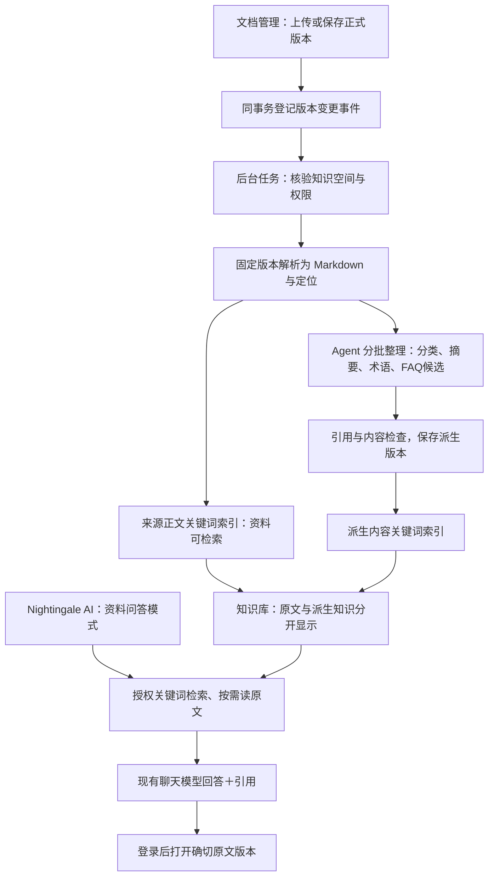

# 文档自动入知识库与会话资料问答方案 V2

日期：2026-11-13。状态：分析方案，尚未实施。此版收敛前版：不开发语义/向量检索，不配置 Embedding 或重排序模型；使用现有聊天模型整理和回答，检索与排序由关键词全文索引完成。根因分析不在本分支开发。

## 用户体验和范围

沿用现有“文档管理”上传入口；按当前代码对应“档案管理 → 文档/附件”。用户为档案/目录设置知识空间后，后续上传或正式保存自动入库，无需再去知识库重复上传或逐份点击“生成知识”。已存在资料提供一次性批量初始化。

Nightingale AI 的同一会话页面增加“运维助手 / 资料问答”模式。资料问答选择知识空间，可附加档案、文档范围；服务端按权限检索，回答附确切来源与版本。模式并非聊天模型选项，不需要新增模型服务。

原文索引和 Agent 整理分别记录状态。模型超时或限额时，已经成功解析的来源仍可被检索，摘要显示“整理失败，可重试”；不能因为摘要生成失败就隐藏可用正文。

## 现有基础与需要补齐

- `archives/files.go:newDocumentVersion` 是上传、新建在线文档和正式保存/恢复共同使用的版本提交点。版本、Blob 摘要、原始文件和在线结构化正文可复用。
- `archives/edit.go` 区分私有草稿与已保存版本。在线文档的保存正文是 Canvas Editor 结构化快照，不能将其 JSON 文本当作 Markdown 原文；应提取标题、段落、列表、表格及资产引用。
- 上传 Word 原件及其确认后的在线副本有来源关系，应关联为一份资料的不同表示，避免两份重复摘要和重复搜索结果；在线副本可能有修改时必须保留独立版本与来源。
- `pkg/knowledge` 目前侧重结构化排障规程与业务组授权；通用资料应新增正文、来源定位和索引定义，不强迫报告填写步骤、操作、恢复检查。
- 会话前端会移除 `action.key`，服务端还会自行按创建意图路由。资料问答必须增加显式、可持久化的模式，不能仅发一个旧 action key 或在用户问题里加提示语。
- 档案当前仅校验有效登录身份、不绑定业务组。不能宣称仅给知识索引加业务组过滤就实现了客户隔离；原件接口、历史版本、资产、引用及导出也需要一致的授权策略。

## 一、文档变更如何触发

### 触发范围

| 来源动作 | 行为 |
|---|---|
| 新附件上传并提交成功 | 为确切文档版本入队 |
| 替换附件 / 保存在线文档 | 追加版本并对新内容入队 |
| 恢复历史版本 | 因其创建新的正式版本而重新同步当前指针；可复用内容解析缓存 |
| 私有草稿自动保存、上传临时图片 | 不入公共知识；正式保存引用后才纳入 |
| 文档重命名、移动空间、授权调整 | 更新元数据/范围；权限撤销立即阻断，不等待索引完成 |
| 删除、回收档案或文档、取消知识同步 | 立即禁止默认召回与读取，异步清理索引和依赖摘要 |
| 从回收站恢复 | 重新核验归属与有效版本，再启用同步，不直接复活所有旧权限 |

“正式版本”指用户已经保存的文档版本，不要求整份档案先进入 archived 状态。空白在线文档不进入可检索状态。

在文档版本保存的同一数据库事务中写入轻量 outbox 事件。提交后后台消费，不在上传请求中等待解析或模型。事件落库失败与版本一起回滚，不出现“已保存且永远漏同步”。后台暂时停止不影响已提交事件，恢复后继续处理；另设定期对账发现漏任务。

幂等标识使用来源类型、document_id、version_id、任务处理版本。解析缓存使用空间内内容摘要与解析器版本，模型整理另记输入摘要、模型/Skill版本。不跨客户显示去重命中，不覆盖原文件。

同一文档短期多次正式保存时合并排队任务，优先当前版本；正在处理的旧版本可以保留历史产物，但不得将其切回当前版本。正式索引指针只在当前任务和来源修订匹配时原子更新。

## 二、归属与权限

每份档案配置 `knowledge_space_id` 和自动同步策略，文档默认继承，允许显式排除个别文档。客户/项目是空间的元数据；首版以现有业务组权限作为空间授权基础，避免另建一套不一致的用户权限。

已明确设置默认空间的后续上传自动运行；历史未绑定空间的档案显示“待设置归属”，由有权限的人批量指定，不让模型猜测客户，也不默认向全员开放。

同一空间内原件、来源 Markdown、派生知识、索引片段、缓存与确切引用按同一规则读取。原件权限比目标知识空间窄时不能自动扩大；需要共享时由明确的共享动作处理。混合来源的派生内容要求读者具备所有必要来源权限，否则拆分或屏蔽，不把受限内容复制到宽权限摘要。

资料问答每次请求和每次读取重新验证账号与空间访问权。模型不能设置用户身份、知识空间权限或直接访问目录。历史会话在权限撤销后，至少不能重新向模型注入无权的正文、片段和历史派生回答；历史显示、分享、导出也要按来源权限检查。已经看过/下载的内容无法技术上收回。

若暂不调整原档案全员登录可读的策略，只能将方案定位为同一授权范围内的共享资料库，不能作为多客户隔离交付。建议首版同步补齐归属和原文授权。

## 三、资料解析和 Agent 整理

| 内容 | 解析路径 | 输出 |
|---|---|---|
| 在线文档 | 解析已保存 Canvas 快照；提取文字、标题、列表、表格 | Markdown＋原始元素定位＋受管图片引用 |
| 文本 PDF | 提取有页码的文本与可识别表格，检查覆盖 | Markdown＋页码与块定位；部分成功明确标记 |
| DOCX | 按文档结构提取段落、标题、表格及资产 | Markdown＋章节/段落定位 |
| 原始 MD/TXT | 在文档上传层补支持与校验，保留原文 | 标准化正文与行/章节定位 |
| 扫描 PDF / 图片 | 本版不假设有 OCR；识别无可用正文的情况 | “待 OCR”或待补文字，不生成空的成功知识 |
| XLSX/PPTX 等 | 本版不承诺支持；后续专用解析器扩展 | 明确不支持，不静默漏掉内容 |

不依赖浏览器截图或模型猜测内容，不把在线 JSON、PDF 二进制直接塞给文本模型。

Markdown 保留原文数字、单位、版本、否定词和条件；复杂表格不能无提示丢弃。正文缺页或布局影响含义时显示部分解析，问答说明范围。模型整理采用分章节预算，不把任意大文件一次塞进上下文；每章节可重试、可续跑，再汇总文档摘要。

Agent 输出包括：分类、标签、简短摘要、关键术语、事实条目、FAQ 候选和关联建议。每条事实/回答关联原文段落，不得将缺失信息补成事实；FAQ 作为派生候选，不取代原文。原文作为引用依据，摘要作为导航与搜索辅助。规程审核继续单独管理，普通报告可自动入检索。

来源正文和派生知识保留独立版本、摘要、生成时间、模型与 Skill 版本。只有支持引用可验证且结构合格的派生版本才进入默认索引；错误内容保留失败任务，不能覆盖上个有效版本。

## 四、没有向量模型的检索

检索为确定性词项召回与权重排序，不调用 Embedding、重排模型，也不让聊天模型为全部文档逐份打分。

1. 按知识空间和有效版本先限定可搜索集合。
2. 对标题、档案名、章节、原文、摘要、标签建立中文词项索引，保留设备名、型号、指标名、版本号和错误码完整词项；可配置人工维护的别名/缩写。
3. 根据词项命中、词频/稀有度、标题/章节权重及明确过滤条件排序。具体中文分词策略以验收语料检验；不能只按空格拆词。
4. 按原文段落和来源去重，同一原文与在线副本合并展示；返回有限片段和确切来源编号。
5. Agent 按需继续读取原文章节，再回答并附引用。资料未覆盖时明确说明，不凭知识常识编造客户的日期、金额、责任人或结论。

BM25 类排序是索引算法，不是重排序模型。具体索引适配器在实施时按部署与中文效果确定，保留 MySQL/PostgreSQL/SQLite 业务数据兼容；不将某一种数据库的专用全文语法扩散到业务调用者。索引可以重建，Markdown与元数据是事实来源。

命中是相关性，不是验证状态。默认优先最新有效来源；可检索原文、派生内容，但必须清楚标识类别和日期；操作预案检索仍要求满足现有正式版本和适用条件，不混成可直接执行的内容。

## 五、同一会话页面内的资料问答模式

界面沿用 Nightingale AI，会话顶部/输入框增加模式与范围：

- 运维助手：保持现有默认行为，告警分析逻辑不在此任务修改。
- 资料问答：选择知识空间，可限定档案、文档；只读知识检索与原文工具。允许客户资料类问题，仍要求根据资料回答。

服务端增加 `mode=ops|knowledge_qa` 与授权 `knowledge_scope`，持久化到会话元数据。旧会话缺省 ops。每条消息保存模式/范围快照及其引用；刷新、多轮追问保持模式。模式由后端有效值和当前权限决定，不接受客户端指定任意 prompt、工具列表。

资料问答在创建意图 fast-path 和旧待确认操作恢复之前选择独立受限执行路径，避免“创建验收清单怎么做”误触资源创建，也不能在资料模式中继续批准旧运维操作。工具白名单服务端执行，禁用创建/修改资源、作业、页面执行动作及通用外部工具源。

模式或客户/空间切换时先停止当前运行并开启新会话，保留旧会话可回看，不把 A 客户资料和回答带入 B 客户上下文。取消和超时沿用现有流式能力；知识引用是结构化字段，不仅是一段可被模型伪造的链接。服务端校验 document_id/version_id/section_id 后生成登录读取地址。

建议工具：`search_knowledge(query, scope_filters, limit)`、`read_knowledge(document_id, version_id, section_id)`。后台整理另用服务端固定来源读写接口，用户问答只有读权限。Skill 提供查找、原文核对、引用与资料未覆盖的处理规则；上传文档本身不能变为 Skill 或增加工具权限。

## 六、页面与任务状态

文档管理列表增加“知识同步”列：未启用 / 待归属 / 排队 / 解析中 / 原文可检索 / 整理中 / 已整理 / 部分解析 / 待 OCR / 失败 / 已停用。解析和整理可分栏显示，避免已可检索的资料仅因摘要失败显示为全失败。

文档详情提供同步进度、确切来源版本、最后成功版本、缺失项、失败原因、查看关联知识和重试；上传成功与入库成功分开提示。知识库列表增加来源原文与派生知识类别，不占用既有排障预案字段。

资料问答显示选定范围、来源卡片、资料版本/日期、定位、部分解析提醒；引用点击进入已授权确切版本。默认搜索最新有效版本，旧版仅在明确历史查询或历史引用中使用。

更新期间可继续提供未被撤回的上个有效版本，但必须显示“新版处理中/失败，当前回答依据旧版”。删除或撤权则立即停止提供，不能把旧版本当作回退继续使用。

## 七、已有资料如何初始化

先由管理员按档案/目录批量指定空间和同步策略，再后台扫描有效文档的当前已保存版本。列出数量与预计处理状态，使用与新增上传同一条任务链；已完成相同版本不重复整理，不一次默认索引所有历史和私有草稿。初始化可暂停后恢复，保存游标并定期对账，支持处理遗漏；失败项可单独重试。

后台使用经过授权的服务身份，每个任务绑定空间、来源版本和创建策略；不能长期依赖上传者浏览器或临时会话 token。权限变化后任务重新核验，失去访问则停止并记录。任务限制并发、分章节大小、模型调用预算及重试次数；外部模型超时可能已消耗调用，不声称网络严格一次。

## 八、数据与模块落点

- 档案模块继续拥有原件、已保存文档版本、资产与编辑流程；新增知识空间绑定、可停用同步配置及事务事件。不得让知识任务修改原稿或私有草稿。
- 知识模块拥有来源引用、Markdown版本、派生版本、正文位置、词项/段落索引、任务和索引清单。复用原件确切引用或受控快照，不再由用户重复上传；长期证据需要保留策略。
- 会话模块新增显式模式、范围、结构化引用，以及只读工具白名单。保持既有模型配置、流式显示、取消和聊天记录；域范围放宽仅对资料问答模式生效。
- 既有结构化 Ops 知识保持兼容；新通用资料内容与可执行定义分离。根因分析侧以后通过只读检索和产物接入接口衔接，本任务不用等待其实现。
- 新增表/字段同步三方言初始化、升级 SQL 与真实数据库验证。原件/资产、Markdown与数据库一致备份；索引另验证重建。

## 九、开发顺序与验收

| 顺序 | 交付 | 关键验收 |
|---|---|---|
| 1 | 归属/授权、版本事件、任务与历史扫描 | 上传/保存版本只入队一次；私有草稿不入库；权限全链一致 |
| 2 | Markdown正文、原文定位、中文词项索引 | 不调用聊天模型也能索引正文；数字、表格、来源版本可核对 |
| 3 | Agent自动整理、任务状态、增量更新 | 有效摘要带引用；模型失败原文仍可查；旧任务不能覆盖新版本 |
| 4 | 会话资料问答模式、引用卡片 | 多轮/刷新模式保持，明确未覆盖，创建意图不触发写工具 |
| 5 | 端到端、真实模型与文档集验收 | 上传→自动知识→问答→更新→新版引用→删除阻断完整通过 |

代表性资料预先标注答案与出处，至少覆盖：中文术语、缩写/错误码、表格数字和单位、客户同名文件、多章节、跨资料问题、旧版日期、原文否定条件、重复原件/在线副本、没有答案。分别报告召回/引用与答案忠实度，不让 Agent 自己给自己判通过。

专项用例包括：上传回滚不产生孤立任务、重启恢复、乱序/快速更新、空白文档、Word待确认副本、OCR缺失、模型超时、格式无效、知识与原件权限不一致、撤权/回收后缓存泄漏、伪造引用、文档内嵌提示注入、切模式/切客户不串历史、已存在运维待确认操作不能在资料模式执行、备份恢复与重建索引。

本轮仅完成调用链核对与方案修订，没有实现新功能，也未重复执行历史功能测试。交付只做文档渲染、链接/文件一致性和下载核验。
