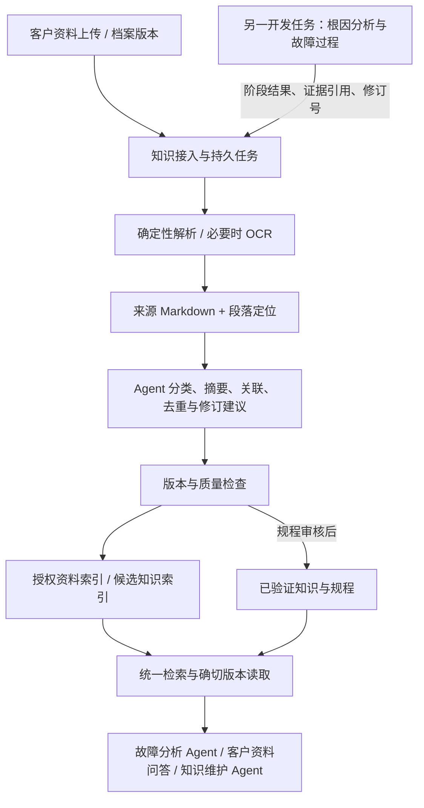

# 通用资料知识库与自动沉淀方案

日期：2026-11-13。状态：设计建议，尚未实施。本分支范围调整为知识库初始化、资料入库、持续沉淀更新和 Agent 检索；根因分析及故障执行由另一开发任务负责。当前已有处置模块保留兼容，不在本任务继续扩展。

## 结论与范围

可以实现由 Agent 驱动的知识初始化与持续维护：资料上传或故障阶段变化后，自动读取授权来源、解析、整理、生成 Markdown、建立检索索引、发现重复和冲突、形成新版本。底层任务推进、权限、版本提交和索引切换由程序保证，不依赖一段模型对话持续运行。

全自动应按内容区分：忠实转写的来源资料经过程序检查后可自动进入授权检索；模型总结、故障经验可自动形成带来源和状态的候选知识；跨案例归纳出的根因与可执行规程不能因为模型认为可信就自动成为已验证结论。首版默认候选自动生成、验证规程经负责人发布，后续可按知识类型配置自动发布条件。无需为每一次上传和索引操作安排人工审批。

截图中的“AI 分析”入口携带 event_id 进入 AI 会话。当前通用 Agent 按工具与技能目录开展调查，可给出原因假设和证据；按钮本身不保证根因已经证实。知识库只消费其明确提交的结果和引用，不重复建设根因分析循环。

## 当前实现与缺口

| 当前已有 | 对本方案的价值 | 尚缺能力 |
|---|---|---|
| 私有知识来源、摘要、业务组授权 | 原件与来源管理基础 | 客户/项目知识空间、完整解析与知识正文管理 |
| Markdown/TXT、PDF、DOCX 上传 | 可接收首批资料 | PDF/DOCX 目前不能直接辅助成稿，需人工文字摘录；扫描件无 OCR |
| 结构化预案、正式不可变版本、停用 | 保留既有排障规程能力 | 普通报告不能强制套用步骤/动作/恢复检查模板 |
| search_ops_knowledge | 按本次处置的规则和环境匹配预案 | 全文、中文问题检索、段落定位、跨资料引用；现实现最多扫描 200 项，主要匹配标题/摘要 |
| 处置证据与知识反馈草稿 | 可作为故障经验来源 | 阶段订阅、自动增量沉淀、去重与冲突管理 |
| 通用会话的 Skill 目录与工具调用 | 可接入检索与知识维护技能 | 现有提示主要限定 IT 运维，需要独立资料问答用途，才能支持其他客户业务报告 |
| 档案原件与确切版本导入 | 可复用资料来源 | 档案现对有效登录账号开放，不能自动等同于客户知识空间权限；导入需明确目标授权 |

后台处置 Agent 当前仅开放限定工具，不加载任意 Skill 或脚本。通用会话支持 Skill，不代表后台知识任务已经具备同样能力。本方案新增专用知识任务模式与工具授权，不扩大既有处置工具范围。

## 模块职责与协作接口

由知识模块封装来源、解析、版本、索引和授权，调用者只理解少量接口。内部按文件类型提供解析适配器，按检索实现提供索引适配器，不让不同 Agent 各自读磁盘、各自维护索引。

对外能力建议：

- `IngestSource`：上传/引用一个有版本的来源，返回持久任务编号。
- `SubmitObservation`：提交外部系统阶段产物，返回接收编号；相同来源版本幂等。
- `Search`：按当前身份和空间检索，返回可引用片段及状态。
- `ReadVersion`：读取确切正文版本和章节，不能由当前指针替换历史引用。
- `ProposeRevision`：在指定基础版本上提出新增或修订建议，返回差异及依据。

任务状态通过统一 `GetJob` 查询；规程发布仍为独立有权限的决定。工具名是拟议名称，尚未开发。

根因分析端建议提交 `schema_version, source_kind, source_id, source_revision, artifact_kind, occurred_at, target_refs, facts, hypotheses, unknowns, evidence_refs, conclusion_status`。身份、客户/项目与权限由后端核验，不能信任模型传入的归属。阶段类型可为 analysis_updated / operation_recorded / recovery_verified / case_closed；不要求对方先实现所有事件。

- `facts` 中每条事实必须关联证据，并区分“报告称/人员反馈”与运行系统直接观测。
- `hypotheses` 保留为假设，不写成已确定根因；根因未知也可以沉淀案例。
- 事件生产方已可靠提交的数据通过 outbox 交付；暂不支持时按更新时间与稳定 ID 重叠轮询并定期对账。
- 幂等键为来源类型、来源 ID、来源修订号、产物类型；迟到旧版本不能覆盖新版本。
- 对话原文不直接当作正式知识；只取可授权、可留存的结论和证据。聊天消息并不自动证明动作成功。
- 原始指标和日志保留在运行系统，知识保存有限证据摘录、时间范围、摘要和引用；需长期复盘的证据按留存规则固化，避免只留下会过期的链接。

## Markdown 如何存储

推荐“三层保存”，Markdown 是主要可读正文格式，但不是权限和版本数据库的替代物。

| 层次 | 保存内容 | 使用方式 |
|---|---|---|
| 来源原件 | PDF、DOCX、XLSX、图片、原始 MD 等不可变字节 | 追溯、重新解析及下载 |
| 来源正文 | 忠实解析的 Markdown、图片/表格受管资产、段落定位表 | 全文检索和原文阅读；不等于已验证操作规程 |
| 派生知识 | 文档摘要、案例、FAQ、关联说明、经验与规程 Markdown | 按状态检索；已验证规程另有结构化执行定义 |

每个版本保存内容摘要、来源版本、解析器版本；模型派生产物另记模型及 Skill 版本、支持证据与生成任务。客户/项目/业务组、权限、最新指针、状态、任务与审计由数据库管理。索引可以从原件/Markdown/元数据重建，不是唯一真相。

建议私有目录使用系统 ID：`sources/<source_id>/<version>/original`、`documents/<doc_id>/<version>/content.md`、`assets/<asset_id>`。客户名称和上传文件名只作显示，不能决定授权或存储路径。不要把客户正文放到公开 frontend/pub，不要让模型获得任意文件读写工具。

Markdown 正文保留标题层级、段落、表格标题、单位、脚注及必要图片引用。复杂表格可附 CSV/JSON 作为受管辅助资产；页码、原始段落/单元格/幻灯片定位保存为独立映射。引用格式至少包含 source_id、source_version、document_version、section_id、page_or_location。不能只引用模型摘要。

资料正文和结构化可执行规程分开：既有 Ops Spec 保持兼容；通用报告不必填写恢复检查。未来从已审核资料生成规程时，建立确切版本引用，不从任意 Markdown 代码块直接执行命令。

## 自动初始化流程

| 环节 | 输入 | 自动处理 | 输出或异常处理 |
|---|---|---|---|
| 归属登记 | 用户上传、知识空间、原始文件或档案版本 | 核验身份与目标空间权限，保存摘要；同空间同内容去重 | 来源版本与任务；客户归属不明时等待填写 |
| 解析 | 原件、文件类型 | 按类型解析；图片/扫描件走已配置 OCR；保留页码、表格及附件关系 | 来源 Markdown 与覆盖率、失败/部分状态 |
| 整理 | 可用正文 | Agent 分类、生成标题、标签、摘要、术语和关联建议 | 派生知识及支持段落；不改原文数字或推断缺失参数 |
| 质量检查 | 正文、派生内容、定位 | 检查解析覆盖、来源引用、空章节、金额/单位/版本等关键字段、权限 | 合格来源自动可检索；部分内容标记不完整；冲突进入待核实 |
| 建索引 | 确切版本 Markdown 与元数据 | 按章节/段落/表格切分，保留上下文，提交索引清单 | 只有完整提交后的版本成为当前默认检索版本 |
| 问答 | 用户问题、当前授权空间 | 搜索后按需读确切章节，生成带出处答案 | 无依据时说明资料未覆盖；不编造答案 |

第一阶段支持 MD/TXT、文本 PDF、DOCX。扫描 PDF/图片需要 OCR 能力；未配置时显示“待 OCR”，不记成入库成功。XLSX、PPTX 在第二阶段增加专用解析器，保留工作表/单元格、幻灯片与图表来源；不承诺“任意格式自动正确理解”。加密、损坏、不支持、扫描缺页、只解析部分的结果必须在任务和检索中可见。

## 持续沉淀与更新

知识维护 Agent 订阅资料新版本和故障阶段产物，先确定“更新已有文档还是新增案例”，再生成差异建议。事实、假设、未知项分别保存。故障处理中自动维护可检索的过程案例；结案后基于最终结果形成复盘，不把中途猜测覆盖为最终原因。

- 同一故障各阶段更新同一案例的新版本，避免每次告警通知生成一篇知识。
- 相似故障可以关联，但一次成功不能自动证明方法对所有客户和版本适用。
- 原文件更新只重建受影响的正文、切片、派生知识；新版本失败时原有效版本继续提供，并标记存在待处理更新。
- 对原文忠实的更新可按政策自动提交；模型推导、冲突修订、扩大适用范围保留待确认差异。
- 源资料停用/删除或权限撤销，读取立即拦截；后台清理索引、向量、缓存及依赖产物。衍生知识同时标记需复核，不能因为已复制正文而继续泄露。
- 默认搜索最新有效版本；历史引用始终指向原版本。来源之间有冲突时返回日期、适用环境和冲突说明，不静默拼成单一结论。
- 数据库使用幂等任务、租约、重试预算、基础版本校验及定期对账；中断后恢复，不重复收费生成已完成结果。模型/嵌入请求可能在外部成功而本地超时，需记录不确定性，不能承诺网络层严格一次调用。

## 检索设计与 Agent 工具

第一阶段采用权限过滤 + 中文友好的词项检索 + 标题/章节/标签/环境权重，支持指标名、版本号、错误码、设备名精确检索。先用代表性中文资料验证分词与检索效果，不能把按空格拆词当成完整中文检索。

第二阶段加入向量召回、词项与语义结果融合、必要时重排。向量索引可以后置；文件为 Markdown 不等于具备语义检索。现有聊天模型连接成功不代表已经有可用嵌入模型，需独立配置、版本与权限。向量服务不可用时保留词项检索。

返回每个片段的标题、正文摘录、确切版本、定位、来源、资料日期、验证/草稿状态和相关理由。检索范围由授权身份在服务端确定，过滤发生在召回时，读取确切正文时再次校验；结果摘要、重排和模型输入也不能混入无权内容。

拟议工具：`search_knowledge(query, filters, limit)`、`read_knowledge(document_id, version_id, section_id)`、`get_ingest_job(job_id)`、`propose_knowledge_revision(document_id, base_version, changes, evidence_refs)`。后台另可使用固定来源读取工具。维护 Agent 没有故障操作、任意 Shell/SQL/HTTP 或公开发布文件的工具。

Skill 定义“怎么整理/检索/更新”，Tools 实际读写，程序控制任务和版本。推荐 knowledge-ingest / knowledge-maintain / knowledge-retrieve 三种固定用途。上传资料永远是数据，不能自动变成 Skill 或指令；正文中的“忽略规则/发送文件”不会赋予工具权限。

新增独立“资料问答”入口，使用授权检索工具和适合客户业务资料的提示范围；不修改另一个开发任务的根因分析逻辑。故障分析 Agent 只需要接同一只读检索接口，并提交阶段结果。

## 页面建议

知识中心按客户/项目知识空间组织：

1. 资料：原件、类型、来源版本、解析预览、定位和入库进度；支持批量上传与失败重试。
2. 知识：来源正文、案例、FAQ、参考资料、规程；分别显示来源状态和审核状态。
3. 搜索/资料问答：片段、出处、版本、筛选和“资料未覆盖”。
4. 更新待办：重复建议、正文差异、冲突、过期复核、待 OCR、失败任务；人员只集中处理例外和审核。
5. 自动化设置：允许的来源/类型、触发方式、空间归属、模型、任务预算、可自动入索引的类别、规程审核规则。

原告警处置页面不承担所有客户资料管理。既有知识预案页面可保留，并引用知识中心的确切资料版本。

## 实施顺序与验收

| 阶段 | 范围 | 最小验收 |
|---|---|---|
| 1. 通用来源与 Markdown 正文 | 私有空间/权限、MD/TXT/PDF/DOCX、版本、定位、持久任务 | 不用模型也能完成忠实原文入库；有明确部分/失败状态 |
| 2. Agent 检索 | 中文词项检索、确切段落读取、引用、独立资料问答 | 已知答案能找到原文，未知问题不编造，跨客户越权被拒绝 |
| 3. 自动初始化与修订 | 分类摘要、去重、差异、自动索引政策、异常待办 | 上传触发任务；更新只产生必要新版本，冲突不覆盖原文 |
| 4. 故障过程沉淀 | 外部阶段产物接口、案例更新、结案复盘与规程候选 | 用固定接口样例先测，不依赖另一个开发任务完成；重复/乱序不污染案例 |
| 5. 增强解析与检索 | OCR、XLSX/PPTX、语义融合、质量评估 | 格式忠实度、中文召回和引用准确性达到预先定义的验收集要求 |

验收集使用经过授权的代表性资料，至少覆盖标题、跨段落、表格数字和单位、中文同义词、指标/错误码精确查询、历史版本、冲突、新旧文档、资料未覆盖，以及两个客户同名文件。独立标注应检出的证据和允许回答范围，不让 Agent 自己给自己判通过。

专项检查包括：模型编造数字、OCR 缺页、私有草稿可见性、原文中嵌入工具指令、删除/撤权后残留召回、任务重启/重复事件/乱序版本、索引失败保持旧版本、跨客户去重信息泄露、完整备份和重建索引。必须区分模拟接口测试、真实解析器测试、真实模型评估、浏览器检查和人员验收。

模块实现继续放在 Center，不增加 alert/edge 的热路径依赖。数据库变更同步 MySQL/PostgreSQL/SQLite；保留现有 Ops 接口和正式版本引用。备份同时覆盖原件、Markdown、资产与数据库，索引另验证可重建。

## 本轮检查

已核对告警 AI 入口、通用会话路由与 Skill 配置、后台处置工具范围、知识来源与草稿生成、结构化匹配，以及档案接口权限约定。本轮仅输出方案；未修改业务代码、未部署新功能，也没有重新运行历史功能测试。下载页面、文件一致性与有效期另行实际核验。
