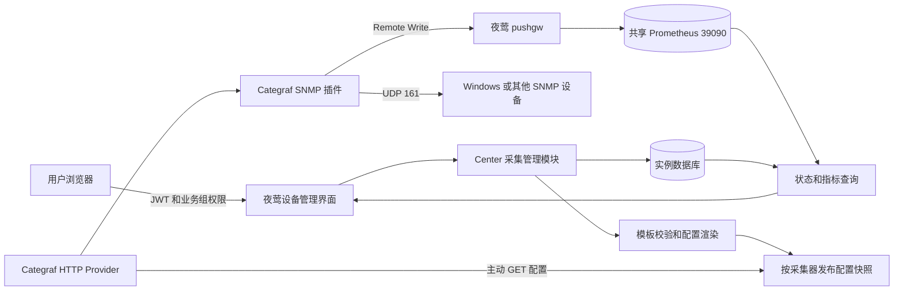

# 夜莺 SNMP 设备管理设计

日期：2026-10-25。状态：设计稿，尚未实现。适用对象：当前夜莺分支的开发、运维和验收人员。

目标是在“基础设施 → 设备列表”中新增监控设备，选择 Categraf 和 SNMP 模板后自动开始采集，随后在同一页面查看状态、指标和仪表盘。配置由 Categraf 原生 HTTP Provider 主动获取；不增加配置同步进程，不要求 Categraf 开放入站端口。

本设计以夜莺分支 `jealous-bumblebee`、代码基线 `3d1601c7` 和 Categraf `v0.5.18` 为依据。当前工作区另有资产和报告功能相关修改，不属于本设计的实施范围。本文出现的新页面行为、表、配置项和接口均为拟开发内容；现有能力和已知限制在对应章节注明。

相关约束见[项目模块地图](../../../CLAUDE.md)、[开发工作流](../../agent-development-workflow.md)和 [CMDB 接口说明](../../api/cmdb.md)。

## 1 目标与范围

### 1.1 用户操作结果

用户填写设备地址、业务组、采集器、SNMP 凭据及模板，保存后即可在设备列表看到一条“等待采集”的设备。Categraf 定期获取配置并采集；出现当前配置对应的有效指标后，页面显示“采集正常”。设备可编辑、停用、重新启用和删除，操作过程保留审计。

第一版支持 Windows 基础监控、SNMP v2c、IPv4 单播地址、一个设备对应一个当前采集器、多台 Categraf 的人工分配，以及现有 Windows `192.168.0.151` 的迁移。架构支持后续增加交换机和路由器模板、SNMP v3、批量导入、IPv6 和采集器重新分配。

### 1.2 第一版边界

- 在现有“设备列表”内增加入口和筛选，不增加新的顶层菜单或原先的三个页头分类。
- 沿用夜莺账号、业务组、数据源和告警体系；资产管理继续使用 CMDB。
- HTTP Provider 管理 SNMP 插件配置，本地 CPU、内存等插件继续由 local provider 管理。
- 指标沿用当前夜莺写入共享 Prometheus `39090` 的链路，内置 TSDB 保持关闭。
- 提供设备指标页和模板仪表盘；告警规则由用户另行启用，不在新增设备时自动发送通知。
- 第一版不实现网络扫描、自动发现整段网段、自动故障切换、任意脚本执行、Categraf 二进制升级和通用插件配置中心。

### 1.3 核心验收场景

以 `Dev01 / 192.168.0.151` 为例：选择当前 `categraf01`，输入已知 SNMP 凭据，选择 Windows 模板。保存后设备立即出现在已选业务组；90 秒内应看到有效采集结果，并能打开 CPU、内存、磁盘及网卡图表。90 秒是当前 10 秒配置轮询、30 秒采样周期下的验收目标，需要环境实测，不是 Categraf 的固定保证。

## 2 当前基础与模块职责

| 对象                    | 当前职责                                   | 本设计增加的职责                                 |
| ----------------------- | ------------------------------------------ | ------------------------------------------------ |
| 夜莺设备列表和 `target` | 监控对象、业务组、标签、Agent 心跳及元数据 | 管理 SNMP 对象入口、类型标记、采集状态和指标展示 |
| `pkg/cmdb`              | 资产、机房、机柜、位置和资产权限           | 可选关联监控设备，不承担配置下发                 |
| Categraf local provider | 读取 `input.*` 本地文件                    | 保留未被远程管理的插件                           |
| Categraf HTTP Provider  | 从指定 HTTP 地址获取插件配置并更新插件     | 直接复用，不新增外部同步程序                     |
| 夜莺 pushgw             | 接收指标、附加对象标签、写入数据源         | 校验受管理指标身份，供状态读取使用               |
| 共享 Prometheus         | 存储及查询指标                             | 保存受管理 SNMP 指标，继续使用已有实例           |

新增 `pkg/collection` 作为设备采集管理模块，对外提供设备生命周期、配置快照和状态查询接口。渲染模板、加密凭据、版本计算和发布事务集中在该模块内，路由和页面不各自拼接 TOML。

Categraf 上游仓库作为外部依赖，固定版本验证。夜莺新增功能不改变 n9e-plus 已消费的导出函数签名。第一版的管理和配置读取由 center 承担；若后续 edge 或 alert 需要读取新增模型，应同时提供数据库路径和 CenterApi 路径。

## 3 总体架构



配置与指标使用不同接口和权限。浏览器没有必要连接 Categraf，也不能直接访问其文件系统。夜莺不挂载 Docker socket，不通过 Web 请求执行 `docker exec` 或重启容器。

### 3.1 当前环境的部署映射

| 项目               | 当前值或实施方式                                                    |
| ------------------ | ------------------------------------------------------------------- |
| 开发分支 Web       | `http://192.168.0.152:30301`，公网开发槽位为 `n9e-dev1.zhiteng.win` |
| 当前采集器         | 已有 Docker 容器 `categraf`，主机标识 `categraf01`                  |
| 当前采集入口       | Docker 网桥上的 `172.18.0.1:30311`                                  |
| 新增配置读取       | 在既有采集入口增加精确的 GET 路径，转发至当前 center                |
| Prometheus         | 继续使用宿主机回环地址 `127.0.0.1:39090`                            |
| Categraf HTTP 服务 | 保持关闭，`9100` 不需要开放                                         |
| 已废弃查询代理     | 不恢复 `30312`                                                      |

开发网关现有采集协议拒绝规则继续保留。30311 仅为当前本地环境适配；独立部署采用可达的 HTTPS 采集入口和专用证书，不将 Docker 网桥地址写死到产品逻辑。

## 4 Categraf 能力与兼容约束

基准实现见上游固定版本的 [HTTP Provider](https://github.com/flashcatcloud/categraf/blob/v0.5.18/inputs/http_provider.go)、[Provider 管理](https://github.com/flashcatcloud/categraf/blob/v0.5.18/inputs/provider_manager.go)、[配置封装](https://github.com/flashcatcloud/categraf/blob/v0.5.18/pkg/cfg/cfg.go) 和 [插件注册](https://github.com/flashcatcloud/categraf/blob/v0.5.18/agent/metrics_agent.go)。实施前使用该版本的实际二进制完成协议兼容用例。

| 能力                         | 设计中的处理                                               |
| ---------------------------- | ---------------------------------------------------------- |
| local 和 http 可共同启用     | 本地基础采集与远程 SNMP 分开管理                           |
| 定期 GET 并比较配置版本      | 服务端维护稳定、非空版本和完整快照                         |
| 按每份配置的键识别增删       | 配置键必须随实际内容变化                                   |
| 动态注册和撤销插件           | SNMP 配置变化不需要逐次重启容器                            |
| 请求携带当前版本             | 仅视为客户端已接收该版本，不能当作成功启动确认             |
| HTTP Provider 无磁盘配置缓存 | 冷启动依赖配置接口可用；不得声称断网冷启动仍能恢复远程任务 |

v0.5.18 在插件初始化结果确认前更新远程配置缓存，无法提供每份配置可靠应用回执，也不提供任务租约、远程任意命令或自动回滚保证。因此产品以当前配置对应的真实样本确认生效；不能仅凭 HTTP 200 或下一次请求携带版本就显示“采集正常”。

配置接口故障时，运行中的远程任务通常继续使用内存中的配置。进程重启后不能依赖该内存。停用或撤销凭据也不能强制停止一台无法联系配置中心、仍在运行旧任务的采集器。这些限制分别体现在状态、删除流程和运维要求中。

## 5 页面交互

### 5.1 设备列表

保留“基础设施 → 设备列表”。新增“新增采集设备”按钮、采集方式筛选和采集器筛选。默认列表同时包含 Agent 对象和受管理 SNMP 对象。

| 列           | SNMP 对象显示内容                                          |
| ------------ | ---------------------------------------------------------- |
| 名称与标识   | 用户名称、设备 IP、SNMP 类型标记                           |
| 所属业务组   | 夜莺已有业务组                                             |
| 采集器       | 指定的 Categraf，附采集器可达状态                          |
| 配置进度     | 等待获取、已获取、生效已观测、撤销待确认                   |
| 采集状态     | 等待采集、正常、部分指标缺失、失败、中断、查询异常、已停用 |
| 最后采样时间 | 有效样本时间和相对时间                                     |
| CPU 与内存   | 模板对应指标的查询结果，缺失时显示“未获取”                 |
| 操作         | 查看指标、仪表盘、编辑、停用或启用、删除                   |

列表不把 SNMP 对象显示成安装了 Agent 的 Windows 主机。Agent 版本列对 SNMP 对象显示“不适用”，采集器版本在采集器详情中展示。

### 5.2 新增和编辑表单

| 字段       | 规则                                                   |
| ---------- | ------------------------------------------------------ |
| 设备名称   | 必填，1 至 128 字符；允许修改，不改变内部设备 ID       |
| 设备地址   | 第一版仅有效 IPv4 单播地址；拒绝广播、多播和未授权网段 |
| SNMP 端口  | 默认 161，范围 1 至 65535；需符合采集器允许访问的范围  |
| 业务组     | 第一版一个拥有者业务组；写操作需要其写权限             |
| 采集器     | 必选；须允许为该业务组采集，并能访问目标网络           |
| 采集模板   | 第一版选择固定版本的 Windows 基础模板                  |
| SNMP 版本  | 第一版 v2c；v3 在后续版本增加对应认证字段              |
| 凭据       | 选择已有凭据或输入新团体字；编辑时不回显原文           |
| 采集周期   | 默认 30 秒；第一版允许 15、30、60、120 秒              |
| 超时和重试 | 默认 3 秒和 1 次重试；上限分别为 10 秒和 3 次          |
| 标签       | 可选；校验键、长度、数量，禁止覆盖系统保留标签         |
| CMDB 关联  | 可选，关联一个已有资产，不要求虚构序列号和客户         |

保存后立即进入设备详情，不等待 SNMP 请求完成。界面逐步显示配置获取、第一条样本和模板指标结果。保存失败保留表单；发布失败保留已保存草稿及具体原因，不误报成功。

编辑请求包含对象版本，冲突返回 409 并提示刷新比较。凭据字段为空表示保留原值，修改和清除使用不同的显式动作。设备采集地址变更需要发布新配置；第一版将现有 `ident` 保持为历史标识，并禁止与其他对象冲突，界面分别显示标识与当前采集地址。

### 5.3 测试连接

测试必须由选中的 Categraf 发起。center 自己执行 SNMP 请求，只能证明 center 的网络可达，不能替代采集器测试。

第一版复用 HTTP Provider 发布一个临时 SNMP 配置：仅查询 `sysName`、`sysUpTime` 等基本字段，携带独立 `probe_id` 和 `collection_mode="probe"` 标签。由查询模块检查该探测的结果。用户看到“等待采集器执行 → 正在验证 → 通过或失败”；默认等待上限 90 秒，可取消。

探测不创建 Target、CMDB 或告警规则。到期或取消后必须发布移除该条目的新快照。界面显示“清理待确认”，直到采集器随后携带撤销快照版本，且旧探测不再产生新样本。HTTP Provider 本身不执行任务 TTL，离线采集器可能暂时继续旧探测；后端任务到期不等于远端进程已停止。

测试只能给出观察到的事实：收到成功响应、观察到失败指标，或等待超时。仅凭 `snmp_up=0` 不区分团体字错误与网络丢包；具体错误需要有可靠的脱敏错误来源，不能由页面猜测。

### 5.4 停用和删除

停用会从下一份配置快照移除设备。期望状态先变为“停用”，实际进度为“撤销待确认”。撤销观察完成后显示“已停用”。采集器失联时保留待确认状态。

删除默认先停用，再软删除监控配置并保留审计和关联说明。历史指标按 Prometheus 保留策略自然过期，不调用时序库删除接口，也不删除 CMDB 资产。未经撤销确认时可保存删除意图，但在运维视图保留记录，避免隐藏仍可能运行的任务。

软删除后从默认设备列表排除该受管理对象；待撤销对象在管理员的待处理视图中仍可查询。第一版保留其 Target 关联和标识占用作为撤销记录，旧样本不能触发重新登记。原生 Target 列表也执行该过滤，避免出现“采集列表删了，设备列表仍然存在”的两套结果。后续永久清理需要先满足撤销条件和审计保留策略。

## 6 数据模型

新增模型使用 `monitor_` 前缀，避免与现有商业扩展模型重名。下表为逻辑结构，最终字段名在实现评审时固定。

| 表                         | 主要字段                                                                                                                                                                      | 约束与用途                                             |
| -------------------------- | ----------------------------------------------------------------------------------------------------------------------------------------------------------------------------- | ------------------------------------------------------ |
| `monitor_collector`        | ID、名称、关联 Agent ident、数据源 ID、允许网段、当前与上一令牌摘要、上一令牌有效期、配置期望版本、最近获取时间和版本、记录版本、启用状态                                     | 专用配置身份；一个凭据仅绑定一个采集器                 |
| `monitor_collector_group`  | collector_id、group_id                                                                                                                                                        | 采集器可服务的业务组；组合唯一                         |
| `monitor_device`           | UUID、名称、Target ident、地址、端口、协议、group_id、collector_id、credential_id、template_version_id、采集参数、CMDB ID、enabled、deleted、record_version、desired_revision | UUID 稳定；Target ident 唯一；采集参数保存为规范化结构 |
| `monitor_credential`       | ID、group_id、类型、加密内容、key_id、记录版本、更新时间                                                                                                                      | 团体字或未来 v3 凭据；不保存明文审计                   |
| `monitor_template_version` | ID、模板键、版本、参数约束、OID 定义、指标映射、仪表盘引用、内容摘要                                                                                                          | 模板版本不可变；第一版由受控内置模板提供               |
| `monitor_publication`      | ID、collector_id、version、加密快照、快照摘要、设备修订清单、原因、创建者、创建时间                                                                                           | 已发布快照不可变；按采集器原子切换当前指针             |
| `monitor_probe`            | UUID、group_id、collector_id、目标、加密参数引用、截止时间、清理版本、状态、脱敏结果                                                                                          | 临时连接验证；到期清理由 center 调度                   |
| `monitor_audit`            | ID、操作者、业务组、对象 ID、动作、前后差异、关联发布、时间                                                                                                                   | 记录设备、凭据、模板、采集器和回滚操作                 |

`monitor_device.record_version` 用于乐观并发，`desired_revision` 用于识别当前设备配置。两者与整个采集器的发布版本不同。只修改不影响采集的说明文字不触发 Categraf 更新。

第一版规定同一拥有者业务组内不允许重复的地址、端口和协议；同一采集器上的相同采集端点也不得重复。跨网络存在相同私网 IP 的部署需要分配不同 Target ident，不能只依靠 IP 作为全局主键。第一版默认 ident 为设备 IP，冲突时要求填写唯一标识，并由模板映射保留该标识。

数据库中短标识采用固定上限的字符串，JSON、模板和快照使用适配方言的大文本类型。记录创建与配置发布在一个数据库事务内提交；指针切换失败不得留下半份当前配置。

### 6.1 与 Target 的关系

新增监控设备时，在同一事务内创建或明确接管对应 Target，建立现有业务组关联，并创建 `monitor_device`。因此设备能立即出现在设备列表，不必等第一次上报。若 ident 已由一个独立 Agent 使用，默认返回冲突，不自动覆盖或合并。

创建 Target 只表示登记对象，不能伪造 Agent 版本、主机心跳或 HostMeta。新增查询字段 `collection` 承载 SNMP 状态；保留原有 `target_up` 及其 Agent 语义。SNMP 行在前端使用 `collection.health`，Agent 行继续使用原状态。

原有设备查询、统计、筛选和删除路径需识别受管理对象。特别是 `DELETE /api/n9e/targets` 及服务端删除入口，必须经过采集任务撤销检查；不得让 `force=true` 绕过任务生命周期直接留下孤立配置。复用并组合现有 `TargetDeleteCheck`、`TargetDeleteHook`，不覆盖 n9e-plus 已注册的钩子。

业务组、标签和备注的原生编辑入口也需保持一致：受管理设备第一版遵守一个拥有者业务组的约束，不能通过原生分组接口旁路增加其他拥有者。变更组归属必须同时验证采集器和凭据权限，可能影响配置的标签变更必须重新发布；系统标签禁止普通标签编辑覆盖。组删除和采集器删除同样应检查引用。

### 6.2 与 CMDB 的关系

CMDB 的序列号、客户、机柜及维保字段仍由资产管理维护。监控设备可不关联资产；关联操作同时校验业务组管理权限和 CMDB 资产读取权限，不在列表中泄露无权读取的资产字段。

删除监控不删除资产，删除资产不自动停止监控。第一版资产软删除后显示“关联资产已删除”，保留历史引用；恢复、解除关联和重新绑定均有审计。

## 7 配置生成与 HTTP Provider 协议

### 7.1 Categraf 启动配置

以下为拟接入后的示例，不代表当前环境已启用 HTTP Provider。配置读取路径需要先在夜莺和采集入口实现。

```toml
[global]
providers = ["local", "http"]

[http_provider]
remote_url = "http://172.18.0.1:30311/v1/n9e/collection/configs"
basic_auth_user = "collector_example"
basic_auth_pass = "REPLACE_WITH_COLLECTOR_SECRET"
timeout = 5
reload_interval = 10
```

`timeout` 和 `reload_interval` 的单位都是秒；后者是配置轮询频率，独立于设备的 30 秒采样频率。首次改变 providers 或主配置需重启 Categraf 一次。已有 writer 和 heartbeat 设置沿用当前认证采集链路。

正式部署使用 HTTPS；本机 Docker 网桥示例用于已有开发环境。配置凭据与 SNMP 团体字、网页账号分别管理，不复用 root 密码。

已有主配置应修改原有 `[global]` 内的 providers，再增加一次 `[http_provider]`，不能把整个示例直接追加成重复的 TOML 表。保留原有 writer、heartbeat 和其他设置。

### 7.2 配置请求

```http
GET /v1/n9e/collection/configs?agent_hostname=categraf01&version=pub_previous&timestamp=1790000000
Authorization: Basic <collector credential>
```

配置接口根据认证身份定位采集器。`agent_hostname`、全局标签和 `timestamp` 仅用于一致性检查及诊断，不承担授权；客户端不能通过改查询参数获取另一台采集器的配置。

### 7.3 配置响应

成功响应直接返回 Provider 协议 JSON，不能使用网页接口的 `{dat, err}` 包装。`configs` 是“插件名 → 配置内容摘要 → 带格式的配置内容”的两层映射。

```json
{
  "version": "pub_example_v1",
  "configs": {
    "snmp": {
      "CONTENT_SHA256": {
        "format": "toml",
        "config": "interval = 30\n[[instances]]\nagents = [\"udp://192.168.0.151:161\"]\nversion = 2\ncommunity = \"EXAMPLE_COMMUNITY\"\ntimeout = \"3s\"\nretries = 1\nagent_host_tag = \"snmp_target\"\ndisable_icmp_up = true\nlabels = { ident = \"192.168.0.151\", collection_device_id = \"device_example\", collection_collector_id = \"collector_example\", collection_revision = \"rev_example_v1\", collection_mode = \"managed\" }\n[[instances.field]]\nname = \"uptime\"\noid = \".1.3.6.1.2.1.1.3.0\"\n"
      }
    }
  }
}
```

`CONTENT_SHA256` 在实际响应中替换成对应 `config` UTF-8 字节的 SHA-256 十六进制摘要，不能使用设备 ID 作为一个永久不变的键。示例中的身份、版本和凭据仅用于说明协议。

每台设备生成一份配置。一个快照可同时包含多个 SNMP 配置条目，避免修改一台设备就重启全部设备的插件实例。每份内容携带自己的 `collection_revision`，而不是把整个快照版本作为所有设备的标签。

### 7.4 版本与响应规则

| 请求情况                 | 返回规则                                                          |
| ------------------------ | ----------------------------------------------------------------- |
| 首次请求、未知或历史版本 | 返回当前非空 version 和完整 configs                               |
| 请求版本等于当前版本     | HTTP 200，返回同一 version；configs 可省略                        |
| 删除部分配置             | 新 version 加剩余配置的完整集合                                   |
| 删除最后一个配置         | 新 version 和 `configs: {}`，不能用空 version 表示撤销            |
| 数据库、解密或渲染失败   | 返回失败状态和不含 version/configs 的错误对象；不把失败转为空快照 |
| 鉴权失败或采集器禁用     | 401 或 403，错误对象不包含配置及任何有效版本                      |

Provider 按版本和内容键处理变化，服务端不能依赖 304 或空正文作为无变更协议。v0.5.18 没有先按 HTTP 状态阻断解析，因此错误响应也必须保证不具备可应用的配置结构。

只有采集配置集合真的变化时才发布新版本；审计时间、请求时间不进入内容摘要。空集合初始启动时，Provider 可能不推进内部版本，因为不存在条目差异；页面不能把这一情况当成配置故障。相同配置也不得只更改 envelope 版本来期待重新启动插件。

### 7.5 渲染和发布事务

保存设备后，模块读取其固定模板版本、解密授权凭据、归一化参数，使用结构化 TOML 编码器生成内容，并校验 OID、标签和限制。不得通过字符串拼接插入团体字。

对配置依次执行 TOML 解析、字段约束、模板语义检查、凭据引用检查和采集器范围检查。发布事务锁定对应采集器，生成设备修订及完整快照，保存加密快照并切换指针。并发修改同一采集器时重新读取最新集合，不能覆盖另一用户刚添加的设备。跨采集器操作按固定 ID 顺序锁定。

回滚会生成一条新的发布审计，并恢复选定的历史设备配置集合；当前指针和内容必须保持一致。不得声称 Categraf 会自动验证并回滚错误配置。运行时初始化失败可能已经移除旧条目，需要服务端重新发布有效内容来恢复。

### 7.6 版本获取与生效证据

后端分别保存 `last_served_version`、客户端下次请求携带的 `last_client_version`，以及当前修订首次出现的样本时间。前两者分别说明服务端提供过和客户端缓存过配置，第三者才是该设备已运行采集的证据。

需要重新尝试同一份运行失败配置时，发布新的设备修订标签，确保配置内容键改变。自动重试最多三次并退避；模板错误或凭据错误不会靠反复发布修复，应转为明确失败状态和人工修正。

## 8 SNMP 模板与指标规范

### 8.1 模板内容

第一版模板为 Windows 基础监控，包括设备名称、SNMP 管理运行时间、CPU、存储表、接口状态和流量。模板保存参数约束、OID、类型、转换规则、必需和可选指标、展示名称、状态判定规则及仪表盘配置。

模板版本不可原地修改；升级先在选定设备上验证，再分批发布。用户首次使用只选择模板，不需要填写 OID。第一版不允许普通用户上传任意 Categraf 配置或指定 `exec` 等插件。

### 8.2 必须保留的标签

| 标签                      | 用途                                         |
| ------------------------- | -------------------------------------------- |
| `ident`                   | 夜莺 Target 标识，默认沿用设备 IP            |
| `snmp_target`             | 当前 SNMP 目标地址，与稳定的 ident 分开      |
| `collection_device_id`    | 稳定设备 UUID，状态与历史查询使用            |
| `collection_collector_id` | 当前采集器身份，排除旧采集器结果             |
| `collection_revision`     | 当前设备配置修订，区分更新前后的样本         |
| `collection_mode`         | `managed` 或 `probe`，隔离正式采集与连接测试 |
| `index`                   | CPU、存储或网卡的 SNMP 表索引                |
| `hostname`                | 可选的 SNMP 设备名，不能替代稳定 ID          |

限制标签总数和长度；凭据、个人账号及原始配置不进入标签。受管理配置统一设置 `agent_host_tag="snmp_target"`，通过实例 labels 显式设置 ident。这样设备 IP 变化或相同私网 IP 分属不同网络时，Target 标识仍能保持唯一。所有基本字段、表和 `snmp_up` 都必须通过兼容测试验证标签一致，不能只测试 CPU 指标。

### 8.3 内存和磁盘识别

不得将 Dev01 的存储索引 `5`、磁盘索引 `1/2` 固化为通用模板。根据 HOST-RESOURCES-MIB 的存储类型区分物理内存与固定磁盘，保留 index，并从可用描述提取盘符。

原始 Windows 描述可能包含非 UTF-8 字节或 NUL。仅在转换可验证时生成可读标签，例如提取 ASCII 盘符；失败时使用“卷索引 2”，不能让一条描述破坏整个 Remote Write 请求。计算容量使用 `size × allocation_units`，使用率为 `used / size × 100`，排除总量为零的条目。

### 8.4 网卡识别与计数器

模板利用接口索引、设备地址关联、接口类型及状态选择展示对象，不能默认所有机器的物理网卡都是 index `14`。优先使用设备实际支持的 64 位流量计数器；不支持时采用 32 位计数器并在设备详情标明限制。能力探测和模板选择需覆盖不支持的 OID，避免可选字段失败导致整个表不产出。

### 8.5 仪表盘

模板仪表盘使用设备 UUID 变量，不为每台设备复制一份长期维护的硬编码仪表盘。默认展示在线状态、CPU 平均和各核使用率、内存、各卷使用率、网络流量及最近数据时间。

历史趋势可跨设备修订聚合，实时状态仅采用当前 collector 和 revision。CPU、存储索引等仍作为各自维度保留，不能简单求和多个修订或多个采集器的值。

## 9 采集状态与时间处理

### 9.1 两个独立状态

配置进度回答“期望配置是否已被获取、是否观察到生效”；运行状态回答“当前是否有可信、及时的采集结果”。两者分别返回，页面不能将“配置已获取”渲染成“设备在线”。

| 配置进度            | 判定                                         |
| ------------------- | -------------------------------------------- |
| `pending`           | 已发布，尚无该采集器获取记录                 |
| `served`            | 服务端返回过期望快照                         |
| `client_seen`       | 后续请求带回该版本，尚无当前设备修订样本     |
| `observed`          | 已观察到当前设备修订的正式采集样本           |
| `withdraw_pending`  | 已发布移除，尚未满足撤销观察条件             |
| `withdraw_observed` | 采集器取到撤销版本，观察窗口内无新旧任务样本 |

`withdraw_observed` 是运行观察结果，不是远端进程的强制停止证明。对于严格的执行租约或停用时限，需要将来扩展 Categraf 本体，不能由原生 HTTP Provider 假装提供。

### 9.2 健康判定

默认采集周期为 `I`，陈旧阈值取 `S = max(3 × I, 90 秒)`。90 秒和其他参数均应可配置并受上限控制。计算以服务端时间为基准，查询结果同时返回样本时间与查询时间。

| 健康状态     | 判定                                                   |
| ------------ | ------------------------------------------------------ |
| 等待采集     | 尚无当前修订样本，仍在首次等待窗口内                   |
| 采集正常     | 有新鲜成功基本指标，且模板必需指标齐全                 |
| 部分指标缺失 | 基本查询成功，但一个或多个模板必需指标缺失或不可解析   |
| 采集失败     | 当前修订有新鲜失败结果，且没有可确认成功的基本读取     |
| 数据中断     | 当前修订最后样本超过 S；原因可附采集器失联或配置未生效 |
| 查询异常     | 数据源超时、不可用或权限失败；不能误报设备离线         |
| 时钟异常     | 样本显著位于服务端未来，或接收与采样时间偏差超阈值     |
| 已停用       | 已满足撤销观察条件；停用意图未确认时仍显示撤销待确认   |

使用显式样本时间判断新鲜度，不直接依赖 Prometheus 默认 lookback。`snmp_up=1` 表明基本探测结果，不保证全部模板指标正常；结合 uptime 等成功字段和模板指标完整性判定。`snmp_up=0` 仍然是一个样本，不能凭收到它刷新“设备成功心跳”。

该版本 SNMP 插件还可能在连续失败后进入健康检查和恢复等待。状态查询应结合实际版本提供的健康统计，区分“仍在报告失败或恢复等待”与“整个采集器没有数据”，不能要求所有失败阶段都持续产生同一种 `snmp_up` 样本。

当前开发环境曾观测到浏览器与采集服务器约 669 秒的时间差。上线验收前应校正时间源；状态计算、默认查询范围使用 center 返回的时间，图表端提示超过 30 秒的浏览器偏差。不得通过改写真实采样时间或对查询固定偏移来掩盖问题。

### 9.3 状态查询实现

状态模块按数据源和当前页的设备批量查询，使用 UUID、collector、revision、mode 过滤。数据库负责配置及权限，Prometheus 负责指标；不为列表每一行发起独立请求。

对结果做短期缓存和并发合并，缓存键包含数据源、设备修订集合和时间区间；先做权限过滤再获取设备集合。API 失败返回查询异常及最后成功时间，不把缓存值永久当成当前状态。业务组统计使用同一套 SNMP 状态定义，并与原生 Agent 统计分别计算再合并。

### 9.4 Target 登记策略

受管理对象由保存操作显式登记，不依赖开启全局 `GetHeartbeatFromMetric`。这避免失败指标和测试任务被当作真实主机心跳。已有 Agent 心跳机制保持原状，SNMP 运行状态通过上述查询展示。

若部署方另行开启该原生开关，必须验证 `IdentMetrics`、正式任务过滤和测试任务影响；此开关不是本功能的必要条件。配置管理、业务权限与设备注册不能只靠任意带 ident 的样本触发。

## 10 接口设计

网页接口沿用 JWT、禁用用户检查和 `{dat, err}` 结构。下列路由均为新增设计，与原有 Target 接口共存。

| 方法与路径                                             | 作用                               | 权限                                         |
| ------------------------------------------------------ | ---------------------------------- | -------------------------------------------- |
| `GET /api/n9e/collection/collectors`                   | 可用采集器及能力                   | 当前业务组可用范围                           |
| `POST /api/n9e/collection/collectors`                  | 注册采集器及一次性凭据             | 管理员                                       |
| `PUT /api/n9e/collection/collectors/:id`               | 范围、业务组及启用设置             | 管理员，版本校验                             |
| `POST /api/n9e/collection/collectors/:id/rotate-token` | 轮换配置凭据                       | 管理员，保留短期切换窗口                     |
| `GET /api/n9e/collection/templates`                    | 可选模板和固定版本                 | 登录及业务组读取                             |
| `GET /api/n9e/collection/credentials`                  | 凭据名称、类型及引用数量，不含原文 | 业务组读取                                   |
| `POST /api/n9e/collection/credentials`                 | 创建加密 SNMP 凭据                 | 业务组写                                     |
| `PUT /api/n9e/collection/credentials/:id`              | 更新凭据并重新发布受影响设备       | 业务组写，版本校验                           |
| `DELETE /api/n9e/collection/credentials/:id`           | 删除未被引用的凭据                 | 业务组删除，有引用返回 409                   |
| `GET /api/n9e/collection/devices`                      | 分页配置和状态                     | 业务组读取                                   |
| `POST /api/n9e/collection/devices`                     | 新增、登记 Target、发布            | 操作权限和业务组写                           |
| `GET /api/n9e/collection/devices/:id`                  | 设备详情，凭据脱敏                 | 业务组读取                                   |
| `PUT /api/n9e/collection/devices/:id`                  | 编辑和发布                         | 业务组写，版本校验                           |
| `POST /api/n9e/collection/devices/:id/enable`          | 启用及发布                         | 业务组写                                     |
| `POST /api/n9e/collection/devices/:id/disable`         | 停用及撤销发布                     | 业务组写                                     |
| `DELETE /api/n9e/collection/devices/:id`               | 带版本软删除及撤销                 | 业务组删除                                   |
| `POST /api/n9e/collection/probes`                      | 创建采集器侧验证                   | 业务组写及探测额度                           |
| `GET /api/n9e/collection/probes/:id`                   | 探测状态和脱敏结果                 | 原任务的业务组读取                           |
| `DELETE /api/n9e/collection/probes/:id`                | 取消并撤销探测配置                 | 业务组写                                     |
| `GET /api/n9e/collection/publications`                 | 配置发布历史和摘要                 | 业务组授权后的过滤视图                       |
| `POST /api/n9e/collection/publications/:id/rollback`   | 恢复选定配置                       | 影响范围的写权限；共享采集器整批回滚仅管理员 |
| `GET /v1/n9e/collection/configs`                       | 原生 HTTP Provider 配置            | 专用采集器认证，裸协议响应                   |

凭据创建和更新提供独立的组权限接口，常规设备查询仅返回凭据 ID、类型和是否已配置。所有记录变更包括 `record_version`；幂等创建使用 `Idempotency-Key`，防止重复点击生成两台设备。

更新共享凭据需要明确展示受影响设备数，在事务内为相关采集器发布新快照。撤销已引用凭据必须先停用或换绑设备，不能直接清空现有任务的团体字。配置读取身份轮换采用两个有效摘要的短期窗口；窗口到期后旧身份失败，但已运行任务仍遵守第 12 节的撤销限制。

### 10.1 新增请求示例

```json
{
  "name": "Dev01",
  "address": "192.168.0.151",
  "port": 161,
  "ident": "192.168.0.151",
  "group_id": 1,
  "collector_id": "collector_example",
  "protocol": "snmp_v2c",
  "credential_id": "credential_example",
  "template_version_id": "windows_basic_v1",
  "interval_seconds": 30,
  "timeout_seconds": 3,
  "retries": 1,
  "labels": {},
  "enabled": true
}
```

响应包含设备 UUID、记录版本、发布版本和 `configuration_state="pending"`，不能在响应时提前宣称在线。

### 10.2 列表扩展响应示例

```json
{
  "ident": "192.168.0.151",
  "target_up": 0,
  "collection": {
    "device_id": "device_example",
    "kind": "snmp",
    "configuration_state": "observed",
    "health": "healthy",
    "collector_id": "collector_example",
    "revision": "rev_example_v1",
    "last_sample_at": 1790000000,
    "checked_at": 1790000015,
    "cpu_percent": 14.8,
    "memory_percent": 23.3,
    "missing_metrics": []
  }
}
```

示例体现 SNMP 健康和原始 Agent 状态的不同来源。前端不可继续对所有对象只渲染 `target_up`；旧调用者仍可以读取原字段，新调用者按 `collection.kind` 选择逻辑。新字段缺失时保持现有 Agent 行行为。

## 11 权限与凭据保护

网页用户操作需要菜单操作权限和业务组权限共同满足；采集器分配范围和凭据所属组都需再次检查。读取单条详情、测试结果、发布历史和回滚接口执行同样的对象校验，不能仅在列表过滤。

配置认证使用随机、足够长度的采集器凭据，服务端保存不可逆摘要；明文只在注册或轮换时显示一次。认证身份绑定 collector_id，不能通过请求中的 hostname 切换身份。配置权限只允许读取自己的当前快照，不具备页面管理员权限。

SNMP 凭据和含凭据的历史快照采用认证加密，例如 AES-GCM，并保存 key_id。密钥来自独立文件，开发预览使用实例私有密钥；备份和恢复同时保存受控密钥材料。无有效密钥时禁止发布，不降级保存明文。URL、指标、审计、前端缓存和普通错误日志均不包含凭据原文。

配置响应使用 `Cache-Control: no-store`，网关和代理不记录正文、认证头或完整响应。上游 v0.5.18 在配置变化时存在打印配置内容的日志路径，运行配置应按可能含秘密的日志处理：限制读取和保留期限；若实施验证确认泄露团体字，则发布前增加受控脱敏修补，或替换为已验证不会泄露的固定版本。不能宣称 stock 版本已完成秘密日志脱敏。

指标写入凭据与配置读取凭据分离。采集器写入身份须能映射 collector_id；接收端校验其受管理设备、当前允许的修订和保留标签，禁止 A 采集器伪报 B 的受管理结果。普通既有 Linux 指标继续走原路径。现有 categraf01 迁移时显式登记当前 writer 身份；新增采集器必须使用独立身份，不允许多个采集器共用写入凭据后再仅靠可伪造的标签区分。

更新中的旧修订可在有限过渡期写入历史数据，但不参与新修订状态判断。接收端对被拒绝的旧任务样本仍记录脱敏的对象及修订观测，撤销流程不能因为入库过滤掉旧样本就错误推断远端已停止。

测试和配置仅允许 SNMP、授权地址范围及受控 OID。普通用户不能指定任意远程 URL、插件名、主机文件路径和执行命令。探测按用户、业务组和采集器限速并限制并发。

## 12 故障处理和运行限制

| 场景                             | 系统行为与页面结果                                           |
| -------------------------------- | ------------------------------------------------------------ |
| 配置接口短暂不可用               | 不发布空配置；既有进程保留内存中的旧任务，显示配置获取异常   |
| 配置接口不可用时 Categraf 冷启动 | 本地插件可继续，远程任务等待接口恢复；明确提示远程采集未恢复 |
| 数据库故障                       | 当前发布无法更新；配置接口返回错误，不撤销现有任务           |
| 发布语法或语义错误               | 发布前拒绝，保留旧快照并返回脱敏原因                         |
| 插件运行时初始化失败             | 当前修订无样本，标记疑似未生效；重新发布有效修订或人工回滚   |
| 团体字错误或目标不通             | 展示采集失败或验证超时，不推断唯一原因                       |
| 数据源不可用                     | 展示查询异常，不把所有设备标红为离线                         |
| 采集器失联后用户停用             | 期望停用、撤销待确认；不承诺远端已停止                       |
| 浏览器或采集服务器时钟偏差       | 展示时间偏差，用服务端时间查询，不修改真实样本               |
| 一个模板可选指标不支持           | 展示能力缺失，不影响其他已验证指标                           |
| 批量更新部分设备错误             | 每设备保留独立修订和错误，避免全采集器任务全部重启           |

### 12.1 采集器重新分配

第一版不做自动切换。重新分配先撤销旧采集器配置并等待其获取及静默窗口，再向新采集器发布。原生 Provider 更新时可能短暂同时运行新旧配置，指标按 collector 和 revision 隔离，状态只读取当前拥有者。

旧采集器无法联系时，不存在仅靠配置 API 保证停止旧进程的办法。管理员强制切换必须保留旧任务待撤销记录并展示可能重复采集；不能把吊销配置读取令牌当成强制停机。严格互斥或到期停止需要未来的 Agent 租约扩展。

## 13 容量与可观测性

初始工程保护值为每页 50 台、每采集器 1000 台、一次配置响应最大 8 MiB、每用户同时两个探测、每采集器同时十个探测。它们是待压测的产品限制，不是已验证容量；达到任一配置上限时在发布前拒绝并提示拆分采集器。

状态查询目标是在 50 台设备的一页内按数据源合并请求并缓存约 10 秒；默认页面每 10 秒刷新状态。配置拉取 10 秒，常规指标 30 秒。批量编辑先合并事务变更再发布，避免每个字段变更生成一次采集器更新。

记录配置请求延迟和失败、发布次数和大小、当前待获取设备数、首次有效样本延迟、撤销等待时长、探测耗时及状态查询失败。日志包含对象 ID、修订和错误类别，不含秘密。

运维告警关注配置接口持续失败、远程任务重启后未恢复、大量设备同步中断、长时间撤销未确认和未来时间戳。此功能的运维告警在独立验收接收端验证，不能在测试时向真实业务人员发通知。

## 14 当前 Windows 的迁移方案

目标为 `Dev01 / 192.168.0.151`，当前由 `categraf01` 本地 SNMP 配置采集，写入共享 Prometheus。其配置路径为：

```text
宿主机：/home/zt/Project/nightingale/docker/compose-bridge/etc-categraf/input.snmp/windows.toml
容器内：/etc/categraf/conf/input.snmp/windows.toml
```

迁移步骤如下：

1. 备份现有 Categraf 主配置、Windows 配置和现有仪表盘；记录 CPU 核数、内存、磁盘、网卡及样本时间作为迁移基线。
2. 注册现有采集器，绑定其业务组、数据源和允许访问的 `192.168.0.151` 地址，设置独立配置身份。
3. 在 UI 创建未启用的 Dev01；凭据通过受控输入或导入迁移，不写入设计文档、Git 或日志。
4. 预览远程渲染配置，核对指标命名和 ident；识别存储及网卡，不复用硬编码的通用 index。
5. 开启 local 与 http providers，远程快照先为空。做一次 Categraf 重启，确认原有本地 Linux 和 Windows 采集均正常，HTTP Provider 请求也正常。
6. 切换窗口内先将本地 Windows 文件移出 `input.snmp` 目录，再重载本地插件，随后启用远程 Dev01。接受一个有限采集间隔，避免本地和远程长期重复采集。若本机仅此 SNMP 文件，保留空目录应验证不会破坏其他插件启动。
7. 观察远程版本和当前修订样本，核对设备列表、指标页及仪表盘，确认原 Linux 采集保持正常。
8. 保留旧文件作为受控备份。原硬编码仪表盘先保留，新的模板仪表盘按 UUID 查询；确认后再处理重复入口，不在迁移中删除历史指标。

恢复到本地配置时，先撤销远程任务并确认；再恢复本地文件和重载。配置中心不可用、无法完成撤销确认时，需要在采集主机上停掉远程 Provider 后恢复本地配置，避免双重采集。主配置 provider 变更需重启进程，不能只假设 HUP 会重读主配置。

当前约 11 分钟时钟偏差必须在实时验收前定位并校正。改变服务器时间可能影响已有 Prometheus 样本顺序，应作为独立运维变更执行并检查，不在设备迁移脚本中偷偷修改系统时间。

## 15 代码实施位置

| 位置                                      | 预计改动                                           |
| ----------------------------------------- | -------------------------------------------------- |
| `pkg/collection/`                         | 设备生命周期、模板编译、发布、探测和状态模块       |
| `models/monitor_*.go`                     | 模型、事务和持久化读取                             |
| `center/router/router_collection.go`      | 网页管理和专用 Provider 协议路由                   |
| `center/router/router_target.go`          | SNMP 状态扩展、统计与原生编辑删除联动              |
| `center/center.go`                        | 初始化、后台探测清理和优雅停止                     |
| `center/cconf/conf.go`、`etc/config.toml` | 功能开关、密钥文件、限额、状态参数                 |
| `models/migrate/` 和初始化 SQL            | MySQL、PostgreSQL、SQLite 一致的 schema 与显式升级 |
| `frontend/src/pages/targets/`             | 新增按钮、表单、类型筛选、SNMP 状态及详情入口      |
| `frontend/src/pages/collection/`          | 采集器、模板详情及设备采集详情的内部页面           |
| `frontend/src/services/`                  | 结构化管理接口及错误处理                           |
| `scripts/preview.py`                      | 功能配置和实例私有密钥注入，刷新保持设置           |
| 现有 30311 采集入口                       | 精确增加配置 GET 路径及专用认证转发                |
| `doc/api/collection.md`                   | 实施后的协议和运维说明                             |

功能开关拟为 `Center.Collection.Enable`，默认关闭。专用 Provider 路由只在功能和采集入口均明确启用时注册；不为此开启全部 APIForService 或扩大公共预览网关协议访问范围。

Schema 变更覆盖 gorm、MySQL 初始化及升级 SQL、PostgreSQL 初始化及升级 SQL、SQLite 初始化。沿用仓库大文本方言约束，不能用 SQLite 通过替代其他数据库验证。新增操作权限和各语言 UI 文案按项目规范维护。

## 16 实施顺序

| 阶段             | 交付内容                                       | 完成条件                                                 |
| ---------------- | ---------------------------------------------- | -------------------------------------------------------- |
| A 协议验证       | 一份最小 SNMP 配置由原生 HTTP Provider 获取    | 用固定二进制验证新增、修改、删除、空配置、断网和重启行为 |
| B 管理与发布     | 模型、凭据、模板编译、事务及专用接口           | 权限、并发、错误响应和回滚用例通过                       |
| C 页面与登记     | 设备列表、表单、Target 登记、状态和模板图表    | 新增后立即可见；真实样本才显示正常                       |
| D 探测与生命周期 | 采集器侧验证、取消清理、停用删除和原生入口联动 | 离线、撤销待确认、重复请求不产生孤立任务                 |
| E 环境迁移       | 现有 Dev01 从本地配置切换到远程配置            | 一条采集链路，原 Linux 指标正常，页面和实际数据一致      |

阶段 A 是协议兼容门槛，发现上游实际行为与本设计假设不符时先调整设计和用例。需要 Agent 可靠回执、冷启动离线缓存或租约时另立扩展，不把外部同步程序作为默认补丁。

## 17 验证与验收

### 17.1 必须自动验证的行为

| 类别       | 场景                                                                                             |
| ---------- | ------------------------------------------------------------------------------------------------ |
| 原生协议   | 正确的裸 JSON、TOML、稳定摘要、相同版本、修改内容、删除部分和最后一项、未知版本                  |
| 失败保护   | 401、403、5xx、无正文、坏 JSON、解密失败均不能变成撤销全部任务                                   |
| Agent 行为 | 当前版本加载成功、初始化失败、同摘要内容变更不会生效的反例、接口失联、进程冷启动、无配置初始版本 |
| 发布事务   | 两个用户并发新增不丢设备，记录版本冲突，重试幂等，回滚后的修订可被重新执行                       |
| 权限       | 跨组设备、凭据、探测和历史发布不可读写，采集器查询参数伪造无效，Target 原生入口不能绕过          |
| 凭据       | 加密往返、密钥缺失失败、轮换、备份恢复，API 和审计不回显原文，Agent 日志脱敏验证                 |
| 模板       | 不同存储和网卡索引、零容量、非 UTF-8 描述、可选 OID 缺失、只支持 32 位计数器                     |
| 状态       | 新鲜成功、失败样本、部分缺失、超时无数据、数据源故障、旧修订、旧采集器、未来时间戳               |
| 生命周期   | 测试取消与超时、离线停用、软删除、凭据和采集器引用检查、不会删除资产和历史指标                   |
| 方言       | MySQL 和 PostgreSQL 的实际迁移、事务、唯一约束和大文本；SQLite 用于聚焦行为测试                  |

测试使用一次性配置服务和 SNMP fixture，不对真实 Windows 修改配置或模拟破坏。真实设备仅执行授权的读取和监控接入验证，失败用例使用隔离的地址、凭据及接收端。

### 17.2 浏览器和人工验收

1. 登录当前分支预览，从设备列表添加一台 SNMP 设备，检查新增后立即出现并属于正确业务组。
2. 观察获取进度和第一条当前修订样本；不能仅因保存成功就显示在线。
3. 打开图表，核对真实 CPU、内存、卷及网络数据。更改名称不产生重复对象，更改采集参数产生新修订。
4. 在隔离目标上验证错误凭据和断网，不虚构可确定的错误原因；数据源故障显示查询异常。
5. 停用、启用和删除，检查撤销进度及原生批量删除入口，确认无孤立采集任务。
6. 测试业务组只读用户和无权限用户，检查页面与直接请求均符合权限。
7. 在 Dev01 完成迁移核对，并证明原 Categraf 的 Linux 采集仍然存在。

实施期间先执行聚焦行为测试，源码完成后执行 `make verify`，需要全面 vet 与集成门禁时执行 `make verify-all`。测试结束后再做一次最终预览刷新，核对源码和前端摘要、本地及公网探测，再进行受影响的浏览器回归。通过、失败、跳过和未验证分别记录；不为每次表单文案调整重复全部门禁。

只有本文的文档修改时，执行协议示例解析、相对链接、Markdown 结构和设计一致性检查，不运行应用全量测试或重建当前服务。本文不表示功能已发布，也不替代实施后的自动化、Agent 浏览器检查及人工验收。

## 18 交付与运行记录

实施完成的交付材料应包括实际变更文件、数据迁移说明、固定 Categraf 版本、聚焦和最终测试结果、跳过项、预览 build ID、配置身份与密钥的本地存放位置、当前快照及生效观测、实际页面截图、回滚步骤和仍需人工验证的事项。

开发只使用 worktree 私有数据库、密钥及开发槽位。共享 Prometheus 的写入沿用当前已授权设置；停止或销毁预览不删除共享服务和历史指标，但应先停用对应采集任务并保存证据。稳定域名和生产部署不属于设计文档交付操作。

本设计选择直接复用原生 HTTP Provider。可靠应用回执、断网冷启动缓存、执行租约和严格停用时限属于后续 Agent 能力扩展；第一版以明确状态、受控发布和真实指标观测提供可验证的设备采集管理。
