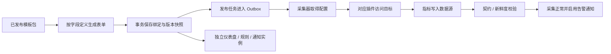

# 按分类模板添加监控设备：设计方案

日期：2026-10-30。状态：设计与交互原型，尚未实现本方案的通用业务功能。适用分支：`feat/snmp-device-management`。本方案取代此前“16 类配置页面”的设备添加原型；现有 SNMP 设备、模板和采集任务继续保留。

> 实现进度：首期分类目录、白色卡片/列表、基本信息与详细配置双入口、草稿发布及 Windows/Linux SNMP 三级选择已进入实际业务代码。接口和已实现边界见 [采集 API](../../api/collection.md#分类模板目录首期)；本文件与独立原型继续描述完整目标，数据库、硬件等执行适配按迁移计划推进。

## 1. 要实现的使用方式

管理员在**模板中心**创建分类，并为具体设备类型维护完整模板包：采集方式、设备添加表单、指标说明、仪表盘模板、告警规则及通知方案。使用者打开**新增设备配置页**，在表单内通过“设备类型 → 产品 / 厂商 → 版本 / 型号”三级联动下拉菜单完成选择；系统自动匹配已发布模板并展示所需参数；保存后，系统按照模板分配采集任务、实例化仪表盘和告警通知配置。

本轮的交互问题是：分类树能否表达“数据库 → MySQL → 8.0”和“服务器 → 戴尔 → PowerEdge R740”；模板编辑后是否能决定新增设备的表单；不同模板能否走各自采集方式，并保留已有设备的独立设置。原型只在浏览器内存中演示，不调用真实配置、设备或通知接口。

入口：[交互原型](prototype.html)。本地可直接打开 HTML；刷新分支预览：`python3 -B doc/design/template-driven-device-management/publish.py`。原型包含模板中心、模板编辑、分类管理、新增设备、模拟采集进度和设备专属资源。查看顺序建议为：**MySQL 8.0 → Windows SNMP → Dell R740 → 编辑模板并发布 → 再用新版本添加设备**。

## 2. 核心规则

| 用户要求 | 本方案的具体行为 |
|---|---|
| 统一配置采集、仪表盘、报警通知模板 | 同一模板包保存采集配方、表单定义、指标契约、仪表盘、告警规则、通知预设；一起校验、一起发布 |
| 模板按设备类型分类 | 分类树使用稳定 ID 和父子关系，界面首屏展示三级路径；层数由数据结构支持扩展，上级可聚合下级模板 |
| 选择模板后表单自动匹配 | 表单来自发布版本中的字段 Schema，前端不再按 MySQL / Windows / Dell 写不同的设备新增页面 |
| 添加后按模板采集 | 服务端按白名单适配器编译配置，经所选采集器执行；模板存在不等于采集器已经支持该插件 |
| 每台设备可调整 | 设备固定模板发布版本并创建独立资源，允许按设备覆盖参数、指标展示、仪表盘、规则和通知映射 |
| 一个采集器采多台设备 | 一个采集器可接多条远程任务；任务按监控对象区分，IP 不作为唯一键 |
| IP 只校验格式 | 不限制网段，不拒绝重复 IP / 端点，不用 IP 自动合并资产；其他必填参数和权限仍需校验 |

### 2.1 四个不能混用的“版本”

- **设备产品版本 / 型号**：分类中的 MySQL 8.0、SQL Server 2022、Dell R740、HPE DL380 Gen10。
- **模板发布版本**：例如同一个“MySQL 8.0 远程监控包”的 `1.0`、`1.1`，标识模板配置变化。
- **协议版本**：例如 SNMP v2c / v3，属于采集参数或模板支持能力。
- **实际探测版本**：从目标读到的数据库补丁版本、BMC 型号与固件。用于验证兼容性，不能用用户选择的分类冒充探测结果。

MySQL 8.0 分类下发布模板 `1.1`，仍然是 MySQL 8.0，不会自动成为 MySQL 8.4。硬件型号相同也不代表所有 BMC 固件的接口、权限和指标都完全一致。

## 3. 分类与模板组织

```text
模板中心
├─ 数据库
│  ├─ MySQL
│  │  ├─ 5.7
│  │  ├─ 8.0
│  │  └─ 8.4 LTS
│  ├─ SQL Server
│  │  ├─ 2019
│  │  └─ 2022
│  └─ Oracle
│     └─ 19c
├─ 服务器
│  ├─ 戴尔
│  │  ├─ PowerEdge R740
│  │  └─ PowerEdge R750
│  ├─ 惠普
│  │  └─ ProLiant DL380 Gen10
│  └─ 联想
│     └─ ThinkSystem SR650
├─ 操作系统
│  ├─ Windows
│  │  ├─ Server 2019
│  │  └─ Server 2022
│  └─ Linux
│     └─ 通用 Net-SNMP
├─ 网络设备
│  └─ 厂商 → 型号 / 系列
├─ 缓存与中间件
│  └─ 产品 → 版本 / 部署方式
├─ 容器、存储、云与拨测等
│  └─ 产品 / 厂商 → 适用变体
└─ 待归类
   └─ 旧组件与自建组件
```

这些路径是设计样例，不代表当前模板库已经具备对应硬件的已验证采集包。硬件与操作系统分开分类：同一台 Dell R740 可以同时关联“硬件健康”“Windows SNMP”“MySQL 实例”三条监控绑定，它们可使用不同地址、凭据和采集方式。

分类保存 `id,parent_id,name,sort,enabled`。模板保存 `category_id`，历史设备保存选择时的分类路径快照。改分类名称或移动目录不改变模板 ID、采集任务身份和已有监控对象；已有设备详情同时显示历史路径与当前路径。删除分类前必须迁移子目录和模板引用；禁用分类使其不能新增绑定，不停用已有设备。

同级同名分类需要给出明确处理，禁止目录循环。模板的展示名称和分类不替换原生 `builtin_component.ident`，避免破坏已有指标、仪表盘及告警资源的关联。

模板中心分类树顶部提供“全部展开”“全部折叠”，一键控制所有层级目录；各节点仍可单独展开 / 折叠。批量操作只改变目录展示，保留当前选中分类、搜索词、发布状态筛选和卡片 / 列表模式，不改变模板或设备配置。

可用于设备接入的模板应关联明确的第三级版本 / 型号分类；通用模板也应建立“通用”分类节点，避免只归在“数据库”或“MySQL”父目录而无法完成三级选择。

## 4. 模板包编辑

继续使用夜莺模板中心作为唯一目录，扩展组件的结构化接入定义。现有采集说明、指标说明、仪表盘、告警规则资源可以复用；不再把可执行采集定义只藏在 Markdown 的 TOML 代码段里，也不单独建立 SNMP 模板中心。

编辑器的页面分区如下：

| 页面 | 管理内容 |
|---|---|
| 基本信息 | 名称、分类、产品版本 / 型号、协议、适配器、执行位置、兼容范围、负责人、依赖 |
| 设备添加表单 | 字段名、字段键、控件、必填、默认值、秘密属性、条件显示、格式校验、帮助、分组 |
| 采集配置与指标 | 插件 / 配方、参数绑定、采集项、指标名及单位、必需标签、前置权限、样本契约、采集说明 |
| 仪表盘模板 | 布局、面板、指标表达式、变量、默认选项、设备范围参数 |
| 告警与通知 | 告警规则、阈值 / 持续时长、无数据规则、通知策略预设、消息模板、接收角色映射 |

可以新建空模板，或基于已有模板创建独立草稿。界面必须区分“保存草稿”和“发布新版本”：修改草稿不影响当前发布版，新增设备只选择已发布且具备可用适配器的版本。原型中的“发布”只更新本页内存。

### 模板展示与设备图标

模板中心支持**卡片 / 列表**切换。两种模式共享同一批模板、分类、搜索与发布状态筛选，切换不清空条件；列表展示图标、名称、分类路径、发布版本、采集方式、资源概况和操作。模式可以通过原型地址中的 `layout=grid` / `layout=list` 分享，不写入业务配置。**新增设备直接打开配置表单，使用表单内的三级联动下拉菜单；不先跳转到模板中心或目录卡片页面选择模板。** 模板中心仅管理分类和模板，卡片、列表与编辑页均不提供“添加设备”按钮或设备接入快捷操作；新增设备统一从设备列表进入。

卡片使用白色背景，沿用夜莺原模板中心的精简样式：桌面以紧凑网格展示，卡面只显示 logo 和设备模板名称，分类、版本及监控资源详情放在编辑页 / 列表中。鼠标悬停或键盘聚焦卡片时，右上角显示铅笔编辑图标和删除图标；点击右上角铅笔仅打开图标、名称、分类和启停等基本信息；点击卡片任意内容或空白区域进入其他详细设置。两个入口独立响应。触屏设备常显操作图标，避免依赖悬停。编辑页的基本信息保留图标导入功能。

删除先弹出确认框，仅移除当前原型内的模板，刷新恢复；仍被模拟设备引用的模板暂不允许删除，避免破坏已有设备的版本与资源快照。正式实现时需结合权限、停用及引用关系确定完整删除策略。

图标入口位于“编辑模板包 → 基本信息 → 设备 / 产品图标”。参考现有夜莺 `ComponentFormModal` 与 `LogoPicker`：可选择已有组件图标，或填写图片 URL / Base64；原型另外支持选择本地 PNG、JPG、SVG、WebP 文件，单张不超过 2 MB，并在应用前预览。初始图标来自仓库 `integrations/*/icon`，内嵌在 HTML 中，独立打开也能展示。服务器硬件示例先用 Redfish 协议图标，可自行替换为型号 / 厂商图标。

图标先应用到模板草稿，发布后出现在卡片、列表和新增设备摘要；草稿变化不修改已发布版本或旧设备快照。移除 / 图片不可用时显示默认占位图标。原型导入不上传服务器，刷新会重置；正式实现复用原生 `logo` 展示约定，文件存储、校验、访问控制与发布引用需在实现阶段补齐。

### 4.1 动态表单

表单 Schema 随模板发布，不随前端页面发版硬编码。首期支持文本、密码 / 凭据引用、数字、开关、下拉、多选、端点列表和条件字段。条件是声明式的相等、包含、全部满足；不运行模板提供的 JavaScript。

字段需要区分：

- 通用对象字段：名称、业务组、采集器、数据源、周期、可选资产关联。
- 模板字段：数据库账号、SNMP 认证、BMC 登录、TLS、采集范围等。
- 凭据字段：界面填写或选择凭据，服务端只在凭据存储中保存密文；普通读接口返回引用和是否已设置。
- 常量和派生字段：模板固定的插件、路径发现策略、保留标签，不允许用户覆盖。

切换模板时保留名称、业务组等通用字段，清除原模板专有字段和凭据，重新检查采集器能力。协议选择导致的隐藏字段不参与校验和下发，例如切到 SNMP v3 后不下发旧团体字。

### 4.2 典型表单

| 分类 / 模板 | 用户填写 | 采集方式与关键区别 |
|---|---|---|
| 数据库 / MySQL / 8.0 | 地址、端口、监控账号、密码、可选数据库 / 采集范围、TLS | 远程数据库协议；监控账号授权范围由采集项决定，不能统一要求 root |
| 数据库 / SQL Server / 2022 | 地址、端口、认证方式、账号密码、实例 / 数据库范围、TLS | SQL 登录使用账号密码；集成认证需受支持的执行身份和位置，不能把任意中央采集器当成 Windows 登录会话 |
| 数据库 / Oracle / 19c | 地址、端口、Service Name / SID、监控账号密码 | 连接标识与依赖按 Oracle 适配器核验，不照搬 MySQL 表单 |
| 操作系统 / Windows / Server 2022 | 地址、SNMP 版本、端口；v2c 为团体字；v3 为用户名、安全级别及适用的认证 / 加密字段 | SNMP 版本切换改变表单；本分支真实执行目前仅支持 v2c，v3 是待实现能力 |
| 服务器 / 戴尔 / PowerEdge R740 | iDRAC 地址、HTTPS 端口、iDRAC 账号密码、证书校验、采集范围 | 设计采用 iDRAC Redfish；型号、固件、资源路径和指标映射必须验证 |
| 服务器 / 惠普 / DL380 Gen10 | iLO 地址、端口、iLO 账号密码、证书校验、采集范围 | 设计采用 iLO Redfish；使用 HPE 对应发现 / 映射定义，不复用 Dell 固定路径 |
| 服务器 / 联想 / ThinkSystem SR650 | XCC 地址、端口、XCC 账号密码、证书校验、采集范围 | 设计采用 XCC Redfish；控制器代际、固件与硬件选件仍需核对 |

硬件监控中的账号是 **iDRAC / iLO / XCC 的账号**，不是服务器操作系统账号。硬件温度、风扇、电源、磁盘等采集项也不同于操作系统 CPU 使用率。

### 4.3 采集配方和指标契约

模板选择受控适配器，例如 `snmp`、`mysql`、`sqlserver`、`oracle`、`redfish`。适配器声明自己支持的协议、执行位置、输入字段、必要权限及输出契约。模板将字段绑定到适配器参数，不能通过任意 TOML / SQL / 命令绕过该契约。

服务端使用类型化配置序列化器处理端点、DSN、密码转义和标签；不能把密码简单拼接进模板字符串。采集器需要上报插件与版本能力，不支持相应输入的采集器不能被标为可执行。一个受支持的远程采集器可以采多台同类型或不同类型设备。

硬件配方先从 `/redfish/v1/` 做资源发现，再按已验证的关系和厂商定义取得指标。当前仓库的 Redfish 示例包含设备相关的固定路径，不能直接当成 Dell、HPE、Lenovo 通用包。

每个必需指标应声明来源、类型、单位和标签；仪表盘和规则引用的指标必须在契约中。探测既要验证权限和型号，也要验证实际样本是否包含必需指标。只有 HTTP 200、SQL 能连接或 SNMP 能返回 uptime，都不足以证明整个模板可用。

### 4.4 告警与通知是同一模板包中的两类配置

**告警规则**决定什么时候产生 / 恢复事件。**通知预设**决定事件发送给谁、通过什么媒介、用什么消息内容；只导入告警规则不等于已完成报警通知配置。

模板中统一维护：默认规则、默认启用状态、消息模板、通知节奏，以及“设备负责人 / 数据库值班 / 硬件运维”等逻辑接收角色。具体企业微信、邮件、Webhook、Token 等仍由夜莺原生通知媒介管理，模板通过授权引用和角色映射复用它们，不复制渠道密钥。

新增设备默认继承业务组的通知方案；也可明确选择本设备的通知媒介 / 接收团队，或选择“仅记录事件”。没有可用通知映射时必须显示“事件已启用，通知未配置”，不能显示“通知已生效”。模板预设不得引用当前用户无权使用的渠道或团队。

示例默认策略：Windows / Linux SNMP 延续已确认的 CPU、内存、磁盘 >90% 持续 5 分钟和 SNMP 采集中断；MySQL 使用可用性、连接占用等数据库规则；硬件使用部件健康、冗余和固件提供的阈值，不统一套用主机 90% 规则。数据库与硬件的具体阈值仍是设计默认值，发布前需结合实际指标确认。

仪表盘、告警规则和通知配置在绑定设备时创建独立实例，并强制限定当前监控对象。通知变量只使用允许的对象、规则、标签和数值上下文，不允许通过模板读取密码。

### 4.5 发布校验

发布必须检查：分类和兼容范围明确；适配器与字段引用有效；字段键唯一，默认值符合格式，秘密字段没有明文默认值；输出指标和必需标签完整；面板 / 规则的指标引用有效；通知变量与授权引用有效。真实执行支持尚未就绪时，只能保留为草稿或“仅资料包”，不得混入“可自动接入”的设备选择器。

变更字段类型、必需字段、协议、指标名或通知映射时给出变更摘要，发布新不可变版本。停用模板只影响新的绑定；现有设备是否停采必须单独操作。

## 5. 新增设备与执行闭环

### 5.1 页面流程

1. **设备类型与采集配置**：从设备列表点击“新增设备”，直接打开配置表单。表单顶部有“设备类型”“产品 / 厂商”“版本 / 型号”三个联动下拉框，依次选择；例如数据库 → MySQL → 8.0、服务器 → 戴尔 → PowerEdge R740、操作系统 → Windows → Server 2022。第三级选定后自动匹配已发布模板，在同一表单内展示对应采集参数、默认端口、图标及方案摘要。填写通用字段、采集器和凭据；可测试连接，不强制测试成功才能保存。
2. **仪表盘与告警通知**：默认应用完整模板包，确认采集范围、仪表盘、规则和通知映射，可在允许范围内做本设备覆盖。
3. **确认并添加**：展示分类、模板发布版本、采集执行点、脱敏参数、资源和通知结果。保存后进入执行状态跟踪。

三级下拉选项来自模板中心分类与已发布接入定义，不在设备页面写死厂商 / 型号。未选择上级时禁用下级；更改上级清空后续选择和原类型专属参数 / 凭据，保留对象名称、业务组、资产关联等通用信息。未完成选择不能继续，也不默认套用 MySQL / Windows 等模板。一个型号只对应一个已发布方案时自动选用；存在多个方案时，在当前表单追加“适用模板”下拉框，不跳转其他页面。草稿不出现在可选项中。返回上一步继续编辑时保留本次表单输入。

地址校验只验证所选字段的格式。IP 不设网段、重复性或端点唯一限制；同一 IP 的多个端口、数据库实例、硬件和操作系统可同时存在。对象 ID / ident 由系统分配，不能因为 IP 重复而接管已有 Agent Target。

### 5.2 保存与执行状态



数据库事务保存：监控对象、加密凭据引用、模板版本快照、参数、本设备覆盖、原生资源实例和待发布任务。凭据权限及采集器归属在事务内复核。外部采集、连接测试、真实通知发送不放在数据库事务内。

Outbox 工作器按绑定 ID 和配置修订幂等发布，支持有限重试和明确失败状态。状态至少包括：**已登记 / 待下发 / 采集器已获取 / 等待指标 / 采集正常 / 指标不完整 / 连接或权限失败 / 下发失败 / 已暂停 / 撤回中**。配置被获取不等于采集健康。

首批真实样本满足必需指标后，才解除初次接入的告警等待窗口；无数据告警从已激活时间和宽限期开始计算，避免新登记设备立即报采集中断。只读权限失败、型号不匹配、证书问题和网络超时分别显示证据，不凭一次失败臆断密码错误。

### 5.3 对象身份与资产关联

“设备”在此指监控对象，可以是服务器硬件、操作系统或数据库实例。一个 CMDB 资产可选关联多个监控对象；也允许先添加未关联资产的监控对象。不能按 IP 自动合并资产。首次绑定不新增或替换已有独立 Agent Target 的所有权。

为兼容当前链路，采集样本继续携带受保护的 `ident`、`collection_device_id`、采集器 ID、采集修订和受管模式标签；将 `monitor_device` 的语义扩展为监控绑定或在兼容层映射，不直接批量改写已有 ident。设备详情、仪表盘、规则和通知实例均由绑定 ID 和修订限制范围。

## 6. 版本、覆盖与生命周期

设备保存所选的不可变模板发布版本。公共模板发布新版本后，已有设备保持原样，界面提示“有可用更新”。升级预览按采集项、表单、指标、仪表盘、告警和通知分别给出差异及资源影响。

默认保留本设备覆盖。更新未覆盖项；覆盖冲突必须明确解决。只有用户显式选择“重置本设备覆盖”才替换定制。当前旧版 `refresh_template` 会重建资源并重置定制，新设计应提供独立升级流程，保留旧接口兼容而不把破坏性重应用当作普通保存。

回滚创建新的执行修订，不复用旧发布信封；历史模板、告警和时序样本保留。暂停设备撤回任务并暂停其规则；恢复时保留用户原来停用的规则状态。删除只撤销该监控绑定及其资源，不删除 CMDB 资产、同 IP 的其他绑定、独立 Agent 或历史样本。

通知预设也固定版本，模板修改接收方式不会静默改变已接入设备的通知路由。渠道停用、团队权限变化时将实例标成“通知配置失效”，保留告警事件，等待重新映射。

## 7. 现有架构如何承接

本节为拟实现方案，不执行迁移或创建生产表。

| 逻辑实体 | 关键字段 / 复用点 |
|---|---|
| 组件分类 | 稳定 ID、父 ID、名称、排序、启用；管理分类树 |
| 组件接入定义 | 关联原生组件 ID，分类、对象类型、适用版本 / 型号、Schema、适配器、采集说明和指标契约 |
| 模板发布版本 | 不可变包内容、版本、校验摘要、资源快照、通知预设、发布人 / 时间；扩展或复用 `monitor_template_version` |
| 监控绑定 | 复用设备、采集器与凭据模型；新增 / 扩展发布版本、参数、覆盖、资产引用、通知映射、期望 / 实际状态 |
| 原生资源归属 | 绑定 ID、资源类别、原生 board / alert_rule / notification 资源 ID、来源版本与覆盖标记 |
| 下发 Outbox | 绑定、修订、操作、幂等键、尝试次数、下一次尝试、失败证据；与绑定事务一起提交 |

模板中心仍复用 `builtin_component`、`builtin_metric`、`builtin_payload`。设备层复用 `pkg/collection` 的凭据加密、快照、发布、撤回、归属校验与原生资源实例化；按协议拆出适配器边界，先迁入当前 SNMP，再扩展 MySQL、Redfish 等。

采集器 Provider 当前只支持受管 SNMP 路径，不能因为 Categraf 有 MySQL / Redfish 插件就声称远程模板下发已支持这些插件。需要扩展下发协议、插件能力报告、重载行为、撤回和当前修订样本校验。

新增管理 API 建议沿现有组件路由扩展分类、接入定义、草稿、校验、发布和版本差异接口；设备 API 增加明确的发布版本、参数、通知映射及升级动作。接口名称在实施时确定，不改变被 n9e-plus 使用的已有导出签名。

分类、表单和发布管理只在 Center；edge / alert 若需要读取新规则 / 路由元数据，必须同时实现 DB 与 CenterApi 读取。告警规则、仪表盘、消息模板优先复用原生实例，不复制第二套告警引擎。

任何实际 Schema 变更必须一起维护 gorm、MySQL、PostgreSQL、SQLite 初始化与迁移 SQL，并验证升级已有 `monitor_*` 数据。SQLite 单测不能替代其他数据库验证。

## 8. 现有模板迁移与实施顺序

当前盘点基线为 89 个默认组件和 2 个自建组件，详见 [全部组件分类与接入计划](catalog-migration.md)。这份清单保留资料完整性，替换旧的“16 类通用表单”设计，不将它们全部标成已经能自动接入。

1. **P0：分类与模板包。** 分类树、结构化字段、草稿 / 发布版本、四部分资源与通知预设；保留原生组件 ID / ident。当前 Windows_SNMP / Linux_SNMP 转为兼容接入定义，已有设备快照不变。
2. **P1：用户指定的闭环。** MySQL 版本包、Windows / Linux SNMP、Dell R740 iDRAC 与 HPE DL380 Gen10 iLO。补齐对应真实适配器、能力协商、字段、指标、仪表盘、告警通知与采集器侧配置撤回，按设备实测后发布。
3. **P2：扩展数据库 / 型号。** SQL Server、Oracle、PostgreSQL、Lenovo XCC、网络 SNMP、缓存与常见服务；按产品 / 型号 / 版本复用基包并验证差异，不逐个复制整个前端表单。
4. **P3：复杂对象。** Kubernetes、多节点存储、云账号、推送接收通道和本机专项；各自采用节点 / 角色 / 范围 / 执行位置契约。未补齐的空模板保留资料浏览，不作为可执行模板发布。

每个模板的验收都需要：字段匹配 → 采集器能力匹配 → 真正从目标取得指标 → 指标标签匹配仪表盘 / 规则 → 真实事件触发 / 恢复 → 使用测试接收端验证通知 → 暂停 / 删除撤回，且不影响同 IP 其他绑定。

## 9. 设计验收与本轮交付边界

| 场景 | 原型应展示的结果 | 实施阶段必须补的真实验证 |
|---|---|---|
| 数据库 → MySQL → 8.0 | 账号密码、端口和采集范围；保存后显示数据库采集计划 | 最小授权、版本识别、插件指标与通知 |
| 服务器 → 戴尔 → R740 | iDRAC 表单及 Redfish 采集项；不出现数据库认证字段 | 实际型号 / 固件、资源发现、指标完整性 |
| Windows SNMP v2c / v3 | 条件字段切换，隐藏字段不下发 | v3 执行器尚未实现，不计为当前支持 |
| 新建 / 修改模板表单并发布 | 新版本可以在新增设备中选择，并显示新字段；草稿不会泄漏到设备选择器 | 服务端 Schema 校验、权限、不可变版本 |
| 同一 IP 添加硬件与数据库 | 两条独立绑定，不因 IP 重复而拒绝 | 归属标签、共享采集器、资源隔离 |
| 不测试直接保存 | 已登记 / 等待采集，不伪造“采集正常” | Outbox 重试、真实样本新鲜度 |
| 改模板但不升级旧设备 | 旧设备维持原版本与独立覆盖 | 升级差异、冲突、回滚与原生资源历史 |
| 无通知映射 | 明确显示仅有事件、通知未配置 | 权限、失效渠道、原生通知路由与测试接收端 |

本轮只编写设计和独立交互原型；不修改业务代码、数据库、真实设备、采集器或通知配置。原型中的模板、账号、IP、图表和状态都是示例，刷新后重置。原型地址控件先演示 IPv4；实施时 IP 格式校验应覆盖 IPv4 / IPv6，仍不加网段或重复性限制。原型的字段编辑、面板与规则编辑只演示关键交互，完整原生编辑器与适配器尚待实施。浏览器验证是 Agent 工程检查，人工验收仍由用户完成。

新版发布时保留夜莺业务 UI 和现有架构图。旧设备添加原型归档到旧目录的 `archive/2026-10-28/`，保存原字节；原主入口改为指向新版的说明页，不再把旧版作为当前方案。架构图中的旧原型相关描述代表其绘制时点，本轮保持图形文件不变。

## 10. 依据与硬件兼容性

- 当前分支实现：[采集 API](../../api/collection.md)、`pkg/collection/profiles.go`、`frontend/src/pages/collection/DeviceEditor.tsx`、原生模板中心及 `integrations`。
- MySQL、SQL Server、Oracle 参数依据仓库相应 `collect` 文件；它们只是参数与适配器的起点，不是本分支已实现动态下发的证明。
- Dell 提供 iDRAC Redfish API 与不同代际 / 固件文档；R740 采用 iDRAC Redfish 的方案需要按实际设备验证。[Dell 官方说明](https://www.dell.com/support/kbdoc/en-us/000178045/redfish-api-with-dell-integrated-remote-access-controller)
- HPE 为 iLO 5 提供按固件组织的 Redfish 文档；Gen10 / iLO 5 的管理能力和版本关系参考其官方资料，不能使用 Dell 的固定资源路径。[HPE iLO 5 文档](https://servermanagementportal.ext.hpe.com/docs/redfishservices/ilos/ilo5)、[HPE 工具支持说明](https://servermanagementportal.ext.hpe.com/docs/redfishclients/ilorest-userguide)
- Lenovo XCC 通过 HTTPS 暴露 Redfish 管理接口；具体 SR650 代际与 XCC 固件仍需建立验证矩阵。[Lenovo 官方接口说明](https://pubs.lenovo.com/xcc-restapi/)

以上厂商资料只支持选择协议与区分控制器的设计，不足以证明仓库当前 Redfish 示例已经覆盖所有型号、固件、选件和传感器。原型不把示例硬件模板标成实机测试通过。
