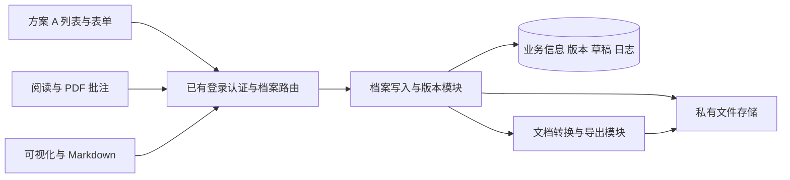

# 档案管理开发方案

版本：v0.2。基线：main a20cd71f。实施分支：feat/feature-planning。状态：产品边界已全部确认，技术小样本通过，开始真实开发。

档案管理采用已确认的方案 A 列表，整合培训服务、巡检报告、故障报告和其他文档。正式实现包括业务留档、多份资料、长文阅读、PDF 批注、可视化与 Markdown 双模式、版本恢复、独占编辑和操作日志。完整范围以[需求 v0.3](requirements.md)为准。

用户已授权：先解决开发方案中的问题，确认无阻塞后开始真实开发。已完成方案整理和用户要求的初步技术验证；不把尚未验证的编辑器能力写成完成结果，不通过删减需求绕过问题。提交、推送、PR、合并和生产发布仍不在授权内。

## 1 已确认的产品决定

| 项目 | 结论 |
| --- | --- |
| 入口与列表 | 一级菜单档案管理；采用方案 A 的标准表格、main 的菜单和视觉风格。正式页面移除原型标记、A/B/C 切换及模拟按钮。 |
| 四个 Tab | 培训服务、巡检报告、故障报告、其他文档；其他文档的类型手填。 |
| 业务字段 | 保留截图字段；培训默认正常，巡检正常/异常，故障Ⅰ～Ⅳ级，人员部门手填。 |
| 状态与材料 | 草稿/已归档；归档需材料齐全；在线讲义/报告可计入，培训签到必须上传。 |
| 编辑与阅读 | 独立整页；Word 导入在线内容，原件保留；PDF 阅读与批注；从空白创建。 |
| Markdown | 同文档双向切换；基础正文可编辑；复杂对象只读占位保留；转换失败不能覆盖原稿。 |
| 账号与并发 | 所有已登录账号可操作；保留登录认证；同一文档只允许一个编辑会话。 |
| 容量与历史 | 沿用需求中的 50 MiB、20 份、500 MiB 等限制；历史不自动清理。 |
| 交付约束 | 未来闭源交付给客户，优先无商业授权费；可接受本地文档处理服务和 Office 式工具栏，但未选定任何收费编辑器。 |
| 排除范围 | 不迁入旧资料，不做 OCR、审批、模板中心、设备/客户/告警关联、独立评论、水印或多人协同编写。 |

系统内的 Markdown 模式不是另一份独立文档。当前已确认的上传格式是 DOCX、PDF、PNG、JPG/JPEG；用户已明确首版不做独立 .md 上传下载，正式导出为 PDF/DOCX。Word 以可编辑内容完整和系统内输出一致为准，复杂布局先确认，不要求与原 Word 逐页、逐像素一致。

## 2 仓库现状与工作隔离

2026 年 10 月 23 日核对结果：本地 main、origin/main 和远程 main 实际提交均为 a20cd71fa270add91098179b83f4441b4fba2f80。前后端同仓维护，不需要两个业务仓库。工作在独立目录 /home/zt/.paseo/worktrees/0b0hlox2/feature-planning，不切换 hip-panther 或其他同事工作区。

本任务保留需求文档、已确认的前端原型，以及后续正式实现；均尚未提交。原型来源、版本和截图保留为样式依据。其他分支的 CMDB、机柜或报表改动不并入本任务。正式实现由一个主要写入者完成，不重构无关模块。

开发预览沿用本工作区独立的 PostgreSQL 数据库、miniredis、运行目录和 dev2 槽位。稳定域名不承载本分支，生产服务和生产资料不参与开发验证。

## 3 复用已有代码与新增范围

| 范围 | 实际文件 | 处理方式 |
| --- | --- | --- |
| 菜单与页面布局 | [menu.tsx](../../../frontend/src/components/SideMenu/menu.tsx)、[PageLayoutWithTabs](../../../frontend/src/components/pageLayout/PageLayoutWithTabs/index.tsx) | 增加一级档案管理及四类页签；沿用布局、主题与图标，不复制一套应用外壳。 |
| 页面注册 | [routers](../../../frontend/src/routers/index.tsx)、[notificationRules entry](../../../frontend/src/pages/notificationRules/entry.tsx) | 按已有动态页面入口约定注册正式档案页面，文档编辑和阅读按需加载。 |
| 表格与操作 | [EnhancedTable](../../../frontend/src/components/EnhancedTable/EnhancedTable.tsx)、[RowActionCell](../../../frontend/src/components/EnhancedTable/RowActionCell.tsx) | 复用查询、分页、表格和行操作；类别配置决定字段，避免复制三份相同 CRUD。 |
| 请求与会话 | [request.tsx](../../../frontend/src/utils/request.tsx)、[router_mw.go](../../../center/router/router_mw.go) | 沿用 token 刷新、错误处理及 auth/user；档案不挂 admin 或业务组限制。上传、下载同样验证登录。 |
| Markdown | [MarkdownEdit](../../../frontend/src/components/MarkdownEdit/index.tsx)、[Markdown](../../../frontend/src/components/Markdown/index.tsx) | 复用已安装编辑基础与主题；在档案模块加入安全渲染、托管图片和复杂块规则，不改写其他页面的 Markdown 行为。 |
| 版本差异 | [frontend package](../../../frontend/package.json) 中已有 diff | 可参考文字差异；不能用字符串差异代替表格、图片或二进制附件差异。 |
| 路由与数据库 | [router.go](../../../center/router/router.go)、[migrate.go](../../../models/migrate/migrate.go) | 新增档案路由、模型与本功能表；不挪用告警、仪表盘、Skill 的数据表。 |
| 正式文档、PDF、文件存储 | main 无本需求的完整实现 | 新增；原型的 contentEditable、示例 PDF 和内存保存不作为可交付能力。 |

现有 Skill 文件保存的是 Skill 语义，不适合作为 50 MiB 二进制文档、版本或 PDF 批注的通用存储。现有 AuthorizationWrapper 依赖资源权限字典，本次不把它直接套在所有账号开放的操作上。

## 4 免费编辑器路线与验证条件

### 采用的实现路线

采用 Canvas Editor，组合其 DOCX 能力和项目现有 Markdown 编辑基础；正式包固定版本，按下述模块适配。正式实现固定 Canvas Editor 1.0.5、DOCX 插件 1.0.0，采用 MIT 路线；不引入原生 Markdown 插件或收费分页组件。固定依赖与字体声明随包保留，运行环境见[档案说明](../../api/archives.md)。候选资料见[编辑器项目](https://github.com/Hufe921/canvas-editor)、[MIT 许可证](https://github.com/Hufe921/canvas-editor/blob/main/LICENSE)、[官方插件及许可证](https://github.com/Hufe921/canvas-editor-plugin)。

初步查询的发布版本为 Canvas Editor 1.0.5、DOCX 插件 1.0.0、Markdown 插件 0.0.1。它们已在本实例的临时验证目录完成基础兼容验证，正式开发再加入业务依赖与锁文件。初步验证覆盖 TypeScript 4.9、Vite 4 生产构建、保存重开、Word 新实例导入、复杂对象保护、9 页长文及文字层 PDF；范围和局限见[技术验证](technical-validation.md)。

Markdown 插件不能直接被视为已满足复杂对象保留。正式转换由档案文档模块控制，必须核对类型、对象身份和样式元数据，保留复杂对象原始结构。

ONLYOFFICE 暂不纳入已选依赖。其社区版官方说明列有源码提供和品牌要求，商业嵌入另有 Developer 路线；不按“免费且可直接闭源交付”作出选型。Tiptap 的现成分页产品属于 Pro，不把它当成无收费依赖的现成能力。依据：[ONLYOFFICE 许可说明](https://helpcenter.onlyoffice.com/docs/faq/docs-community.aspx)、[Developer 说明](https://www.onlyoffice.com/developer-edition-prices)、[Tiptap Pages](https://tiptap.dev/docs/pages/getting-started/overview)。

PDF 阅读优先评估 PDF.js，使用本地打包的 worker、字体及字符映射资源；不依赖公共 CDN。PDF 批注、版本、作者和日志由档案模块维护，不依赖浏览器临时批注状态。[PDF.js 官方分层说明](https://mozilla.github.io/pdf.js/getting_started/)

### 开始业务实现前的技术验证

| 验证 | 必须观察到的结果 | 不通过时的动作 |
| --- | --- | --- |
| 项目兼容 | Node 24、现有 React 18、Vite 4、TypeScript 4.9 可构建候选集成；核心页面保持延迟加载。 | 先处理兼容性，不为一个模块擅自升级全仓工具链。 |
| 正式排版 | 中文标题、长段落、跨页表格、图片、封面、页设置、页眉页脚、页码能保存重开。 | 说明缺失能力，调整候选或提出具体实现方案。 |
| Word 导入导出 | 基本文本、表格、图片可编辑，原件不变；PDF/DOCX 对应当前版本。复杂布局有明确提示。 | 不把损坏、缺图或空白导出当成功。 |
| Markdown 往返 | 修改基础正文后，复杂表格/图片、页设置及页眉页脚仍在；缺失、重复或未知占位可被识别。 | 保留原稿并说明原因；先沟通，不能静默丢内容或取消双模式。 |
| PDF 与打印 | 阅读、PDF 导出及打印使用一致的版面来源；长文、中文、图片和分页可核对。 | 明确转换或渲染缺口，不用示例文件冒充导出结果。 |
| 断线恢复 | 可读取真实编辑快照；10 秒草稿、刷新恢复和正式保存可区分。 | 不依赖编辑器内部不可访问的临时状态作恢复承诺。 |
| 依赖与运行环境 | 固定直接/传递依赖、许可证和字体；不启用宏、AI 或未要求的外网能力。 | 不采购或引入未确认的商业模块。 |

初步技术验证代码位于独立运行目录，不访问业务数据库、不改变 main 菜单、不替换已确认的样式预览；正式集成继续补齐覆盖，不把小样本当成完整业务验收。若上述关键项仍有问题，记录复现文件和实际差异后沟通。

## 5 模块职责与数据流

前端页面只负责表单、查询、阅读交互和保存状态。档案写入模块集中处理材料校验、容量、正式版本、编辑占用及日志，避免把一致性规则散落到三个 Tab。文件内容和编辑器内部数据不从页面直接写数据库。

拟新增前端目录 frontend/src/pages/archiveManagement，包含 entry、列表、表单、详情、阅读、编辑、请求封装与类型。字段配置共用，类别验证保留独立规则。原型目录只保留参考，正式入口不导入原型 fixture。

后端在 center/router 增加薄路由处理，在独立档案包内组合业务写入、文档转换与私有文件存储，在 models 中提供可迁移模型。只为实际变化的文档格式或执行环境设置适配位置，不搭建通用插件平台。不改 n9e-plus 使用的现有导出函数签名。

首版仅供 Center 的 UI 使用，不让 edge/alert 读取档案，因此不新增相关 memsto 缓存或 /v1/n9e 同步通道。若以后产生这类消费者，再同时补齐 DB 与 CenterApi 路径。

## 6 数据与存储设计

### 主要对象

| 对象 | 保存内容与约束 |
| --- | --- |
| 档案 | 类别、统一状态、业务字段、创建/修改账号、主文档、当前正式版本、删除标记与修订号。类别字段用类型化验证；搜索投影只能由同次写入生成。 |
| 档案版本 | 不可变业务字段快照，以及采用的文档版本/批注版本清单。用于整条恢复和一致导出。 |
| 文档项 | 所属档案、名称、用途、来源、格式、当前正式版本、原件关联。不同档案不共享可变文档身份。 |
| 文档版本 | 不可变正文快照或文件对象、格式版本、摘要、操作者、说明和父版本。恢复创建新版本。 |
| 文件对象 | 随机存储键、真实格式、字节数、内容摘要和上传状态。原件与正式版本不可就地覆盖。 |
| 编辑会话与草稿 | 文档、账号、会话、租约代次、基础正式版本、过期时间及最新草稿。不与正式版本混存。 |
| PDF 批注版本 | 所属文件版本、页码、坐标、类型、内容、作者与修订。换文件不复用旧坐标。 |
| 操作日志 | 真实登录账号、当时显示名、时间、对象、动作、前后版本和结果。普通账号不能改删日志。 |
| 阅读书签 | 账号、文档版本、页码/锚点及更新时间。个人位置不形成业务权限隔离。 |
| 转换与导出任务 | 输入快照、状态、错误、输出摘要及重试身份；失败不能改当前正文或原文件。 |

最终物理表名与字段在技术验证通过后固定。业务信息存数据库，二进制和图片存私有文件目录，不写入 frontend/public，也不把大文件编码进 JSON 列。对所有快照记录 schemaVersion，以便未来显式升级数据格式。

### 文件写入与容量

上传先进入本实例的暂存目录，校验实际大小、格式和可解析性，再原子写入不可变文件对象。数据库事务绑定档案、资料版本与日志；失败只留下可识别的未绑定对象，不产生“显示保存成功但文件缺失”的记录。

容量检查在服务端完成，并考虑并发上传的预留空间。替换保留旧版本；历史不计当前 500 MiB 配额但占真实磁盘。Word 导入若创建额外文档项，先检查 20 份上限，不能导入后再发现超限。在线图片使用受控资产标识，不保留临时 blob URL 或重复内嵌编码。

暂存文件拟在 24 小时后、确认没有正式版本/草稿引用时回收。转换产物按输入版本标识，可重建；原件、正式历史和日志不按此规则清理。备份必须同时覆盖数据库、文件对象和关联清单。

### 数据库兼容

增加本功能表时同步 gorm、MySQL 初始化/迁移 SQL、PostgreSQL 初始化 SQL和 SQLite SQL，分别验证。只执行独立测试/预览数据库的新表初始化，不操作生产数据库，不迁入旧系统数据。数据库启动失败要向预览报告，不能只看 HTTP 存活。

## 7 写入一致性与恢复

所有修改携带基础修订号；服务端发现内容已变时返回冲突及当前版本，不能静默覆盖。正式写入、版本快照和成功日志在同一数据库事务中提交。涉及文件时，先确认文件对象已落盘，事务再引用；历史文件引用参与清理检查。

同文档编辑租约放数据库，不能仅依赖进程内内存或会重启清空的 miniredis。每个会话有独立标识与递增代次，包括同一账号的第二个窗口。30 秒心跳、5 分钟失联过期；每次草稿和正式保存都校验会话、代次、过期时间及基础版本。过期旧页面不得写回。

业务信息更新用修订号防止两个表单相互覆盖。不同文档可同时编辑，正式提交时串行更新所属档案的当前版本清单。删除、恢复、替换、归档遇到关联文档占用时返回明确冲突，不绕开租约修改。

10 秒自动保存仅更新该会话草稿；显式保存、替换、归档与恢复形成正式版本。已归档记录编辑期间，其他阅读者继续读取旧正式快照。正式保存完成后状态仍为已归档，形成新归档版本。断网恢复内容按账号、文档和基础版本隔离，先提示再恢复，不自动覆盖服务器新稿。

## 8 Markdown 保留规则的实现设计

采用一份规范化文档快照作为内容源，包含正文、页面设置、页眉页脚、复杂对象及稳定标识。Markdown 是同一快照的可编辑投影，不是把整个 DOCX 导出为普通 Markdown 后重新导入来替换原稿。

基础内容映射为 Markdown 语法。复杂对象用受控只读占位和快照中的原始结构对应；页设置、页眉页脚、页码保存在版面元数据里。切回可视化前，验证占位标识唯一、存在且属于本次基础快照，再把修改后的基础正文与原对象组合。用户未修改的对象和属性继续保留。

Markdown 不能注入任意 HTML、脚本、文件路径或远程资源地址。重复、未知或缺失占位不直接执行删除；明确提示回到可视化模式修改复杂对象。发生不支持的内容或无法判断的映射时，不覆盖原文，可复制当前 Markdown 以免丢输入。

技术验证至少覆盖：完全不改往返、修改普通段落、在复杂对象前后增删段落、普通表格、合并表格、图片、页眉页脚、手工分页、重复文字，以及占位缺失/重复/未知。保存、刷新重开和导出后再核对，不能只比较编辑器里一次切换后的截图。

## 9 阅读 批注与导出

PDF.js 提供页码、缩略图、连续/分页、文字层查找、缩放和全屏；阅读页复用 main 的外层控件。扫描 PDF 可按图片阅读，不显示虚假的全文检索能力。

高亮、划线与文字备注使用 PDF 页坐标保存，不用当前屏幕像素作永久定位。验证旋转、缩放及不同页面尺寸下位置稳定。批注与文件版本绑定，修改批注也取得同文档租约。带批注 PDF 从原件及指定批注版本生成，不改变原始 PDF。

在线文档以同一已保存快照生成阅读、PDF/DOCX 和打印内容。原件下载返回原始字节；导入结果和编辑稿明确区分。整条档案 ZIP 先固定版本清单，再生成信息 PDF、当前资料及对应导出件；中途保存不能把两个版本混在一个包里。下载、导出、打印发起保留操作日志。

在线文档的目录/文字查找不能只依靠画布图像。导出需要核对字体、图片、分页、文字可读性和内容完整性；若候选只能产生图片式 PDF，要把影响列出后沟通，不默认为已经满足全部阅读能力。

## 10 接口与认证

计划使用 /api/n9e/archives 资源族，保持项目响应和错误规范。以下是职责划分，最终接口契约在实现时补充到 doc/api，不让前端拼存储路径。

| 职责 | 操作 |
| --- | --- |
| 档案 | 列表、详情、新建、修改字段、归档、可恢复删除、批量删除、恢复。 |
| 资料 | 上传暂存、绑定、指定用途与主文档、替换、原件/当前版本下载。 |
| 编辑 | 取得/续期/释放租约、读取草稿、自动保存、正式提交、切换模式验证。 |
| 历史 | 档案及文档版本列表、内容差异、指定版本恢复、人员日志、个人书签。 |
| PDF | 读取/保存批注版本、下载原件及带批注稿。 |
| 导出 | 固定版本的 PDF/DOCX、档案 ZIP、任务状态与结果下载。 |

全部用户入口使用现有登录认证，普通账号与管理员的档案功能一致。文档、图片、文件 Range 请求和历史下载同样需要登录；不生成永久匿名文件链接。

导出使用本机离线 worker：固定 Node 24 文档序列化程序和 LibreOffice 转换进程，不新增对外 HTTP 编辑服务。浏览器导出与服务端 ZIP 由同一规范化快照生成，避免两套格式逻辑。打包时固定 worker、依赖版权声明、LibreOffice 和字体；worker 不依赖用户机器上的开发 node_modules。每次转换使用实例私有配置、临时目录和受限并发，设超时并关闭外链及宏。内部交互使用有范围和时效的内部凭据，不能让用户输入的 URL 成为任意服务端抓取目标。不新增 ONLYOFFICE 容器、公开编辑端口或外部文档域名。

文件校验包括扩展名与实际内容、损坏文件、压缩包膨胀、加密文档、路径穿越、图片尺寸和容量。Markdown 及导入内容只在本模块的受控渲染路径展示，不修改现有页面全局安全策略来迁就新文档。

## 11 分步实施与验收

| 阶段 | 实施内容 | 通过条件 |
| --- | --- | --- |
| P0 技术验证 | 固定候选和许可证；运行分页、DOCX、Markdown、保存重开及导出验证。 | 第 4、8、9 节的关键能力有实际证据；问题已沟通，不存在被隐瞒的功能削减。 |
| P1 档案和资料 | 新模型、私有文件存储、登录保护、四类业务校验、状态、正式方案 A 列表/表单/详情。 | 真实请求和持久化闭环；资料必填、限额、替换、删除恢复及失败路径可验证。 |
| P2 文档编写 | 可视化、Markdown、图片、页面排版、10 秒草稿、正式保存、租约。 | 刷新/重登可续写；双模式保留规则及双窗口拒绝写入成立。 |
| P3 阅读与历史 | PDF 阅读批注、在线阅读、书签、版本比较恢复、操作日志。 | 坐标稳定；恢复产生新版本；已归档修改不泄漏未提交草稿。 |
| P4 导出与闭环 | PDF/DOCX、原件、带批注 PDF、整条 ZIP、打印及备份说明。 | 导出与固定版本一致，原件不被覆盖，失败可重试。 |
| P5 工程与人工验收 | 代码审查、数据库兼容、完整验证、隔离预览 E2E、人工验收。 | 检查结果及构建身份可追溯；用户单独确认实际业务体验。 |

这些是同一版完整范围的实施顺序，不是把未完成能力从首版删除。关键步骤有问题先沟通；技术验证通过、设计无阻塞后，按已有授权继续真实开发，不再重复请求“开始”。

## 12 测试与交付

| 层次 | 要验证的行为 |
| --- | --- |
| 模型与写入 | 四类字段、资料要求、并发配额、状态、原子版本/日志、正式稿与草稿分离、删除恢复。 |
| 文件与格式 | 真实 DOCX/PDF/图片、损坏/加密/超限输入、中文和长表、复杂块往返、导出版本一致性。 |
| 并发与故障 | 双账号及同账号双窗口；租约过期旧会话；不同文档同时提交；断网、刷新、存储失败和任务重试。 |
| 认证 | 匿名读取/写入拒绝；普通账号可用；被禁用账号和失效会话拒绝；文件与历史不能绕过登录。 |
| 数据库 | SQLite 行为测试；独立 PostgreSQL 实测；MySQL 新表和写入兼容验证。缺少环境保留未验证项，不算通过。 |
| 页面 | 方案 A 视觉、四 Tab、筛选分页返回、深链接刷新、真实新建/上传/编写/阅读/批注/恢复/导出。 |
| 原功能回归 | 错误密码拒绝、正常登录、仪表盘、告警列表、原菜单和静态资源正常。 |

开发中先跑相关行为测试，再执行 make verify；完整交付前按项目要求执行 make verify-all 并报告失败/跳过。依赖修改核验固定版本、锁文件、冻结安装、生产构建和 Jest。新增功能不靠原型自测替代真实接口/存储/浏览器链路。

正式功能预览切回同仓 frontend 构建，不继续用原型 file-assets 冒充正式应用。刷新隔离实例，核对 sourceChanged/frontendChanged、本地/公网身份和实际浏览器页面，记录新的 build ID。保留方案 A 的旧原型证据，不部署到稳定域名。

交付分别报告自动检查、Agent 浏览器验证、人工验收及生产发布状态。人工验收由用户完成，不替用户勾选。代码、源码资源、SQL、接口文档、运行配置说明、依赖版权声明、备份和回退步骤一并交接；未经授权不提交、不推送、不创建 PR、不改生产环境。

## 13 开始实施前的设计审查

2026 年 10 月 23 日审查结论：产品问题已逐项确认，可以按本方案实施。无商业授权费路线的基础验证通过；正式集成、完整格式矩阵及业务验收属于后续开发检查，不能提前宣称通过。

已处理的设计问题：现成 Markdown 转换会破坏合并单元格，因此采用受保护复杂块；正式稿与草稿分离；同文档租约落数据库；大文件走私有对象而非 Skill/公共静态目录；导出固定版本清单；三种数据库分别维护 SQL；新功能只消费 Center，不修改 edge/alert 或 plus 公开接口。

用户确认的最后两项为：不做独立 .md 上传下载；Word 以可编辑内容完整、系统内输出一致为准，复杂布局先展示转换结果再确认。需要新增范围或已确认规则无法满足时再沟通，不把普通实现问题转成反复请求开发许可。

## 14 实施与交接记录

正式实现和验证结果见[实施验证](implementation-verification.md)。技术验证中的临时编辑器页面继续留作证据，不是当前功能入口。正式页面使用同仓构建、真实接口和预览实例自己的数据库、文件目录。
