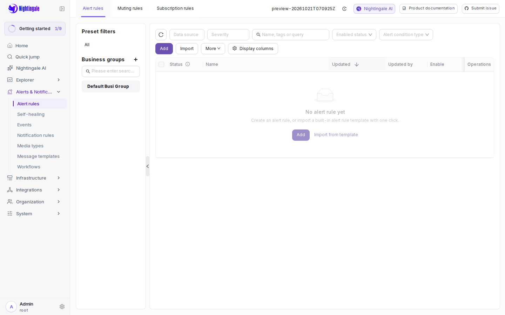

# 同仓前端迁移验证

任务基线 `e4972c82`。迁入 `n9e/fe v9.2.0`，提交
`58e8e242e88d834282bbeb8da9a5dd8d38100d17`，源码归档 SHA256 见
[UPSTREAM.md](../frontend/UPSTREAM.md)。前置调查见[可行性分析](frontend-source-integration-feasibility.md)。

## 设计与审查

- 采用普通目录 `frontend/`，前后端同提交维护；保留现有 Go 入口和 statik 包路径。
- 固定 Node 24.22.0、pnpm 10.32.1，保留原直接依赖的锁定版本，显式补齐 17 项源码依赖。
  pnpm 11.5.2 在本机对此依赖树反复元数据超时；隔离对照后选择 pnpm 10.32.1。
  没有降低 Node 要求，也没有跳过 frozen 安装、类型检查或测试。
- 正常预览、QA 语料和发布均使用同仓源码，不再下载上游 UI。外部 UI 仅为显式联调入口。
- 两个只读 Agent 分别完成 Standards 与 Spec 审查。发现并关闭了忽略配置漂移、
  NODE_ENV 缓存混用、并发 statik 嵌入三项问题，补充了实际回归测试。
- 生产构建固定 NODE_ENV=production；安装显式包含构建所需 devDependencies。
  原始 `.githooks/pre-push` 未修改，不使用 hook 包装器或跳过选项。

## 上游适配

- Ant Design Segmented 声明文件补丁只修正过期的 React event keys，不改库的运行代码。
- Jest 的 ESM 转换支持 pnpm 路径；Plus 私有测试导入替换为公共扩展接口的测试夹具。
- 原有 Grafana 导入测试适配实际 4.1 schema，保留查询、嵌套面板及迁移幂等断言。
- QueryForm 独立初始化由现有首帧和编辑回归覆盖，精确排除旧的全局 AST 禁令。
- 旧 Table 升级缺省 options 会抛错；通过已有失败用例复现，并以 optional access 修复。
- 新 UI 的错误页使用 WebP；为后端静态资源路由补齐后缀，先复现返回 SPA HTML
  而非图片的失败，再验证文件资源、内嵌资源及缺失图片 404 两种路径。

没有以 skip 或删除失败用例来取得 Jest 通过。pnpm 转换仅维护 pnpm-lock.yaml，
原 npm 锁文件可从固定上游归档恢复；转换审查确认原直接依赖版本没有变化。

## 已取得的证据

- 冻结安装成功，生产类型检查及 Vite 打包成功。完整 Jest 首轮修复后为
  197 suites / 1772 tests passed。
- Python 设施测试 25 项通过；Go 当前验证为 2618 passed、0 failed、39 skipped。
  外部服务未配置的 skip 不算通过。
- 使用固定 CATEGRAF_REF=v0.5.15 生成 QA 语料，核对前端包包含当前 src/App.tsx，
  不包含 src/plus、测试目录、测试文件或公开测试夹具。
- 首次统一验证因构建期间又调整嵌入脚本而触发源码漂移保护，结果记录为失败；
  随后冻结输入，重跑原始 `make verify` 入口通过，该失败不作为通过证据。
- `N9E_TEST_FRONTEND_DIR="$PWD/frontend/pub" go test ./front/statik -count=1` 通过，
  逐文件比较生产资源与内嵌资源的 SHA256。
- `python3 -B scripts/preview-smoke.py` 通过：两个一次性 worktree 验证同仓前端身份、
  槽位竞争、内部 API/伪造身份拒绝、独立凭据和数据库、源码/前端漂移、改密后刷新、
  stop 隔离、destroy 幂等及槽位复用。临时实例和 worktree 已清理。
- `make verify-all` 通过，含 vet、全量 integration action 及 i18n 检查；Go 的
  39 项跳过仍未验证，不能把两项模板集成门禁当成外部数据库服务测试。

首次浏览器检查暴露了两处测试夹具问题：仪表盘合法添加的 querystring 被精确 URL
断言拒绝；过期令牌在每次页面跳转后被夹具重新注入。已改为核对 pathname，并只
注入一次令牌，使应用自身的 401 清理生效；仍保留错误密码、真实登录、刷新及失效
会话的行为断言。第一次状态探测也曾拒绝执行，后续探测恢复后才运行用例，未跳过入口。
截图复核还发现刷新后的断言会在加载画面阶段通过；已增加等待预加载器移除、对应
页面列表及名称列渲染的断言，分别在进入页面与刷新后执行，截图也在这些断言之后获取。

## 运行实例与最终检查

`make all` 通过，同仓 UI 成功嵌入并编译为 Go 二进制；最终前端验证仍为
197 suites / 1772 tests passed。内嵌资源逐文件比较再次通过。

Agent 执行 `make frontend-e2e`：3 项通过，包含匿名 API 401、错误密码拒绝、
正确登录、仪表盘与告警规则页进入及刷新后列表加载完成，以及过期令牌返回可用登录页。
用例检查同源失败响应和页面异常；不录制含登录请求的 trace/video。

- 地址：`https://n9e-dev0.cubbber.dev`，development / basic。
- 浏览器检查 build ID：`20261021T070925Z-249d8340`，迁入工作区构建。
- 前端源码指纹：`bfc1db71965d8e62ae5d8ad19d7fc40610267cf0e5b819b0750a2d77b8e58958`。
- 资源 SHA256：`ff53f78f5575ce5bd4a15e8bd37b8b9b170968d8d2415fc3f179f065efe4275a`。
- 启动时 sourceChanged/frontendChanged 均为 false，本地与公网探测通过。
- WebP 本地/公网响应均为 image/webp，字节与生产输出一致。公网默认 Python UA
  曾收到 Cloudflare 1010；浏览器 UA 与实际 Playwright 请求通过，未修改入口访问规则。

截图与上述浏览器 build 对应；随后只补交付证据及提交元数据。最终提交后的交付
build ID 与原始 pre-push 结果记录在 PR 中，交付地址前重新刷新并核对身份。
vet 和全量模板门禁结果复用的依据是：后续仅加强浏览器夹具等待及交付资料，未改
相关 Go/模板输入；生产构建、Jest、嵌入及浏览器检查已针对最终前端输入重新执行。

人工验收、真实模型、full sandbox、外部服务集成及正式发布均与普通迁入验证分开记录。
不得将 Agent 浏览器检查代填为 PR 的人工验收勾选。

## 限制与后续事项

- 这是从旧 statik 升级到公开 v9.2.0 源码，并非对旧 UI 的字节级复原；商业 Plus
  实现不在导入范围内。
- 继承了上游较大的主包（约 18.46 MB，gzip 约 5.4 MB），构建有 chunk 大小提示。
  生成的 statik.go 约 92 MiB；为保留 Go-only 构建兼容路径，本次继续提交该资源缓存。
  公共 PlusPlaceholder 对可选通知默认值扩展产生两项未导出警告；调用方以 typeof
  防护，公开版走原默认值。本次未做拆包或商业功能实现。
- Node 和 pnpm 只用于开发/构建。正式 Go 程序仍提供静态 UI，不引入运行时 Node 服务。
- 原有网关异常退出后的子进程回收问题仍待修复；full 模式的 CATEGRAF_LOCAL
  外部 revision 校验也未在本次迁入中解决。前端输入已改为同仓源码，FE_LOCAL/FE_REF
  不再替代 QA 前端来源；重命名移出 integrations 的门禁选择已补 --no-renames 和回归。
- 尚未验证真实告警触发→通知→恢复、完整商业扩展、full sandbox、外部服务专项、
  正式多架构发布与部署恢复。保持 Draft，等待人工体验验收及其余待办处置。
