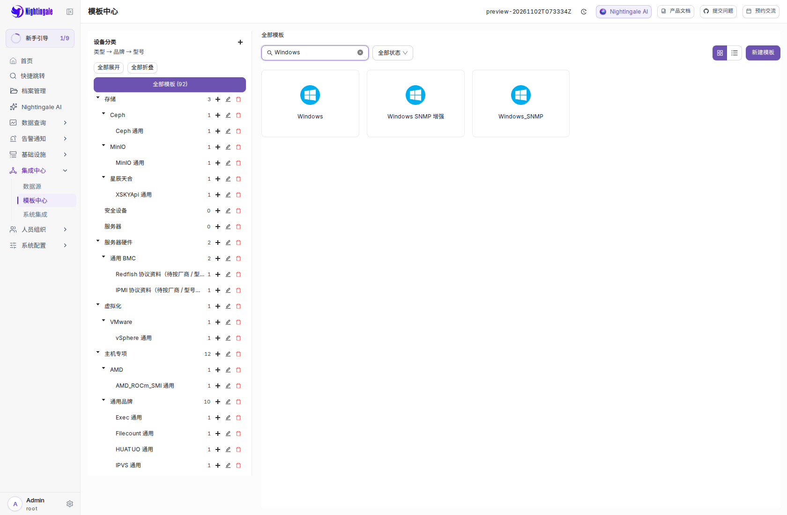
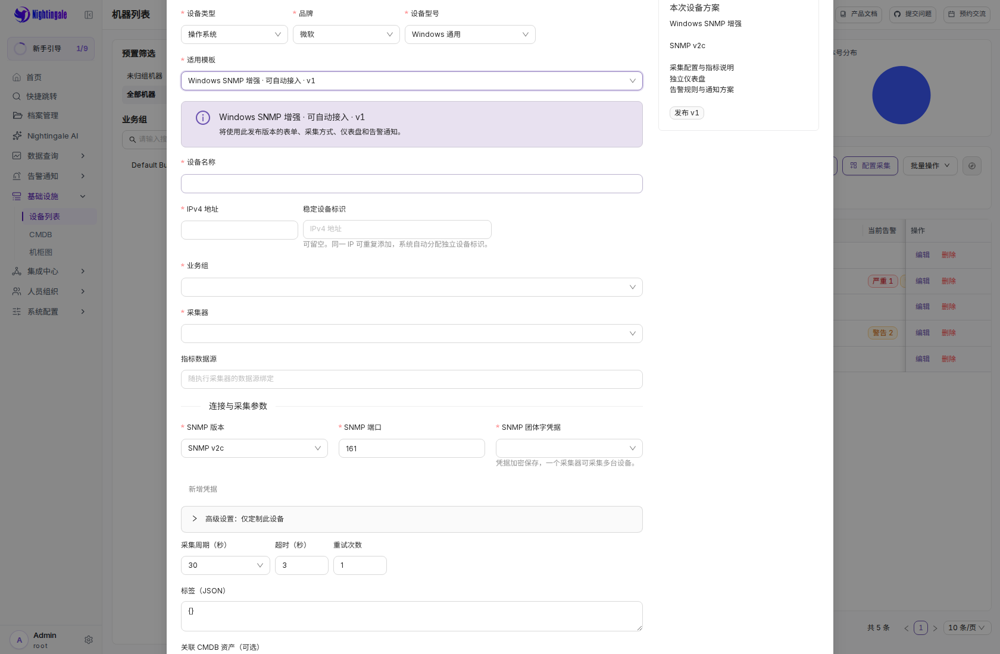
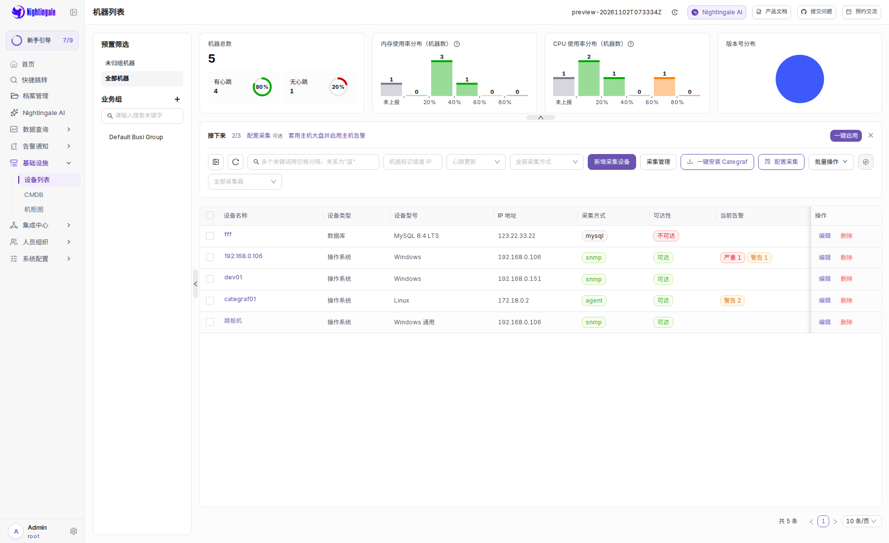
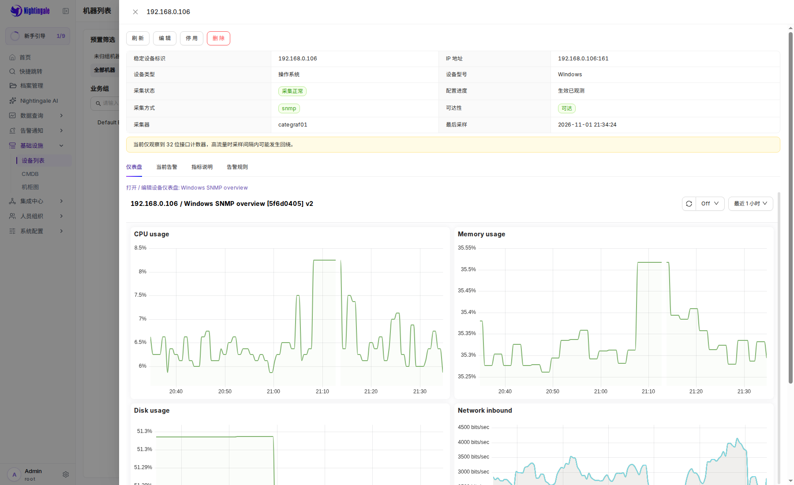
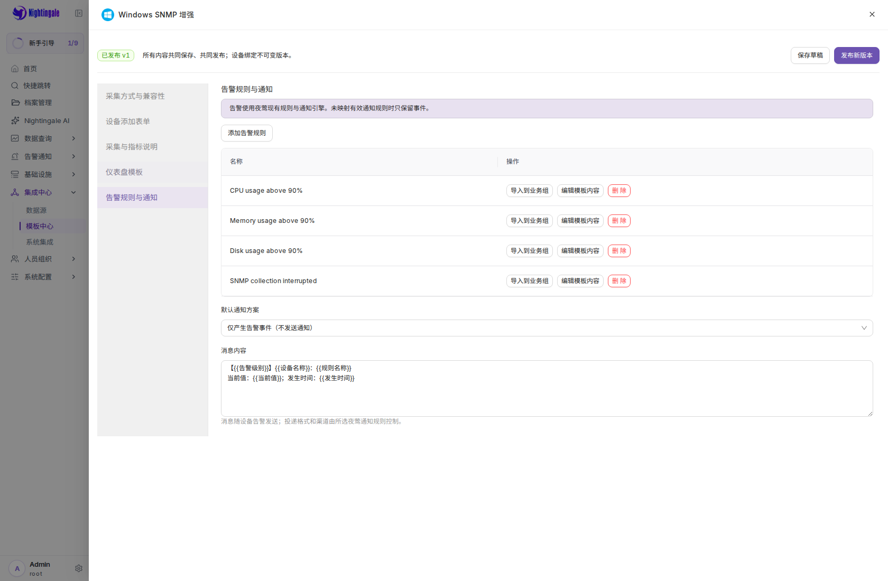

# 模板驱动设备管理：PR 验证记录

验证日期：2026-11-02（UTC）。对比基线 `a053043a64a821d8001407e6d757083d18c86866`；
完整功能及修复的审查版本 `be590b73`。本目录后续提交只增加证据，未修改运行逻辑。

## 范围与设计审查

本 PR 包含整条 `feat/snmp-device-management` 分支：设备采集生命周期、模板中心、
三级分类与图标素材、设备表单和详情、SNMP/MySQL 执行、默认 ICMP，以及设备名称标签。
不是只增加一个 Windows 模板。设计依据是
[SNMP 方案](../../design/snmp-device-management/README.md)、
[模板驱动方案](../../design/template-driven-device-management/README.md)及会话中确认的设备清单和详情要求。
早期实现和验证见两个目录的 implementation.md；本记录明确区分本次最终验证与早期记录。

模板中心管理采集说明/配置、指标说明、仪表盘、告警/通知和接入表单；发布形成不可变版本。
设备在配置页面内按类型、品牌、型号选择模板，由 Schema 生成字段。Center 负责凭据加密、
权限、版本发布和资源实例；Categraf 通过 HTTP Provider 拉取任务。单个采集器可以管理多台设备，
设备地址只做格式校验，支持同 IP 的独立设备标识。设备级覆盖与模板升级按差异保留自定义。
架构选择和已知执行范围见[实现说明](../../design/template-driven-device-management/implementation.md)。

Windows SNMP 增强包包含 48 项指标说明、36 个仪表盘面板、4 条默认规则。
CPU、内存、磁盘超过 90% 持续 5 分钟，以及采集中断使用原生告警引擎；通知需配置现有渠道。
进程/路由表已支持，TCP 连接明细默认关闭。`device_name` 在受控 Remote Write 接收端按设备记录注入，
不能由客户端伪造；改名只影响新样本，不重写历史。直接绕过此接收端写入 Prometheus 的样本不在该保证内。

## 最终代码审查

按 code-review 工作流，由两个只读审查者分别检查完整 diff，并复审至 `be590b73`。

| Standards（项目规范） | 处置与结果 |
| --- | --- |
| MySQL 原生 Target 与 monitor 表的 ident 混合排序规则 | 统一跨表比较；真实 MySQL、PostgreSQL 的 Gorm/SQL 初始化均验证通过 |
| 数据源受限用户可以读共享缓存指标或设备图表 | 在缓存前过滤，图表入口拒绝访问；覆盖六处设备状态读取 |
| 服务 BasicAuth 身份被当成 UI 用户导致主机过滤 panic | 按身份类型分流，保持原有 CenterApi 响应和导出函数签名 |
| 历史 MySQL 临时探针阻止正式配置回滚 | 校验归属后跳过历史探针，不恢复临时任务 |
| 最终结论 | 无剩余代码阻塞项；未发现需处置的 Fowler 代码异味 |

| Spec（需求符合性） | 处置与结果 |
| --- | --- |
| 修改成失败配置时，已生效中断规则重新进入等待 | 已生效规则保持检测；仅初次接入和新增规则等待完整新样本 |
| 暂停/恢复或元数据保存覆盖原生规则启停调整 | 保留用户意图；覆盖暂停期间手动启用→再保存→恢复的完整路径 |
| 恢复设备未把规则/仪表盘范围更新到新修订 | 在计算新修订前保留旧状态，恢复后验证表达式范围 |
| 升级新增规则与原有规则的等待状态混淆 | 分别跟踪新增规则；暂停/恢复后仍只有新增项等待 |
| 最终结论 | 无剩余代码阻塞项；未实现协议明确留在迁移队列，不声明为自动接入 |

修复前失败与修复后通过的原始断言摘录见 [behavior-checks.txt](behavior-checks.txt)。
暂停保存回归先复现 `expected 0, actual 1`，再完成修复。SQL 并发测试也修正为显式选择
活动样例，避免新加的已删除可见性样例被 `First` 误选；并未放宽并发胜出断言。

## 自动检查与实际采集

最终代码运行 `make verify-all`：Go build/test/vet、前端检查、两个完整集成门禁。
推送另由仓库 pre-push hook 执行 `make verify`；远端 CI 状态以 PR Checks 为准。
最终检查数字在同目录 [checks-summary.txt](checks-summary.txt) 中记录。

| 专项 | 实际结果与边界 |
| --- | --- |
| 五个受影响 Go 包 | collection、center/router、models、pushgw/router、alert/process 通过 |
| 真实数据库 | MySQL 8.4.11、PostgreSQL：Gorm 与 SQL 初始化共四条路径通过；重复迁移、独立 Store 并发、乐观锁、模板、图标与原生 Target 可见性均通过 |
| 固定 Categraf HTTP Provider | 通过真实二进制协议、配置重载、失败恢复与日志脱敏检查；版本 v0.5.18/provider-redact1 |
| 固定 Categraf + MySQL | 独立临时 MySQL，已发布模板→Provider→查询→受控写入→完整必需指标通过 |
| Windows 只读实测 | 35 种指标；8 CPU、4 存储、144 进程 CPU、9 路由样本；未向 TSDB 写入测试样本 |
| 真实 Prometheus | 4 台既有托管设备及原生 Agent ICMP 的名称标签与采样时间验证；48 个增强包表达式全部可执行，基础 CPU/内存/磁盘/网络存在真实样本 |
| 仪表盘 | 临时导入增强仪表盘，36 个面板全部渲染，基础图表使用既有真实样本；验证后删除临时看板 |

默认完整检查跳过的外部服务、隔离引擎等测试不能算作通过。上表中的数据库和采集器项是另外显式提供环境后运行的通过记录，
其余未提供环境的项仍未验证。没有向真实通知渠道投递消息，也未进行千台设备容量测试。

## 本地浏览器证据

实际入口仅使用 `http://192.168.0.152:30304`。运行实例为独立 dev4，未更新稳定站点。
业务浏览器验证 build ID：`20261102T073334Z-7888d2f2`，源码为干净的 `be590b73`。
本机和 LAN 探测返回相同 ID，`sourceChanged=false`、`frontendChanged=false`。
前端源码摘要 `c6b19c799b1b1bb10156d315e52fa98da6ca4224182377410dfe32880d81c12a`，
纯前端产物摘要 `5be1e337cf3e7e49218dc983bda43d3f5f3e02087dcead488d3075df12ef8552`。
证据提交后的最终刷新 ID 单独附在 PR 正文，业务逻辑和前端不变时复用这里的完整浏览器结果。

登录检查覆盖匿名拒绝、错误密码、正确登录、路由刷新及失效会话返回登录。
模板浏览器覆盖卡片、发布包编辑、48 项指标、36 面板正文、4 条规则与三级选择生成 SNMP 表单。
设备浏览器覆盖 5 台既有设备的类型/型号、四个标签页、实际图表与事件、显式编辑及取消返回、
常驻操作按钮、可调整列宽和横向滚动；未保存或修改既有设备。

浏览器断言分别保存在 [模板](windows-browser.json)、[设备](device-regression.json)、
[仪表盘](dashboard-render.json)和[登录](baseline-browser.json)。这是 Agent 执行的浏览器检查，
不是人工验收。最终浏览器主要验证既有设备读路径和编辑取消；完整新增/暂停/恢复/删除 UI 生命周期的
早期记录见 SNMP implementation.md，最终版本另有受影响行为测试与真实 Provider 专项，不能把早期 build 当作最终版本。

## 数据、设计资料和验收

[preservation.json](preservation.json) 比较本次任务开始时的独立预览快照：
32 条设备记录、17 个不可变模板版本、94 条模板记录的原配置未变；4 个协议采集任务与 5 个 ICMP 任务保留。
176 个分类仍满足三级约束，用户改过的目录保留。20 个原生看板、77 条原生告警规则配置逐行一致；
38 个已发布设计文件、29 个设计源码文件摘要一致。临时渲染看板已删除，测试数据库由用例清理。
备份、凭据及解密后的采集配置留在本机私有实例目录，不包含在本目录或下载包。

人工验收请从本地入口登录，依次检查：

1. 模板中心的目录增删改、同级别跨父目录拖动、模板拖动、折叠/展开、卡片/列表和图标上传。
2. 点击卡片右上角编辑只修改基本信息；点击卡片主体进入完整模板编辑。
3. 设备列表新增时在页面内选类型、品牌、型号和模板；Windows SNMP 显示版本/端口/凭据，MySQL 显示账号/密码。
4. 用测试对象完成新增、连接失败提示、采集生效、修改名称、暂停/恢复和删除；核对 `device_name` 新样本。
5. 点击设备名称进入详情与仪表盘，类型/型号和四个标签页一致，显式编辑进入原编辑布局。
6. 检查默认告警、设备级自定义和升级冲突处理；真实通知投递使用专门测试渠道。

人工验收待完成，PR 为草稿。SQL Server、Oracle、SNMP v3、Redfish 等执行适配器及具体硬件型号
仍需迁移和实际采集验证；分类或表单存在不等于该类型已经能自动采集。
合并和稳定发布不属于本次创建 PR 的操作。回退代码不能自动撤销新增设备资源；
部署前应保留数据库和凭据密钥备份，单独处理已创建资源和采集器发布。
