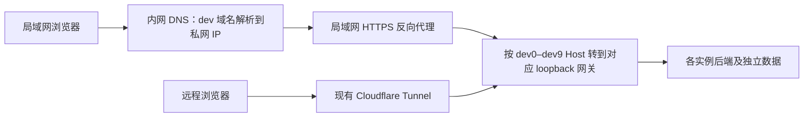

# Preview 局域网访问可行性分析

后续实施：已采用“网关额外监听明确私网 IP”的方案，两个入口共用 handler，
由同一个网关进程拥有，因而无须另建 systemd 转发单元。操作以
[局域网入口](worktree-preview.md#局域网入口)为准；下文保留调查时的主机快照和候选方案。

调查日期：2026-10-23。源码基线：`a20cd71f`，分支 `cruel-seahorse`，初始工作区干净。
本轮只调查、执行只读 HTTP 探测并记录方案；没有新增监听、修改防火墙/DNS、刷新实例或发布。
运行状态是调查时快照，不是本任务版本的交付预览。

## 结论

可行。日常页面、账号登录、同源 API 和 AI 流式请求可以通过局域网访问，
无须改变实例数据库、账号或 Skill 隔离。Cloudflare 可继续作为远程入口。
短期可将当前已有的局域网 HTTP 转发纳入管理；长期推荐保留 dev 域名，使用
内网 DNS 和受信任 HTTPS 反向代理，使局域网流量绕过 Cloudflare。

| 方案 | 改造范围 | 适用场景与限制 |
| --- | --- | --- |
| HTTP 私网 IP + 槽位端口 | 小：入口转发、生命周期和状态输出 | 快速改善可信开发网访问；需重新登录，部分剪贴板能力受限，无 TLS 传输保护 |
| dev 域名 + 内网 HTTPS + 分区 DNS | 中：统一代理、证书续期和内网解析 | 长期日常验收；保留原 origin 和 HTTPS 能力，客户端须实际使用内网 DNS |
| 网关直接监听所有网卡 | 代码量小，但扩大暴露范围 | 不建议作为默认方案；显式局域网入口便于保持后端隔离及独立控制访问范围 |

## 当前源码与主机事实

- `cmd/preview-gateway/main.go` 的 `serve()` 将网关固定在 `127.0.0.1:<slotPort>`。
  `scripts/preview.py` 的 `app_config()` 同样将 n9e 后端固定到 loopback。
- 默认 dev 槽位使用 30300–30309；stable 独立使用 30299。
  `reserve()` 的端口可用性检查也只在 loopback 上进行。
- `config()` 要求配置中的非空 `url` 使用 HTTPS。直接把该字段改成
  `http://192.168.0.152:30301` 会被拒绝；`--local-only` 仅跳过公网探测，
  不会新增局域网监听。不能把它解释成启用 LAN 的开关。
- 主机 `ens160` 当前地址为 `192.168.0.152/24`。已有 systemd 用户 socket
  监听 `192.168.0.152:30301`，service 通过 `systemd-socket-proxyd`
  转到 `127.0.0.1:30301`。这组配置位于主机用户目录，未纳入本仓库管理脚本。
- 已有转发对应实例 `ad61a7ac797049d2`，build ID 为
  `20261023T102532Z-680bec9e`。这是其他 worktree 的实例；当前 worktree 尚无 preview 绑定。
- `192.168.0.152:30302` 当前拒绝连接，而 loopback 的 30302 有网关监听，
  说明现有 LAN 转发只覆盖个别槽位，不是所有 preview 已支持 LAN。

主要依据：[预览管理器](../scripts/preview.py)、[网关](../cmd/preview-gateway/main.go)、
[共享服务管理](../scripts/preview_services.py)、[运行手册](worktree-preview.md)、
[Tunnel 配置](development-environment.md#公网预览)。

## 只读探测结果

所有请求都从服务宿主机发起，关闭 Python HTTP 代理环境变量影响。
这只能证明宿主机上监听及转发正常，不能证明另一台电脑的路由、防火墙或 Wi-Fi 隔离已通过。

| 探测 | 结果 |
| --- | --- |
| loopback 和 LAN 的 `/__preview/info` | 均为 HTTP 200、ready=true，build ID 一致 |
| loopback `/login`，连续三次 | HTTP 200；约 7、1、2 ms；页面均 4014 字节 |
| LAN `/login`，连续三次 | HTTP 200；约 6、3、2 ms；页面大小和 build header 与 loopback 相同 |
| 公网 dev1 HTTPS `/login`，连续三次 | 约 8.0 秒 TLS 握手超时，随后两次约 7.2、5.3 秒返回 403 |

公网样本未成功取得相同页面，不能计算有效的速度提升倍数，也不能将 403 或 TLS
超时全部归因于 Cloudflare Tunnel。尚未分析具体公网策略或用户客户端的网络路径。
LAN 路径已具备低延迟服务条件；用户实际设备的完整页面加载时间仍需对照测量。

## HTTP 与现有功能的兼容性

1. **登录和鉴权可沿用。** 登录页将 token 存入 localStorage，请求拦截器用 Bearer
   传输；这条链路没有 HTTPS 或 Secure cookie 的硬依赖。IP、域名及端口变化会形成
   不同 origin，所以切换 LAN HTTP 后要重新登录。HTTP 无 TLS，token 传输不受 TLS 保护。
   依据：[登录实现](../frontend/src/pages/login/index.tsx)、
   [请求实现](../frontend/src/utils/request.tsx)、
   [MDN localStorage](https://developer.mozilla.org/en-US/docs/Web/API/Window/localStorage)。
2. **AI 流式请求在机制上兼容。** 当前前端使用相对路径 fetch、Bearer 和可读流，
   网关设置 `FlushInterval=-1` 即时转发。它们不要求 HTTPS；新增代理应避免响应缓冲，
   保留取消传播和长连接。依据：[前端流处理](../frontend/src/components/AiChatNG/useStream.ts)、
   [网关](../cmd/preview-gateway/main.go)、
   [MDN readable streams](https://developer.mozilla.org/en-US/docs/Web/API/Streams_API/Using_readable_streams)。
3. **剪贴板存在差异。** 私网 IP 的 HTTP 不属于 secure context，不能套用 localhost
   的例外；异步 Clipboard API 受限。仪表盘导入已有手工粘贴退路，复制存在回退实现，
   仍需浏览器实际验收。依据：[仪表盘导入](../frontend/src/pages/dashboard/Detail/Title.tsx)、
   [面板操作](../frontend/src/pages/dashboard/Panels/index.tsx)、
   [MDN secure contexts](https://developer.mozilla.org/en-US/docs/Web/Security/Defenses/Secure_Contexts)、
   [MDN Clipboard API](https://developer.mozilla.org/en-US/docs/Web/API/Clipboard_API)。
4. **准备入口的 token 清理仍可工作。** `/__preview/ready` 用 JS 清 localStorage 和
   sessionStorage，对 SW/CacheStorage 使用特性检测；当前没有依赖 Clear-Site-Data header。
   HTTP 下部分安全上下文能力不可用，不影响前两项存储清理。
   依据：[网关 handler](../cmd/preview-gateway/main.go)。
5. **SSO 和外部 OAuth 客户端需单独验证。** OAuth/OIDC 回调依赖配置的 RedirectURL，
   访问 IP 不会自动同步 IdP 注册。MCP/A2A 的 BaseURL 未显式配置时还会按请求 Host
   和 forwarded scheme 生成 URL。默认 preview 最小配置不启用 SSO，普通账号登录
   不受此配置项阻碍。依据：[OAuth](../pkg/oauth2x/oauth2x.go)、
   [OIDC](../pkg/oidcx/oidc.go)、[MCP URL 生成](../center/router/router_mcp_oauth.go)。

应让浏览器整站访问 LAN 入口，保持 UI 与 API 同源；不要混搭公网 HTTPS 页面和
私网 HTTP API，否则需要额外处理混合内容、跨源及浏览器本地网络访问策略。

## 建议的实施范围

### 第一步：统一管理 LAN HTTP 入口

沿用“LAN socket → loopback gateway → loopback n9e”的拓扑。
只绑定明确配置的私网地址，保留 gateway 对内部 API、debug、metrics 的拒绝规则，
不开放 n9e 随机内部端口、PG、miniredis 或 Prometheus。限定可信开发网的访问范围。

管理器建议增加独立的 `lan` 配置及 `lanUrl`、`lan.ok` 状态，保留现有 `url` 的公网
HTTPS 语义；`url` 命令可显式选择 LAN，输出该入口的 `/__preview/ready`。
生命周期必须同时拥有 LAN socket/service：stop 停止监听但保留配置和实例数据，
refresh 重用槽位，destroy 移除本实例转发并释放槽位。按实例 ID 核对归属，防止端口
被新实例复用后遗留旧入口；当前手工配置尚未具备这些管理器保证。

端口检查应覆盖 LAN 地址和 loopback 两端，错误不能只在转发启动时才发现。
IP 变化时要明确报错并更新入口；建议为宿主机设置 DHCP 地址保留。
保留现有公网检查，LAN 检查结果独立展示，不用 `--local-only` 冒充 LAN 已通过。
此步骤不应自动为 stable 增加新入口。

### 第二步：内网 HTTPS，保持原 dev 域名

代理只列出 dev 域名映射，未知 Host 拒绝，不把 stable 加入默认路由。
正确传递 Host、`X-Forwarded-Proto=https`，支持流式响应和 HTTP upgrade。
客户端需要使用内网 DNS；仅修改 hosts/DNS 而没有 HTTPS 终止代理，无法让当前
loopback HTTP 网关直接承接域名的 443 请求。

使用浏览器信任、覆盖 dev 域名的证书，例如用 DNS-01 验证申请并自动续期。
DNS-01 不要求将私网 Web 服务开放给互联网；所需 DNS 凭据应受限并保存在代理侧，
不传入 preview 运行环境。依据：[Let's Encrypt DNS-01](https://letsencrypt.org/docs/challenge-types/#dns-01-challenge)。
Cloudflare Origin CA 默认为 Cloudflare 到源站的信任链，不可直接作为普通浏览器信任
证书使用，依据：[Cloudflare Origin CA](https://developers.cloudflare.com/ssl/origin-configuration/origin-ca/troubleshooting/)。

## 后续实施的验收与本次边界

- 自动化：LAN/public 两条路径 build ID 相同；匿名 profile 为 401；内部路径仍被拒绝；
  两实例及 stable 路由不串线；端口冲突、IP 不存在和代理失败有明确错误；
  refresh/stop/destroy 及槽位复用不会遗留转发。实现时先跑对应行为测试，再运行 `make verify`。
- Agent 浏览器：从用户设备可达的入口重新登录，验证页面/API、仪表盘复制粘贴、
  AI 首段和后续流、取消及失败恢复；HTTP 与 HTTPS 差异单独记录。
- 人工验收：在实际使用的电脑上比较同一 build 的页面和静态资源加载、API 响应时间；
  HTTPS 方案还应确认 DNS 未绕回 Cloudflare、证书受信任且续期配置有效。

本次已完成源码分析、主机监听/转发核对、只读 HTTP 探测和文档相对链接检查。
未进行跨设备探测、业务登录 E2E、真实 AI 流、人工验收或发布。
仅新增研究文档，未运行应用构建、测试及 `make verify`；这些结果均不作为通过记录。
