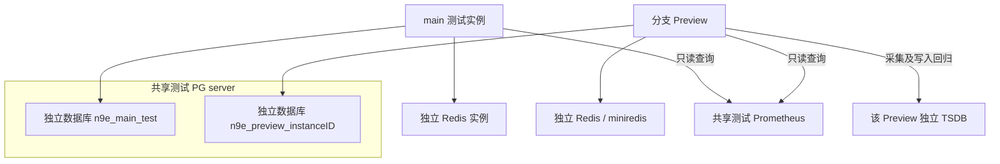

# Preview 与 main 测试环境共享外部存储的可行性分析

后续决定：用户已确认一个 PostgreSQL 服务实例、每环境独立 database/角色；
Redis 保持各实例 miniredis；Prometheus 共享一个只读测试指标源。
本文保留调查时的候选方案，当前操作以[预览运行手册](worktree-preview.md)为准。

调查日期：2026-10-22。源码基线：`a8d0f75b`，分支 `curvy-newt`；本机 main
checkout 的 HEAD 为 `a8d920a7`。本文按用户定义，将 main 视为长期测试环境，
分支 preview 视为可销毁环境；不讨论接入生产数据。本轮仅分析源码和官方资料，
没有切换连接、部署服务、迁移数据或执行外部服务集成测试。

## 结论与推荐组合

技术上可行，但三种存储需要不同的共享方式。推荐共享服务基础设施，同时保留环境
数据归属；不让不同版本的 n9e 操作同一套可写业务状态。

| 存储 | 推荐方式 | 当前项目的改造量 | 不推荐方式 |
| --- | --- | --- | --- |
| PostgreSQL | 一个测试专用 PG server，每环境独立 database、role | 中：已有驱动，需改预览初始化、凭据与资源生命周期 | main 和分支共用数据库/业务表 |
| Redis | 同一主机上，每环境一个独立实例；或继续使用 miniredis | 独立实例中；单实例完整隔离改造较大 | 仅设置不同 DB 编号，或只改 JWT 前缀 |
| Prometheus | 一个共享、只读的测试指标源；写入测试保留独立 TSDB | 只读模式中；严格共享读写高 | 把 env 标签当作授权或租户隔离 |

如果要求三者各自只有一个服务进程，PG 最适合；Redis 要先完成全链路命名空间和
ACL 改造；Prometheus 只有在明确接受共享数据可见性、保留策略和故障影响时才适合
共享写入。后两者不能直接获得与独立实例相同的隔离保证。

推荐拓扑：

不同环境可以查询同一批经整理的测试指标，同时在各自 PG 中维护不同的规则、
仪表盘、账号和告警事件。这样可以比较分支与 main 的行为，但无需共享可写业务库。

收益主要是接近真实 PG/Redis 行为、集中管理测试指标和复用指标输入。它不保证比
现有轻量预览更省资源：SQLite 本来没有额外数据库进程，换 PG 会增加一个长期服务
及连接开销；miniredis 本来在进程内，换真实 Redis 主要是提升测试真实性。共享
只读 Prometheus 可以减少重复采集和每实例 TSDB 开销，但代价是共同的查询、容量
和故障影响。资源收益需要按实际并发数和数据量测量。

## PostgreSQL：共享 server、按环境分库可行

PostgreSQL 官方支持一个 server cluster 承载多个 database，角色在 cluster 范围
存在，数据库仍共享资源、WAL 和部分恢复操作。Schema 只是库内命名空间，隔离
弱于 database，并且受 `search_path` 和 CREATE 权限影响。
来源：[数据库组织方式](https://www.postgresql.org/docs/current/manage-ag-overview.html)、
[Schema 与 search_path](https://www.postgresql.org/docs/current/ddl-schemas.html)。

项目已经有 PostgreSQL 驱动和初始化路径：

- [pkg/ormx/ormx.go](../pkg/ormx/ormx.go) 支持 `DBType = "postgres"` 和连接池参数。
- [center/center.go](../center/center.go) 启动时执行初始化、迁移、默认 Agent 初始化、
  JWT/RSA 配置初始化和内置集成同步，运行中还会启动告警与清理任务。
- [models/migrate/migrate.go](../models/migrate/migrate.go) 包含 AutoMigrate、PG
  专用模型、索引和约束处理。分支与 main 共库会让不同版本修改同一套 schema。
- `EngineName` 控制告警引擎分组，不能隔离用户、规则、配置、历史表或迁移。
- 只读连接主库也不能直接运行完整 n9e：启动和后台工作本身存在写操作。

因此建议 main 使用固定数据库，preview 使用随机实例 ID 对应的数据库和登录角色，
不要只按可复用的 dev0 槽位命名。应用角色无 SUPERUSER、CREATEDB、CREATEROLE
权限，只能管理本环境的对象。建库、授权和删除由单独的管理流程执行；其管理凭据
不进入 n9e 的配置或运行环境。还需审计 PUBLIC 的 CONNECT 授权和角色继承关系。
来源：[权限模型](https://www.postgresql.org/docs/current/sql-grant.html)、
[角色属性与连接数限制](https://www.postgresql.org/docs/current/sql-createrole.html)。

现有代码有两个需要先处理的兼容点：

1. `checkPostgresDatabaseExist` 会把 DSN 改为 `dbname=postgres`，连接维护库并查询
   `pg_database`。若应用角色被严格限制为只能连接本环境库，现有启动流程会失败。
   应优先适配“目标库已由管理器预建”的直接连接路径；过渡方案可以有限允许连接
   维护库，但不授予建库权限。
2. [scripts/preview.py](../scripts/preview.py) 的 `seed()` 只初始化 SQLite，
   生成随机 root 凭据；PG 初始化路径在
   [pkg/ormx/database_init.go](../pkg/ormx/database_init.go) 中会创建默认账号。
   必须增加 PG 专属的初始化和随机凭据写入，完成后再开放预览入口。仅改 DSN 会
   使凭据文件与 PG 中的账号不一致。

单库多 schema 并非完全不可做，但本项目有裸表名 SQL、初始化逻辑，以及按
`pg_class.relname` 查索引而未限定 schema 的迁移查询。需要逐项审计，复杂度高于
分库，暂不作为首选。`TablePrefix` 同样不能替代完整的环境隔离。

PG 共享可提高真实方言验证覆盖，但连接池、长查询、DDL、磁盘和备份仍互相影响。
应给每环境设连接预算和查询超时，按并发实例数计算总连接数；不能直接沿用示例中
每实例 150 个连接的配置。该方案不提供每环境独立的 CPU/IO 故障域。

## Redis：仅分 DB 不够，现有前缀也不完整

项目的 [storage/redis.go](../storage/redis.go) 支持 standalone、sentinel、cluster
和 miniredis，standalone/sentinel 可配置 DB 编号。外部连接本身不难，但以下语义
使“一个 Redis、不同 DB”不能作为完整环境隔离：

- DB 编号只区分普通键空间，RDB/AOF 仍共同保存这些数据；Cluster 只支持 DB 0。
  来源：[SELECT](https://redis.io/docs/latest/commands/select/)。
- Pub/Sub 不受 DB 编号隔离。一个 DB 发布的消息可被另一个 DB 的同名频道订阅者
  收到。来源：[Pub/Sub database scoping](https://redis.io/docs/latest/develop/pubsub/#database--scoping)。
- 内存上限和淘汰策略在实例级别生效，一个 preview 的 Streams 或缓存增长仍可能
  影响 main。来源：[淘汰策略](https://redis.io/docs/latest/develop/reference/eviction/)。

当前代码中的环境命名空间覆盖情况：

| 用途 | 实际键或频道 | 发现 |
| --- | --- | --- |
| JWT | `HTTP.JWTAuth.RedisKeyPrefix` | 可配置，但只覆盖对应 JWT 路径 |
| 登录失败计数 | `/userlogin/errorcount/<username>` | 无环境前缀，同 DB 时相同用户名互相影响 |
| OIDC id_token | `n9e_id_token_<userId>` | 无环境前缀，不同环境常有相同数字用户 ID |
| AI 会话锁、状态、流 | `ai_assistant_chat_lock:*`、`aichat:*` | 无统一环境前缀 |
| AI 取消频道 | `aichat:cancelch:{chatID}:seq` | 即使分 DB，频道仍然共享 |
| Skill Git 缓存 | `n9e:ai:skill_git_remote_commit:<skillName>` | 同名 Skill 的不同仓库/ref 可能复用缓存键 |
| A2A TaskStore | 默认 `{a2a}:task:*` | 底层提供 KeyPrefix，但当前 Router 没传环境值 |

依据：[models/user.go](../models/user.go)、
[router_mw.go](../center/router/router_mw.go)、
[AI 状态与频道](../models/ai_assistant_state.go)、
[AI 锁](../models/ai_assistant_lock.go)、
[Skill Git 缓存](../aiagent/skill/git_cache.go)、
[A2A Router](../center/router/router_a2a.go)、
[Pub/Sub 实现](../storage/pubsub_bus.go)。随机 chat/task ID 可以降低偶然碰撞概率，
但不是隔离机制；复制测试数据或重放相同 fixture 时尤其不能依赖它。

若必须共用单个 Redis，需要覆盖所有命令调用、Lua 的 KEYS、Streams、锁、缓存、
取消频道和 A2A 的统一 `environmentID` 命名空间，并保留 Cluster hash-tag 的同 slot
要求。为每环境设置 key pattern 和 channel pattern ACL，使用命令白名单，禁用
FLUSHALL、FLUSHDB、CONFIG 等无必要的管理/破坏命令。仅 key pattern 不能约束
所有无 key 参数的命令；ACL 也不提供每环境内存配额。
来源：[Redis ACL](https://redis.io/docs/latest/operate/oss_and_stack/management/security/acl/)。

推荐第一阶段让 main 使用独立真实 Redis，preview 继续用 miniredis，或按需启动
各自的真实 Redis。可以共用主机和镜像，保持独立进程、端口、凭据及数据卷。
这样也能测试真实 Redis 的重连、重启、Lua、Streams 行为，而无需立即改造全库键名。

## Prometheus：先区分共享只读数据与共享写入

### 共享只读测试数据源

可行且优先推荐。每个环境在自己的 PG 中创建数据源配置，查询同一个测试专用
Prometheus。各自的规则、仪表盘、告警事件和通知接收器仍独立。共同指标便于比较
main 与分支在相同输入下的结果。

“只读”要在 Prometheus 前的接入代理和凭据策略上落实，允许查询和必要元数据
接口，拦截写入、管理及 lifecycle 接口；不能只靠团队约定不执行写操作。查询接口
也可能使用 POST，不能简单地按“只放 GET”判断。n9e 当前网关拦截的是进入本环境的
`/prometheus` 路由，不能替代对外部数据源的访问控制。

Prometheus 官方安全模型默认 HTTP 用户能够读取全部时序数据；BasicAuth 或 env
标签不能提供标签级租户授权。共享只读数据源的前提是所有参与环境都允许读取整套
测试指标，并接受查询负载和服务故障的相互影响。
来源：[Prometheus 安全模型](https://prometheus.io/docs/operating/security/)。

### 共享写入同一个 Prometheus

有条件可行，但改造和约束明显更多：

1. 时序由指标名和完整标签集确定。来自不同环境但标签完全相同的样本会进入同一
   时序，可能混合数据、发生重复或乱序冲突。必须在可信写入口强制添加环境标签。
   来源：[数据模型](https://prometheus.io/docs/concepts/data_model/)。
2. 对 scrape 数据使用 target labels/relabeling；对 remote-write 数据在可信写入
   路径注入标签。`external_labels` 用于与外部系统通信，不能让共享 Prometheus
   本地所有样本自动获得各自环境标签。
   来源：[配置语义](https://prometheus.io/docs/prometheus/latest/configuration/configuration/)。
3. 查询也需对应过滤，覆盖告警、仪表盘、变量、录制规则和查询工具。
   `sum(rate(metric[5m]))` 仍会聚合所有环境，写入带标签不等于查询自动隔离。
   严格隔离需要可信查询代理或租户能力，不能靠前端自动补一个字符串条件。
4. 若 n9e Pushgw 向 Prometheus 发送 remote-write，需显式开启接收端，并配置
   `/api/v1/write` writer。官方仅建议特定低量场景，不将此功能当作替代 scrape 的
   通用采集入口。项目已有 `Pushgw.Writers.WriteRelabels`，但还需审计全部采集与
   派生指标写路径，不能假定只改一个 writer 就覆盖所有写入者。
   来源：[remote-write receiver](https://prometheus.io/docs/prometheus/latest/querying/api/#remote-write-receiver)、
   [项目 Writer](../pushgw/writer/writer.go)。
5. 所有环境共享保留策略、磁盘容量和查询资源；高基数和重查询会影响 main。
   销毁某个 preview 后，优先让数据按保留策略自然过期，避免广泛删除共享指标。
   来源：[本地存储限制](https://prometheus.io/docs/prometheus/latest/storage/)。

因此完整的采集、remote-write、录制与清理回归测试仍建议使用独立 TSDB。若业务
确实要求单服务上的严格租户写读隔离，应另行评估具备租户机制的时序后端或代理，
而不是把原生单实例 Prometheus 标签视为租户边界。

## 预览设施需要怎样改

这不是直接修改三个连接地址的任务。当前 basic/full 区分沙箱能力，建议另外引入
存储配置选项，不把“外部存储”等同于 full profile。

| 改造位置 | 必要变化 |
| --- | --- |
| 主机登记与实例 manifest | 记录后端类型、资源 ID、归属、配置摘要和凭据文件路径；对公网隐藏连接凭据 |
| `scripts/preview.py app_config()` | 从受控实例配置生成 PG、Redis、外部数据源设置，保留鉴权及网关边界 |
| `seed()` | 支持 PG 初始化、幂等恢复和随机账号；开放入口前完成凭据替换 |
| `pkg/ormx` | 适配已预建数据库和最小权限角色，明确是否允许连接维护库 |
| 网关 `health()` | 当前固定查询本地 `/prometheus/api/v1/query?query=vector(1)`；关闭 EmbeddedTSDB 后必须改为对应的数据源健康检查 |
| 就绪检查 | 分别验证应用版本、匿名拒绝、首次账号、PG 读写、Redis 所需操作和数据源；仅 `vector(1)` 不能证明实际采集数据存在 |
| 数据源初始化 | 显式创建/核对外部数据源；仅配置 Pushgw writer 不会自动创建可查询的数据源；移除或禁用旧的内嵌数据源引用；核对数据源和规则的集群配置与本实例 EngineName 一致 |
| refresh / stop / destroy | refresh 保留本环境资源；stop 保留；destroy 仅删除有归属凭据的本环境资源；支持部分失败重试和审计 |
| Seed fixture | 使用整理过的测试数据；如复制 main 测试库，要处理用户令牌、JWT/RSA、通知配置、模型凭据、任务和进行中状态 |

依据：[预览管理器](../scripts/preview.py)、
[网关 health/checkLogin](../cmd/preview-gateway/main.go)、
[内嵌数据源初始化](../models/datasource.go)、[配置处理](../conf/conf.go)。

现有 `destroy` 只删除实例目录和私有临时目录。接外部服务后若不补资源回收，删除
worktree 也不会删除 PG 数据库、Redis 状态或共享指标。管理器需要区分自己创建的
可销毁资源与用户指定的共享服务，禁止根据一个连接地址推断拥有整个服务的删除权。

main 继续从干净 main checkout 构建，使用稳定入口；分支使用 dev 槽位。现有实例
配置由每次构建生成，手改生成 TOML 会在 refresh 时丢失，正式实现应进入管理器。
隔离文件目录、Skill 和进程环境的现有约束应继续保留。

## 实施顺序与验收

建议按以下顺序落地，每一步都可以独立验证和回退：

1. 增加可选外部存储配置，保留当前 SQLite/miniredis/TSDB 为轻量预览默认值。
2. 在隔离资源上验证 main + 两个 preview 使用同一个 PG server、三个独立数据库。
3. 接入共享只读 Prometheus，并保留可选独立写入 TSDB；验证查询和写入拒绝。
4. 如需要真实 Redis 行为测试，先配置独立实例；确有单实例复用要求时，再完成全链路
   命名空间和 ACL 改造，而不是临时使用不同 DB 编号作为交付方案。
5. 如有旧实例数据要保留，单独执行导出、转换、导入和核对；不将 SQLite→PG、
   内嵌 TSDB→外部存储视为配置切换自动完成的迁移。先保留原实例再做切换。

至少覆盖以下验收场景：

- 两个 preview 建立同名账号、规则和会话后互不影响，main 数据不变；旧 JWT/PAT
  及复制的认证材料不能意外跨环境复用。
- 一个分支执行 schema 变更，其他环境的表结构和业务行为不变；迁移失败不能被
  一个 HTTP 200 就绪结果掩盖。现有迁移存在仅记录错误后继续的路径，应检查迁移
  结果或 schema 后置条件。
- 相同 username、user ID、Skill 名称、chat/seq fixture 下，Redis 登录限制、
  id_token、锁、缓存、Streams、取消频道、A2A 任务均无串扰。
- 如果尝试共享 Redis 实例，真实 Redis 上验证 DB 间 Pub/Sub、ACL 拒绝、Lua 和
  Cluster hash-tag；miniredis 单测不证明这些边界。
- 共享只读 Prometheus 支持预期查询，写入/管理被拒绝；独立写入测试不会改变 main
  的测试指标。若选择共享写入，必须补标签伪造、无标签写入和跨环境查询用例。
- 在事先设定的并发实例数和查询负载下测量资源与时延；本轮没有测量结果，不给出
  容量或性能承诺。
- 服务重启、凭据错误、连接耗尽和初始化中断后能按设计失败或恢复；destroy 中断
  可重试，不能误删 main 或其他 preview 的资源。
- 刷新保留所需数据，销毁后对应 PG/Redis 资源释放；源码、前端和公网 build ID
  证据对应最终版本。

仓库 CI 已配置 PG 外部测试，但主要涉及 `pkg/ormx` 等专项包，不能代替完整的
PG 驱动 n9e 启动、业务和多环境隔离验收；更不能以 SQLite 测试代替 PG 兼容性。
参考：[CI 外部测试](../.github/workflows/verify.yml)、
[开发环境要求](development-environment.md)。

本轮交付是设计可行性与改造清单，以上验收均为后续实施要求，不是已通过记录。
