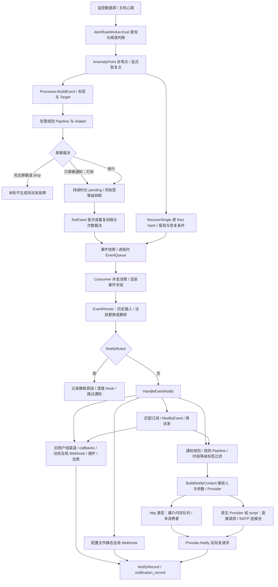

# 告警链路与外部平台推送接入调查

> 协议更新：业务已确认故障problem、恢复ok；真实样例原文不入库仓库。当前字段类型假设和最小待确认项见 [样例验证](api/external-push-samples.md)。以下保留调查时点的链路证据。

调查日期：2026-10-27。源码基线：`ed46238250ca41c9ff881a3ffe454d17ac8f07ef`，分支 `dirty-peacock`；调查开始时工作区干净。已阅读根目录 `AGENTS.md`、`CLAUDE.md`、`doc/agent-development-workflow.md` 和相关 API 文档；仓库内未发现更深层 AGENTS.md。

本轮仅调查并新增本文：未修改业务代码、运行配置或运行数据库，未调用 1.0 平台接口，未触发真实短信、电话或通知。本报告的“已有”指源码存在可执行路径；没有读取运行实例的渠道配置、凭据和生产数据，不能据此认定现场已经启用或成功投递。

## 1. 结论与接入边界

建议复用**通知规则 → 通知媒介 → Provider**，新增面向 1.0 的专用协议适配器，并为该集成增加持久推送任务及结果状态。现有通用 HTTP、Webhook 的请求格式、成功判定、自动重试和并发顺序都不能直接满足本次完整要求。仅增加一个 URL 或改 Content-Type 不足以完成接入。

当前事件已具有故障/恢复标记、规则名、时间、等级、标签和可选 Target；缺少已确认的 1.0 客户标识映射、设备类型词典、等级词典、签名规则，以及可靠的跨重启推送幂等与顺序状态。对方不去重，因而**本端防重复建任务不等于对方恰好收到一次**；请求结果不明时必须保留待核对状态，不能自动反复投递。

最终验收分开记录：A）接口接收且原始告警实际入库；B）1.0 后续业务解析、人员匹配、账号通知、短信/电话按既有逻辑完成。响应体 `status=200` 只能作为接口受理证据之一，不能证明 B。

## 2. 当前告警及通知流程图

图中持久化失败仍可能继续派发；事件队列 FIFO 只描述出队次序，消费及发送完成次序没有保证。订阅是事件匹配与重新派发机制，并非消息中间件的持久订阅。所查告警通知路径未发现 Kafka、RabbitMQ 等外部消息队列接线；使用进程内队列及 goroutine，不能作为持久投递保证。[事件队列](../alert/queue/queue.go#L10)、[并发消费](../alert/dispatch/consume.go#L71)、[持久化后派发](../alert/dispatch/consume.go#L127)、[订阅](../alert/dispatch/dispatch.go#L747)。

## 3. 告警事件生命周期、标识及降噪

### 3.1 故障如何产生

`AlertRuleWorker.Eval` 按规则类型查询 Prometheus、Loki、主机心跳或其他数据源。查询返回异常点，点带时间戳、标签、严重度和查询信息；查询发生错误会退出本轮评估，不直接以空结果恢复。Prometheus 路径将查询配置的 Severity 写入异常点，主机路径可判断心跳失联等。显式恢复点先处理，然后调用 `Processor.Handle(..., "inner", ...)`。[eval.go:167](../alert/eval/eval.go#L167)、[错误退出与分流:217](../alert/eval/eval.go#L217)、[严重度赋值:415](../alert/eval/eval.go#L415)、[主机失联:904](../alert/eval/eval.go#L904)。

`BuildEvent` 从规则复制业务组、规则名、通知配置等，写入异常点时间、值、严重度、hash，合并数据标签与规则追加标签，再 relabel；通过 `ident` 可关联 Target。随后执行告警规则 Pipeline、屏蔽、pending 持续时长、等级抑制、重复通知裁决，放行才进入事件队列。[process.go:133](../alert/process/process.go#L133)、[BuildEvent:245](../alert/process/process.go#L245)、[标签填充:707](../alert/process/process.go#L707)、[Target 关联:753](../alert/process/process.go#L753)、[规则复制](../models/alert_rule.go#L1742)。

### 3.2 恢复如何产生并关联故障

内部评估时，已经在 `p.fires`、本轮不再出现在 `alertingKeys` 的 hash 进入恢复判断；显式恢复点也可调用 `RecoverSingle(true, ...)`。该方法必须先找到 `p.fires[hash]`，再检查 `RecoverDuration` 留观和 `RecoverConfig.JudgeType`：自定义恢复条件不能仅靠异常点消失触发恢复。原始条件恢复路径不能区分“指标回到正常”与“查询结果缺失”，这是代码已有边界。[HandleRecover:343](../alert/process/process.go#L343)、[RecoverSingle:377](../alert/process/process.go#L377)。

恢复沿用原 hash 和 `FirstTriggerTime`，更新规则相关字段，置 `IsRecovered=true`、`LastEvalTime=now`、`RecoverTime=now`，清除 fires/pending 状态后入队；恢复不再做等级抑制合并，各已触发档位各自恢复。恢复时重新判断“只屏蔽通知”。`NotifyRecovered=0` 不阻止恢复历史落库，但会阻止正常恢复通知。[恢复状态:418](../alert/process/process.go#L418)、[逐条恢复:363](../alert/process/process.go#L363)、[恢复通知开关](../alert/dispatch/dispatch.go#L232)。

另有 HTTP 外来事件入口：`makeEvent` 转给所属引擎的 Processor；`pushEventToQueue` 则直接接受事件入队，不能假定所有来源都经过内部评估的相同裁决。后续适配必须界定是否包括这些来源。[router_event.go:22](../alert/router/router_event.go#L22)、[makeEvent:113](../alert/router/router_event.go#L113)、[路由注册](../alert/router/router.go#L52)。

### 3.3 状态与唯一标识

| 项目 | 当前语义与限制 | 源码 |
| --- | --- | --- |
| pending / fires | Processor 中按 hash 管理的内存状态；pending 未满足持续时间不派发 | [process.go:443](../alert/process/process.go#L443) |
| 故障/恢复 | 运行时 `IsRecovered bool`；历史表为 `IsRecovered int`，0/1；活跃表只保留未恢复事件 | [事件字段](../models/alert_cur_event.go#L25)、[ToHis](../models/alert_cur_event.go#L417)、[历史结构](../models/alert_his_event.go#L18) |
| hash | MD5(`ruleId + Labels.String() + datasourceId + Severity + Query`)，代码用下划线拼接。严重度、查询或原始标签变化均可能形成另一身份；不是“设备唯一告警 ID” | [Hash:797](../alert/process/process.go#L797) |
| TagHash | 仅对异常点原始标签计算 MD5，用于同标签下多档严重度抑制；与完整事件 hash 不同 | [TagHash:801](../alert/process/process.go#L801) |
| `Id int64` | 每次 `EventPersist` 都无条件插入一条历史，取得新主键，再作为本次 event.Id；重复提醒和恢复都有自己的 ID | [EventPersist:363](../models/alert_his_event.go#L363) |
| `FirstTriggerTime int64` | 本轮连续故障首次异常点时间；重复通知继承。可辅助区分同 hash 的不同故障轮次，但秒精度不足以天然保证唯一 | [fireEvent:583](../alert/process/process.go#L583) |
| `Status / Claimant` | `AlertCurEvent` 有运行时保留字段，`persist` 只处理 Status=0；所查开源主链路未建立其完整业务状态枚举，不能用它代替故障/恢复标记 | [字段:80](../models/alert_cur_event.go#L80)、[persist:204](../alert/dispatch/consume.go#L204) |
| 通知记录状态 | 1 成功、2 失败、3 只屏蔽通知；表示发送路径的判定，不能代表对方后续人员通知完成 | [notification_record.go:10](../models/notification_record.go#L10) |

`EventPersist` 是“检查 hash 是否存在 → 插历史 → 删旧活跃 → 故障重插活跃”的多步操作；此函数本身未包成一个事务，也没有历史幂等键。故障与恢复并发消费甚至可能影响落库次序。edge 的持久化请求最多三轮、每轮 2 秒、轮间 100ms；代码明确承认“center 已提交但响应丢失”时会产生重复历史记录。持久化失败只记录日志/计数，不否决后续通知，event.Id 可能为 0。[EventPersist](../models/alert_his_event.go#L363)、[edge 重试说明](../alert/dispatch/consume.go#L188)、[persist](../alert/dispatch/consume.go#L204)。

### 3.4 去重、重复提醒、屏蔽和聚合

- **重复触发**：相同 hash 在 fires 内复用 `FirstTriggerTime`；`NotifyRepeatStep=0` 禁止重复提醒，否则按分钟间隔；`NotifyMaxNumber=0` 表示不限次数。`LastSentTime` 在入队时更新，不是接收方成功确认时间，失败不会自动回滚计数。[fireEvent](../alert/process/process.go#L583)、[pushEventToQueue](../alert/process/process.go#L635)。
- **仅通知屏蔽**：继续生成/记录事件，影子计数控制屏蔽期快照节奏，不消耗真实通知次数；解除后可补首次通知。Consumer 在持久化后跳过全部正常通知并写静默原因。[process.go:520](../alert/process/process.go#L520)、[consume.go:129](../alert/dispatch/consume.go#L129)。
- **完全屏蔽**：规则失效、时间窗、目标不存在/业务组不符、屏蔽规则或 Hook，可使本轮故障不进入 fires/派发；异常 hash 在屏蔽裁决前先记入 `alertingKeys`，以免已有故障因本轮被屏蔽而误恢复。[mute.go:19](../alert/mute/mute.go#L19)、[process.go:157](../alert/process/process.go#L157)。
- **等级抑制**：同原始标签分组内只让最高优先级的候选触发；1 比 2、3 更严重；恢复按已 fires 项逐条进行。[inhibitEvent](../alert/process/process.go#L494)、[等级常量](../models/alert_rule.go#L60)。
- **Pipeline**：可 drop、relabel、update、callback，在告警规则和通知规则两个阶段运行。告警规则阶段在 pending/去重之前；带外部副作用的 callback 可能每轮评估执行，不宜在那里直接提交 1.0 告警。[规则阶段](../alert/process/process.go#L161)、[通知阶段](../alert/dispatch/dispatch.go#L188)、[pipeline 注册](../alert/pipeline/pipeline.go)。
- **聚合不是统一持久收敛**：`AlertAggrView` 保存的是查看事件的视图规则；旧 Webhook 的 Batch 是把队列事件打包成数组并按严重度优先出队，不是按故障轮次去重。没有发现开源当前派发主路径的通用持久聚合等待任务。[视图模型](../models/alert_aggr_view.go#L14)、[批量消费](../alert/sender/webhook.go#L186)、[优先级队列](../alert/sender/webhook_event_queue.go#L45)。

## 4. 通知实现与可复用程度

### 4.1 谁生成任务、谁实际发送

| 层次 | 方法与行为 | 判断 |
| --- | --- | --- |
| 事件消费 | `Consumer.consumeOne`：渲染 RuleName/annotations、持久化、静默判断、调用 Dispatch | [consume.go:99](../alert/dispatch/consume.go#L99) |
| 新通知规则 | `HandleEventWithNotifyRule`：遍历 NotifyRuleIds，检查 Enable，执行规则 Pipeline、恢复开关、过滤，定位媒介/模板，再 goroutine 调 `SendByNotifyRule` | [dispatch.go:169](../alert/dispatch/dispatch.go#L169) |
| 默认发送入口 | `SendByNotifyRule` 默认赋值 `SendNotifyRuleMessage`；`BuildNotifyContext` 确定 Provider、接收人与自定义参数 | [默认 Hook](../alert/dispatch/dispatch.go#L30)、[BuildNotifyContext:575](../alert/dispatch/dispatch.go#L575) |
| 建 HTTP 任务 | `SendNotifyRuleMessage` 的 `request_type=http` 分支构造 `memsto.NotifyTask`，调用 `EnqueueNotifyTask` | [dispatch.go:627](../alert/dispatch/dispatch.go#L627) |
| 消费与发送 | `startNotifyConsumer → processNotifyTask → Provider.Notify`，每媒介队列上限 10 万，默认 5 个消费者；原生 Provider/script 走直接调用，SMTP 单独连接池 | [cache:269](../memsto/notify_channel_cache.go#L269)、[processNotifyTask:328](../memsto/notify_channel_cache.go#L328)、[传输路由](../alert/dispatch/dispatch.go#L650) |
| 旧渠道 | `HandleEventNotify → NotifyGroupDispatch/GlobalWebhookDispatch/EventCallbacksDispatch → Send`；同时存在静态全局 Webhook、脚本插件及 Ibex 自愈路径 | [dispatch.go:697](../alert/dispatch/dispatch.go#L697)、[Send:842](../alert/dispatch/dispatch.go#L842) |
| 订阅 | 匹配规则/全局订阅，按数据源、产品、类别、标签、业务组、持续时间、等级筛选，`ModifyEvent` 后重新进入通知链路 | [subMatches:769](../alert/dispatch/dispatch.go#L769)、[handleSub:808](../alert/dispatch/dispatch.go#L808) |

当前开源默认发送入口直接调用 `SendNotifyRuleMessage`，不能把 plus 的升级/聚合 Hook 当成当前已经启用的行为。公开的 Hook、`BuildNotifyContext` 等也是兼容边界，后续应优先增加字段/内部服务，保留现有导出签名。

### 4.2 接收人与策略

新规则通过 `NotifyConfig` 的媒介、模板、严重度、时间窗、标签、属性和 Params 决定发送。`GetNotifyConfigParams` 解析 `user_ids` / `user_group_ids`，从缓存展开用户组，按媒介 `contact_key` 提取手机号、邮箱或 token，并按用户 ID 去重；自定义参数也进入 Provider 请求。该去重仅限这一份配置展开的接收人，不覆盖多个规则、多个订阅或多个渠道的同一外部目标。[NotifyConfig](../models/notify_rule.go#L44)、[过滤实现](../alert/dispatch/dispatch.go#L359)、[接收人展开](../alert/dispatch/dispatch.go#L472)。

旧路径按用户组得到用户及渠道集合，局部 map 合并用户、callback 和 Webhook；它与新通知规则、静态全局 Webhook 并行存在，不构成所有路径的统一去重。[notify_target.go:98](../alert/dispatch/notify_target.go#L98)、[HandleEventNotify](../alert/dispatch/dispatch.go#L697)。1.0 负责后续选人，因此适配器应按事件/目标发一次，不要把本地手机号或每个本地用户展开成一份相同的外部告警。

具体地，HTTP 任务没有 sendtos 或配置引用 `$sendtos` 时整体发送一次，否则 `processNotifyTask` 遍历每个 sendto 调一次 Provider。因此把 1.0 通用 HTTP 渠道挂到多人用户组会有重复提交风险，局部用户去重不能解决这一点。[cache:329](../memsto/notify_channel_cache.go#L329)。渠道删除或更新还会停止旧消费者、删除其内存队列，待发任务没有持久迁移保证。[缓存更新](../memsto/notify_channel_cache.go#L163)、[通道停止](../memsto/notify_channel_cache.go#L249)。

### 4.3 HTTP、Webhook、脚本及失败行为

| 能力 | 实际实现 | 对 1.0 的影响 |
| --- | --- | --- |
| 通用 HTTP / CallbackProvider | 可模板化 URL、headers、body。Request.Parameters 写进 URL query；body 模板字节直接发出。HTTP 200 即成功，不解析业务 status；响应读失败后若 HTTP 200 也可能被判成功。transport error 自动重试，`RetryTimes` 在这里实际是总尝试次数 | 缺少客户端 form 编码和业务受理校验；超时重试可能重复入库。[provider](../alert/sender/provider/callback_provider.go#L25)、[发送与判定](../alert/sender/provider/http_common.go#L48)、[构造请求](../alert/sender/provider/http_common.go#L205) |
| HTTP 默认值 | `GetHTTPClient` 默认 10 秒；通用 HTTP concurrency=0 变 5、retry_times=0 变 3、retry_interval=0 变 100ms；缓存队列并发另有默认值 | 配置 0 不能简单解释为“不重试”；适配器必须自行明确语义。[models:465](../models/notify_channel.go#L465)、[默认值:537](../models/notify_channel.go#L537) |
| 旧 callbacks | 默认 `doSend` 发完整事件 JSON；使用 `poster.PostJSON`，5 秒、最多三次 transport 尝试，固定 200ms 间隔，不是 form | 请求格式不符且有超时重复风险。[callback.go:184](../alert/sender/callback.go#L184)、[poster:497](../pkg/poster/post.go#L497) |
| 动态全局 Webhook | JSON 单事件/数组；默认 10 秒；transport error、429 返回可重试，其他 HTTP 响应即使 500 也会返回成功。单发最多三次、按分钟递增等待；批量按 RetryCount/RetryInterval | 无法作为可信业务成功判断；批量格式也不符。[webhook.go:25](../alert/sender/webhook.go#L25)、[判定:107](../alert/sender/webhook.go#L107)、[重试:129](../alert/sender/webhook.go#L129)、[批量:186](../alert/sender/webhook.go#L186) |
| 配置文件静态全局 Webhook | `SendStaticGlobalWebhook` 发单事件 JSON，独立 HTTP client；单次请求，无发送重试；HTTP >=400 失败，其余响应成功 | 可复用“全局旁路”概念，但缺协议适配、细粒度路由、持久任务与业务判定，不优先采用。[global_webhook.go:60](../alert/sender/global_webhook.go#L60) |
| Pipeline callback | 结构有 Method/Body 配置，但 `Process` 实际固定 POST + json.Marshal(event)；读到响应就返回 callback success，没有验证 HTTP 状态或 body.status | 配置字段存在不代表它已实现通用协议适配，且在规则评估阶段可能反复执行。[callback.go:20](../alert/pipeline/processor/callback/callback.go#L20)、[Process:47](../alert/pipeline/processor/callback/callback.go#L47) |
| script | 实际启动脚本，stdin 含 event/events/tpl/params/sendtos，按配置毫秒超时，检查进程错误与超时；结果输出截断 | 可以编写适配脚本，但持久任务、锁、审计仍需另建，且引擎部署/预览隔离更复杂，不建议首选。[script_provider.go:50](../alert/sender/provider/script_provider.go#L50) |
| 原生 Provider | 注册了邮件、IM、短信/电话、FlashDuty、PagerDuty、Jira、JSM、Teams、Twilio 等发送实现，成功与重试语义各自负责 | 是专用协议的现成扩展模式；不能直接照搬所有原生渠道的 429/5xx 重试。[init.go](../alert/sender/provider/init.go#L5)、[Provider 接口](../alert/sender/provider/provider.go#L10) |

通用 Body 用 Go `html/template`，理论上可用 `urlquery` 等手工拼表单，但没有一等 form 参数及 HTTP 客户端自动编码能力；这还不能解决业务状态、顺序和结果不明的问题。后续不要把 JSON 原文直接拼成 `json=`，也不要通过只改 header 冒充表单编码。

已有 Twilio 的实现值得参考：`form.Encode()`、显式 form Content-Type，以及对可能已受理的网络错误/5xx不盲重试；这里只复用实现思路，不复用它的手机号匹配或协议字段。[form.Encode](../alert/sender/provider/twilio_provider.go#L177)、[重试边界](../alert/sender/provider/twilio_provider.go#L218)。

**已接线与未验证的区别**：以上注册的 Provider、callbacks、订阅和队列都有后端实现；钉钉应用 Provider 明确未注册，不能因保留配置/源码就认定上线。[init.go:8](../alert/sender/provider/init.go#L8)。CMDB 的 `monitored/alertEnabled` 仅为档案标记，不会创建采集器、规则或 Target 关联。[CMDB API](api/cmdb.md#L93)。本轮没有验证任何生产渠道的凭据、开关或实际投递结果。

### 4.4 发送记录能做什么、不能做什么

`NotifyRecord` 为每个事件记录事件历史 ID、通知规则 ID、订阅 ID、渠道、目标、成功/失败及详情。中心先进入百万上限内存记录队列，每 100ms 批量写 DB；队列满、进程退出或 DB 写失败会导致记录丢失，没有持久补偿。edge 通过 `/v1/n9e/notify-record` 上报失败仅打日志。详情字段最多 2048 字符，不适合作为完整协议审计仓库。[NotifyRecord](../alert/sender/callback.go#L142)、[记录字段](../models/notification_record.go#L28)、[记录队列](../alert/sender/notify_record_queue.go#L25)。

因此可复用通知记录展示“已受理/失败/结果待核对”的摘要，但不能用它充当待发任务表、唯一约束、重试状态机或不可丢的投递审计。现有状态 1 只能表达该发送器认为成功；1.0 的下游通知状态应单独记录验收证据，不能重用成“短信电话已完成”。

## 5. 字段映射、类型及缺失项

下表右侧报文值来自用户提供的对方源码示例，或明确标出的本地说明示例；不是从生产事件抽取。当前告警事件字段中未发现这些 camelCase 字段的现成 1.0 映射，也未发现 `ztservice/acceptWarn` 专用渠道实现。

| 对方字段 | 当前来源、类型及说明示例 | 对方示例 / 缺失与待确认 |
| --- | --- | --- |
| alarmType | `IsRecovered bool`，故障 false、恢复 true；历史 0/1。内部指标命名 alert/recovery 不能当对方协议 | 业务已确认故障 `"problem"`、恢复 `"ok"`；不使用内部recovery名称替代对方值 |
| companyId | 事件 `GroupId int64`、`GroupName string` 是规则业务组；Target 可能属于多个组。CMDB `customer string` 是客户文本，非外部主键 | `"致腾报警-东区"` 是名称文本示例；没有已确认的本端客户 ID→外部标识映射，不能把 group_id、客户名或内部资产 ID 直接发送 |
| deviceType | Target 的 `OS string`、事件 Cate/RuleProd 是系统/数据源/规则分类；CMDB `type string` 如“机架式服务器” | `"virtualization"` 需要对方设备类型枚举及本端映射，不能把 cate=prometheus 当设备类型 |
| deviceName | `TargetIdent string`（来自标签 ident），可选 `Target.HostIp string`、事件标签 `instance` 等；CMDB hostname/businessIp 另存 | `"10.40.21.122"`；ident 不保证是 IP，instance 可能带端口，聚合规则可能没有单设备。需确认按 IP/主机名/外部设备标识匹配及多设备事件处理 |
| problemTime | `FirstTriggerTime int64` 为连续故障首点时间；`TriggerTime int64` 为本次异常数据点时间，Unix 秒。示例格式可转换为 `2026-08-11 12:05:02` | 建议故障/恢复配对都使用首轮故障时间快照，最终取样本时间还是确认触发时间及使用时区需确认；不能用发送当前时间覆盖 |
| recoveryTime | `RecoverTime int64` 运行时恢复时刻；`ToHis` 由 LastEvalTime 写历史 RecoverTime；故障为 0 | 故障示例 `""`，恢复字符串格式/时区/空值规则待确认；非内部 Processor 来源需校验恢复时间是否补齐 |
| triggerName | `RuleName string`，从规则 Name 复制，Consumer 可按标签渲染；恢复时规则名可能已被更新 | `"ESXI宿主机CPU使用率大于95%"`；需确认对方用它显示还是作为故障/恢复匹配键，后者必须冻结首次故障的名称 |
| level | `Severity int`：1 Emergency、2 Warning、3 Notice；数字越小越严重 | `"灾难"` 不能直接推断 1=灾难。对方完整等级词典及中文/大小写要求待确认；CMDB 设备等级不是告警严重度 |
| deviceTags | `TagsJSON []string`、`TagsMap map[string]string`，说明示例 `["ident=host-01","env=prod"]`；另有 OriginalTags、Target.TagsJSON/HostTags | `"['VM-ESXI', 'InnerProxy', '业务等级B级']"` 是字符串，内部多为 key=value，语义也不同。需确认取标签值/键值/资产分类、顺序、空值、单引号与转义方式；不能发成 JSON 数组 |
| sign | 无 1.0 专用签名实现；现有渠道中的 token/HMAC 等各属其他协议 | 算法、密钥来源、字段排序、编码、大小写、时间字段、是否含 sign 自身均未知；不得用现有 hash/MD5 或自定义 HMAC 代替 |

字段证据：[AlertCurEvent 结构](../models/alert_cur_event.go#L25)、[时间与状态](../models/alert_cur_event.go#L64)、[构建及严重度](../alert/process/process.go#L245)、[Target](../models/target.go#L26)、[BusiGroup](../models/busi_group.go#L14)、[等级](../models/alert_rule.go#L60)、[CMDB Device](../frontend/src/pages/cmdb/model.ts#L7)、[CMDB Asset Payload](../pkg/cmdb/store.go#L47)。

### 客户标识映射与渠道级配置

已有 `NotifyChannelConfig.ParamConfig.Custom` 定义自定义参数，通知规则 `NotifyConfigs[].Params` 保存参数值，经 `GetNotifyConfigParams` 进入 `NotifyRequest.CustomParams`；请求配置和 Params 支持模板/变量能力。可复用这一机制配置每个目的端的外部客户标识、映射版本等，无需把内部 GroupId 改成对方标识。[渠道参数](../models/notify_channel.go#L29)、[规则参数](../models/notify_rule.go#L44)、[参数展开](../alert/dispatch/dispatch.go#L472)、[请求结构](../alert/sender/provider/provider.go#L24)。

这只是**通用配置承载能力**，不是已有的客户映射业务：目前 BusiGroup 无外部客户 ID 字段；CMDB customer 是 Payload 中的字符串，CMDB 与 Target/告警无现成绑定。若一个客户/业务组固定对应一个外部标识，可先在专用通知规则上明确配置；若同组存在多个客户，必须另定稳定键和显式映射，缺失/歧义应阻止投递并留下原因。不得将名称相同视作跨系统相同客户的证明。签名密钥可评估复用变量配置，但需确认专用 Provider 的解析及脱敏路径，不能假定增加 Params 就自动得到安全密钥管理。

## 6. 推荐接入位置与最小改动范围

### 6.1 方案比较

| 位置 | 可复用部分 | 结论 |
| --- | --- | --- |
| 新通知媒介 + 专用 Provider | 规则匹配、订阅、渠道开关、参数配置、事件输入、通知记录展示 | **首选**；以不影响现有媒介的独立 request_type/ident 接入，明确协议与重试边界 |
| 配置通用 Callback HTTP | URL/header/body 模板、缓存 client | 可作为本地验证参照；不建议作为最终实现，缺客户端 form 编码、业务判定与可靠任务 |
| 旧规则 callback / 全局 Webhook | 现有触发点和 JSON 推送 | 不优先；影响范围容易扩大，重复路径更多，现有成功/重试语义不适合 1.0 |
| Pipeline callback | 标签加工与补充上下文 | 适合纯字段加工；不宜承担最终投递，规则阶段早于降噪且调用格式固定 |
| 新建与平台通知完全并行的系统 | 能覆盖不同投递语义 | 当前无必要；除非产品明确要求“即使通知被屏蔽也同步外部事件”，否则增加复杂度并绕开现有策略 |

推荐触发时机：故障完成 pending/抑制/屏蔽/重复裁决、恢复状态生成，事件消费完成后，通过**被选中的 1.0 通知配置**创建持久推送意图；网络请求交给该集成专用 worker。优先沿用 `NotifyMuted`、通知过滤、`NotifyRecovered` 的当前语义。若要求外部平台始终收到恢复，即使本地恢复通知关闭/时段变更/后来静默，则必须单独确认“事件同步”与“人员通知”的产品边界，不能悄悄全局绕过现有开关。

### 6.2 后续具体文件、方法与职责（建议，均尚未实施）

1. `alert/sender/provider/` 新增专用 Provider/协议构造模块，实现 `NotifyChannelProvider.Ident/Check/Notify`；在 [init.go](../alert/sender/provider/init.go#L5) 注册。用明确结构体序列化 JSON，再由 HTTP 客户端侧 `url.Values{"json": {string(payload)}}.Encode()` 完成表单编码；POST 到已知地址，Content-Type 精确为 `application/x-www-form-urlencoded; charset=UTF-8`。逐个事件生成报文，不默认把 events 数组当成对方协议。
2. [models/notify_channel.go](../models/notify_channel.go#L57) 增加必要的专用 request config、配置校验和 HTTP client 网络字段识别；按需要登记 native request type，避免继承通用模板的 HTML/JSON 转义。公司映射、设备/等级映射放专用渠道或规则参数，来源和优先级明确；模板只用于允许编辑的文案，协议字段由序列化器负责。
3. [Dispatch.HandleEventWithNotifyRule](../alert/dispatch/dispatch.go#L169)、[SendNotifyRuleMessage](../alert/dispatch/dispatch.go#L627) 仅对新类型增加持久 enqueue 分支，明确专用渠道不需要本地接收人、是否免消息模板。不要只注册 Provider 后沿 default 分支直接发网络请求，也不要继承 http 内存队列。`BuildNotifyContext` 保留公开签名。
4. 新增独立的推送任务/尝试记录模型、持久 worker、任务查询及人工核对/补发入口。中心持有任务状态，edge/alert 走 CenterApi；需同时补 DB 与远程路径、鉴权及服务路由，参考 [eventPersist 路由](../alert/router/router_event.go#L97) 的进程边界。不能让中心和 edge 同时各自发送一份。
5. 若需严格“事件已提交就不会漏建意图”，必须把事件持久化和推送意图建立做成事务 outbox，或设计可重放的候选快照+补偿扫描；现有 `EventPersist` 后接内存 goroutine 有崩溃窗口。这里涉及 [models/alert_his_event.go](../models/alert_his_event.go#L363)、[Consumer.persist](../alert/dispatch/consume.go#L204) 以及过滤配置快照，不能用事后查询当前配置冒充事发时配置。应在实施设计时明确这一可靠性边界，不能仅声称“有任务表就不丢”。
6. 复用 [sender.NotifyRecord](../alert/sender/callback.go#L142) 写可展示摘要；完整请求摘要、HTTP/业务响应、结果不明状态、attempt、耗时、人工处置和目的端身份保存在持久审计里。签名/密钥脱敏，不直接写完整凭据。若增加表/列，配套 gorm、初始化/升级 SQL、MySQL/PostgreSQL/SQLite 验证；不要只跑 SQLite。
7. 前端改动限专用渠道表单/参数、必要的推送状态与核对入口；沿 `frontend/src/pages/notificationChannels`、`notificationRules` 的既有流程，不需要修改告警阈值计算、设备采集、现有短信电话 Provider 或 1.0 代码。

“最小协议适配”只需 Provider/配置/局部分支；要满足顺序、幂等和可追溯结果，最小**完整**方案还必须包含持久任务、故障轮次身份和结果核对。无需引入外部 MQ，但这部分不能省为内存 map。

### 6.3 顺序、重复与结果不明的处理

以下为本端建议设计，不是对方协议定义。

- **故障轮次身份**：不能用 event.Id 关联整个轮次，也不能只用 hash 永久去重。候选键是“目的端/外部客户 + hash + FirstTriggerTime + 事件阶段”，但秒精度、外来事件缺值与进程重启需要验证；更稳妥是在首次故障时持久生成 incident ID，后续重复和恢复继承。原有已活跃事件需定义迁移/接管策略。不要把新本地 ID 擅自塞进对方未确认字段。
- **不重复建任务**：DB 唯一约束覆盖“逻辑目的端 + incident ID + 阶段”；由事务处理重复插入，禁止先查再插的并发竞态。唯一键不应仅含 notifyRuleId，否则同一客户/接口被两条规则或订阅命中仍会重复。保存所有命中来源供审计。默认一轮故障只建一份 problem、一份 recovery；内部重复提醒仅记录命中，不重复提交 problem，除非对方明确需要。
- **有序投递**：同一目的端/故障轮次使用 DB 租约或锁保证单发送者；recovery 依赖 problem 已确认受理，不能只按任务自增 ID 排序，因为并发派发可能让恢复任务先到。problem 缺失时恢复应等待核对，不自动凭空造故障；problem 结果不明时恢复同样阻塞。不同设备/故障轮次可并发。仅把媒介并发数设为 1 仍不足以解决上游 goroutine 入队乱序、多引擎和重启。
- **配对字段快照**：首次故障冻结 companyId、deviceName、triggerName、problemTime、标签/映射版本和目的端；恢复默认继承故障配对字段并补恢复时间，避免规则更名、客户映射修改导致两端无法关联；最终应按对方匹配规则确认。
- **超时/断连/响应截断/无法解析**：本端不知道对方是否已入库，进入“结果不明、待核对”，保存 attempt 和载荷摘要，停止自动重投及依赖恢复。5xx、body.status 非成功也不能在未核对对方异常语义前一概视为“绝对未落库”。只有能证明未发出或未受理的情形才按约定重试。
- **崩溃窗口**：发送前先持久记录 sending；worker 崩溃留下 sending，恢复后作为结果不明处理，不能因租约过期就再次发送。发送成功后本地 ack 落库失败也属于这个窗口。
- **人工核对**：对方管理员根据客户、设备、故障时间、原文或双方认可的关联方式检查原始表/后续业务；确认已收到则标记受理并释放恢复，确认未收到且无迟到风险再人工授权重发同一任务并保留次数。对方未提供查询/回执接口前，本端不能自动完成这个核对，也不能保证端到端 exactly-once。

建议本地任务状态至少区分待发、发送中、接口受理、明确失败、结果不明、等待前序、取消/人工处置；名称待实施时决定。现有 notification_record 的 1/2/3 不足以承担这个状态机。“下游通知完成”单独作为验收状态/证据，不能由接口受理自动推导。

### 6.4 对现有通知的影响

新渠道默认不启用，只有被选中的集成规则建任务，失败不阻塞旧邮件/IM 等发送；不改通用 HTTP 重试和成功判定以免改变存量行为。为同一目标检查告警规则、订阅、callback、动态/静态全局 Webhook，确保 1.0 只有一个约定入口；本轮未调整任何这些配置。

若既有本地短信/电话保留，同时 1.0 也发送，会出现业务上的双重提醒。后续需要逐客户确认通知责任及切换窗口；不能在本轮推断应关闭哪些现有通知，也不能通过全局关通知来规避重复。恢复过滤/静默可能导致“1.0 已有故障但收不到恢复”，须在模拟及联调验收专门覆盖。

## 7. 外部接口已知边界与待确认事项

本节全部来自用户提供的对方源码调查，不是本轮远程调用或独立审计结果：

- 地址：`https://admin.ztservice.cn/messageWarn!acceptWarn.act`；POST；`application/x-www-form-urlencoded; charset=UTF-8`；唯一已知表单参数 `json`，值为完整告警 JSON 序列化字符串，由 HTTP 客户端表单编码。
- 接收层只判断整个 json 参数非空、删除实际换行后保存原文；没有解析字段、验签或查重。收到不完整/错误字段仍可能返回成功，不能用接口宽松行为替代协议确认。
- 已知正常响应 `{"status":200,"msg":"接受成功!"}`，status 为响应体业务状态。正式成功判定需同时检查 HTTP、可解析的业务状态，再与对方记录核对；异常响应是否已经落库尚需联调。
- 没有接收去重机制；本端即使发送额外 Idempotency-Key，也不能推断对方会处理它。恢复报文如何匹配原故障、下游任务何时运行及是否自行去重，都未确认。

实施前应由 1.0 维护方确认：

1. companyId 的真实语义、值域和本端客户/业务组/资产到外部标识的清单；名称改动、同名客户、多组归属怎么办。
2. 允许字段与必填/空值规则（alarmType故障problem、恢复ok已确认）；是否支持一事件一请求之外的批量格式（当前不应假定支持）。
3. deviceType、level 完整枚举；deviceName 匹配依据；deviceTags 的业务分类、字符串语法及特殊字符转义要求。
4. problemTime 的定义、恢复配对时使用哪个时间、时区与精度；重复故障、反复恢复/重发、规则更名的处理规则。
5. sign 原有算法与可对照样例：参与字段、排序、原文/编码前后、空值、密钥获取/轮换、输出格式；即使接收层不验签，也要确认后续处理是否依赖它。
6. 原始表到业务消息的处理程序、执行周期/积压、人员匹配与账号规则、短信电话开关及失败日志；有无测试客户/测试接收账号和防真实通知模式。
7. 完整成功/异常响应、事务提交时机、网关重定向、响应丢失时查证方法、原始记录主键/关联回执或只读查询能力、是否可能延迟落库。
8. 同一事件应推一次还是重复提醒都推；恢复是否必须无条件同步；历史活跃告警首次接入是否补发；切换时本地与 1.0 的通知责任。

以上均保留为待确认，示例不是完整业务协议。原调查未生成签名或猜测恢复值；后续业务已明确problem/ok。

## 8. 建议本地模拟测试与后续验收

### 8.1 实施后的本地模拟（本轮未新增或执行这些接入用例）

使用 `httptest.Server` / 自定义 RoundTripper、隔离 DB 和合成事件；目的端固定为本地模拟服务器，禁用真实通知配置。建议用例：

| 场景 | 需断言的可观察结果 |
| --- | --- |
| 编码与字符 | POST、Content-Type、ParseForm 后恰有 json 参数；二次 JSON 解码与原对象完全一致；中文、`+ & = %`、单引号、引号、换行正确；不是 raw application/json，不在 URL query 塞业务 JSON |
| 字段与校验 | 使用对方确认的故障/恢复 golden 样例及签名向量；deviceTags 是字符串；客户映射缺失/歧义、空设备、未知类型/等级、时间缺失均可定位且不出网 |
| 生命周期 | pending 不发，首次触发一份 problem；连续重复提醒不再建 problem；恢复继承同 incident/故障时间和匹配字段；再次故障建立新 incident |
| 降噪与并行路径 | 完全屏蔽、只通知屏蔽、抑制、恢复开关、规则 Pipeline、多个通知规则/订阅同目标、取消/切换配置；确认约定的任务数量且旧通知次数不变 |
| 乱序与并发 | 延迟 problem 派发让 recovery 先 enqueue；多 worker/多引擎竞争；断言唯一键生效，恢复等待前序，目标间仍可并发 |
| 成功与异常 | HTTP 200 + status=200；HTTP 200 + 业务失败；非 JSON、空体、读失败、4xx/5xx、重定向；不会仅因 HTTP 200 标已受理 |
| 接收后超时 | 模拟端先写入再阻塞/断开响应；本端结果不明，接收次数保持 1，不自动重试，恢复等待；核对后可继续或明确补发 |
| 崩溃和补偿 | 建意图前后、开始发送、对方落库后本端确认前、通知摘要写入失败等窗口；重启不重复发、不丢已持久任务；记录补偿范围和无法保证部分 |
| DB 与远程路径 | MySQL/PostgreSQL/SQLite 唯一约束、事务/租约与迁移；center 与 edge/alert 的建任务幂等、认证和网络失败路径分别验证 |

优先参考现有 [故障/恢复快照测试](../alert/process/process_test.go#L12)、[HTTP 模板测试](../alert/sender/provider/http_common_test.go)、[Twilio 模拟测试](../alert/sender/provider/teams_twilio_test.go#L130)。有 `.env.json` 或环境变量可让部分已有测试真实发通知，后续跑全量检查前仍需核对隔离，不能把渠道页面“测试发送”当作无副作用预览。

### 8.2 后续联调验收，按两个门槛分别签结论

先完成本地模拟，再经授权连接对方测试客户/测试接收账号；双方约定不会通知真实值班人员。记录本端 commit/build ID、目的端环境、配置/映射版本、incident/任务/attempt、时间与脱敏载荷摘要，保留对方原始记录主键及后续业务记录引用。

**A：接口接收与保存。** 发送一组经确认的故障/恢复；核对 HTTP 和响应体业务 status；由对方查询原始告警表核对原文、条数、时间和无重复。对超时情形以实际保存记录核对，不按客户端错误推断未收到。接口成功但查不到记录属于未通过/待核对。

**B：后续业务与人员通知。** 对方确认解析生成业务消息、故障/恢复关联、客户和设备匹配、目标人员/账号符合原逻辑；检查短信/电话任务及发送/接听等双方约定的最终证据。若联调阶段关闭短信电话，只能验收到业务消息或沙箱任务，真实通知仍标“未验证”，不能写 B 完成。人员匹配失败、下游程序未运行、无短信电话记录，即使 A 通过仍不能验收 B。

补充验收：同故障重复提醒、恢复先到/迟到、结果不明核对后补发、重新故障、字段特殊字符/错误签名、映射缺失、静默期间恢复，以及本地旧渠道回归。后续 preview 使用 dev 槽位并附 source/build identity；本轮不需要运行实例地址，preview build ID 为“不适用”。人工验收、发布与任何真实通知均尚未执行。

## 9. 本轮实际检查与限制

- 已完成：Git 状态/分支/最近提交核对，适用规则阅读，告警→恢复→持久化→新旧通知→Provider→记录路径的源码追踪及行号引用；只读后台复核通知实现，主 Agent 独占写本文。
- 已完成自动检查：`go test ./alert/process -run 'TestRecoverSingleSetsRecoverTime|TestPushEventToQueueSnapshotsEvent|TestPushEventToQueueRecoveredNotTracked' -count=1` 通过；只证明现有快照/恢复行为，不证明拟议接入可用。
- `make verify`：退出码 0；Git blob 检查、59 项预览设施测试、`go build ./...` 通过；Go 测试（含子测试）2697 通过、0 失败、46 跳过。跳过项涉及未配置的真实通知凭据/外部数据服务、数据库集成及沙箱环境等，均未验证；详细命令输出保存于本机 `/tmp/dirty-peacock-alert-research-verify.log`（临时证据，不随仓库分发）。未执行 `make verify-all` 的 vet/全量集成/前端门禁。
- 文档检查：116 处本地源码引用的文件/行号存在性检查通过；Markdown 渲染得到六张表格，Mermaid 11.12.0 在浏览器 DOM 成功生成一幅 SVG，无解析错误、无整页横向溢出。截图工具未能取得页面绘制帧，未作为截图视觉验收；已由 Agent 复核源码与流程一致性，`git diff --check` 无错误。HTML/渲染资源仅存于 `/tmp`，未加入仓库。
- 未执行：1.0 接口调用、生产配置/数据核查、真实通知、本接入的模拟/E2E、人工验收、推送/PR/合并/发布。`make verify-all`、frontend、preview 不属于本轮接入功能验证；没有用它们的缺席推导运行正确。

下一步应先补齐第 7 节协议与业务语义，再按第 6 节细化持久任务/故障轮次方案；等待实施指令。
